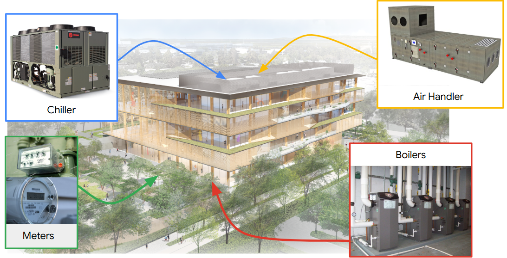
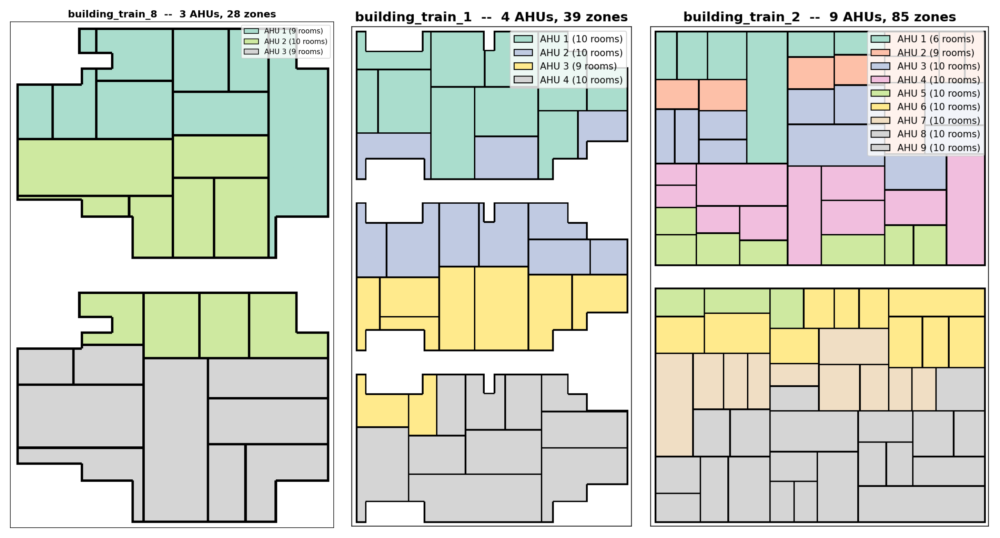
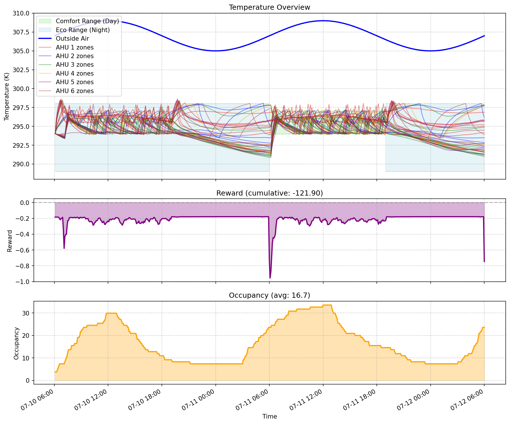

# One Controller for Every Building
### The NeurIPS 2026 Smart Buildings competition: the problem, the interface, a state-space model of the building, and our method

*Based on the starter kit `smart-buildings-2026/starter-kit` · Competition pages: <https://www.kaggle.com/competitions/neurips-2026-smart-buildings/> and <https://smart-buildings-2026.github.io/competition/>*

> **Status note (25 Nov 2026).** This is the full analysis as it was developed. The approach it ends on (constants fitted offline or on day 1, a Kalman-filtered state, `--deployment`, `test_model.py`) was tried and then replaced: nothing is fitted now, the LLM writes a closed-form formula for every coefficient of a fixed state-space function, and the split is computed from the data. The fitted code and the one-off analysis scripts this document names (`code/room_*.py`, `rollout_checks.py`, `dump_vectors.py`, `explore_zone_map.py` and the like) have been removed; their results remain in `outputs/`. The current method is in `docs/DISCOVERY_WALKTHROUGH.md`, the run steps in `docs/RUNBOOK.md`, and the remaining work in `Planning/index.md`. Parts I–III and §14 (the interface and the simulator audit) are current.

---

## Summary

The competition asks for **one control policy that can run the HVAC system of any commercial building**: different shapes, sizes, equipment counts, wall constructions and climates, keeping people comfortable at the least energy, money and carbon. The policy is a Kaggle notebook, judged on buildings and weather it has never seen (§1).

**The problem and the interface (Parts I–III).** A submission returns, every five minutes, 75–209 commands chosen from 283–703 observed numbers (§4–§7). The simulator is deterministic, scored over 30 days at a mean per-step reward whose best shipped baseline is about 0.054 (§3, §11). The evaluation set is six unseen buildings in five unseen weather stations drawn from the same generator, so the useful question is what varies between buildings and what does not (§12).

**The state-space model (Part IV).** Only about `V+8` of the observation's numbers carry information a dynamics model needs; the rest echo the policy's own commands, mirror setpoints, duplicate other fields or are constant (§13). An audit of the simulator shows that its thermal model is a linear RC network. The policy can rebuild it exactly from the floor-plan arrays, up to six unknown material scalars. That gives a **generic room equation** whose coefficients are closed forms in geometry. With two global spreading constants it tracks the simulator to about 0.5 K over three days open loop. With the scalars identified from one day of data, it forecasts 3 hours ahead within about 0.5 K from a filtered state (§14).

**The method (Part V).** Every building obeys the same energy balance and differs in a few numbers. We **generate as much simulator data as possible, discover the structure of the equations by symbolic regression, identify each new building's few parameters while the policy runs, and plan with the discovered model** (§15–§19). The plan is staged and gated: a safe baseline notebook first, then a model-based feed-forward controller, then a sampling MPC sized to the roughly 0.125 s per step the 9-hour session allows, on a dated roadmap to the 15 January 2027 deadline (§19.3). **Part VI** records what has been verified and what has not (§20).

**Reading guide.** Reference tables sit beside the text they support. Statements are tagged where it matters: **[S]** read from source or config; **[D]** computed from the shipped data files; **[R]** read from the instantiated environments; **[X]** measured in a rollout (§20.2); **[I]** inferred, still to be checked. From §16 on the text is proposal, not result. Nothing here modifies the starter kit; the scripts live in `code/` and write only to `outputs/`.

### Contents

**Part I. The problem** — 1 The challenge · 2 How a building is heated and cooled · 3 The benchmark: episodes, reward and score · 4 What is submitted

**Part II. The interface** — 5 The action vector · 6 The observation vector · 7 Kinds of quantity: what you set, see, are given or must infer

**Part III. The world being controlled** — 8 The physics inside the simulator · 9 The six training buildings · 10 The five climates · 11 A day in the life, and the shipped baselines · 12 What varies and what is fixed

**Part IV. The state-space model** — 13 The dynamics model · 14 A generic room model built from the floor plan

**Part V. Our method** — 15 What a control policy is · 16 Our idea: discover the physics, then control with it · 17 Stage one: data and discovering the dynamics · 18 Stage two: wrapping the model in a controller · 19 Testing it honestly, risks and roadmap

**Part VI. Verification** — 20 What has been verified and what is still unknown

**Appendices** — A Files · B Profiling run guide · C Using the starter kit · D Glossary · E Every entry of the `train_8` vectors

---

# Part I. The problem

*What the competition asks, how an office building is heated and cooled, how a run is scored, and what exactly is handed in.*

## 1. The challenge

### 1.1 What is being asked, and why it is hard
Imagine being handed the controls of an office building you have never seen. A few air handlers on the roof each feed a few dozen rooms; a boiler sends hot water to a small coil in every room; every five minutes you may adjust dozens of dials. People come and go, the weather is whatever it is, and you are scored on how comfortable the rooms stay and how much energy and carbon the building burns. Then you are handed a *different* building, with a different layout, room count, air-handler count and wall construction, in a different climate. The same controller has to cope.

The submission is **one policy**: a program that, given the current sensor readings, returns the next set of commands. It is designed on six sample buildings in five climates (30 scenarios) and judged on held-out buildings and weather from the same generator.

Commercial buildings use a large share of the world's electricity and gas, and HVAC is usually the biggest piece, yet most are run by fixed schedules and simple feedback loops (PID) tuned once at commissioning. They ignore forecasts, occupancy, coupling between equipment and the building's thermal inertia. A smarter controller could pre-heat just in time for the morning, coast through the evening on stored heat and trade fan energy against reheat. But learned control is hard to deploy: real buildings are too risky to experiment on, so learning happens in simulation; every building differs, so a policy tuned to one usually fails on the next and what is needed is *transfer*; and the objective mixes competing goals with an unbounded comfort penalty, so one neglected room can wreck an episode.

The simulator builds on Google's open-source Smart Buildings control simulator (`NOTICE`, Apache 2.0). The competition authors (Judah Goldfeder and Ayush Rai, per `pyproject.toml`) added procedural building generation, material sampling, per-room control, real recorded weather and a unified scoring setup.

### 1.2 Our angle
Reinforcement learning would have to rediscover building physics from noisy reward signals, and hand-tuned PID cannot anticipate or weigh cost. We take a third path: every building obeys the same energy-balance structure and differs in a few parameters, so we learn the structure once, in readable form, from simulator data, and estimate each new building's parameters as it runs (§16).

---

## 2. How a building is heated and cooled

### 2.1 The system in the simulator
The simulated building uses the most common commercial-office design: a **variable-air-volume (VAV) system with central air handlers and hot-water reheat**. Figure 1 shows the real-world equipment the simulator represents.



*Figure 1. In the simulator the chiller is implicit (cooling electricity is the thermal load divided by a coefficient of performance of 3.5), the boiler burns natural gas, and the meters correspond to the energy terms in the reward.*

```
 outside air ─┐
              ├─► [ Air Handler (AHU) ] ──supply air──► [VAV box] ─► Zone (room)
 return air ──┘    mixes, cools, fans        ▲           damper + reheat coil
   (recirc.)                                  │                ▲
                                              │                │ hot water
                        [Boiler + pump: hot-water loop] ───────┘
```

An **air handler** (AHU) mixes air returned from the rooms with fresh outside air, cools the mixture to a target supply temperature and pushes it through ducts with a fan. Each room (a **zone**) hangs off the duct through a **VAV box**: a *damper* that sets how much air the room gets, and a *reheat coil* fed with hot water that can warm that air before it enters. A **boiler** heats the water and a **pump** circulates it. One air handler serves up to ten rooms and picks one supply temperature for all of them, so dampers and reheat valves are the only per-room decisions.

Three facts shape everything that follows:

1. **The air handler can only cool.** All heat arrives through the reheat coils. What leaves the air handler is `min(mixed-air temperature, supply-air setpoint)`; the setpoint can pull the temperature down but never up.
2. **Fan power rises steeply with pressure.** Power is roughly flow × pressure ÷ efficiency and flow grows with √pressure, so running the fan hard is expensive, and running it hard while a room slowly recovers is a classic waste.
3. **There are floors.** A running air handler holds at least 200 Pa and recirculates at most 70 % of its air; every damper stays at least 10 % open. Occupied rooms keep receiving outside air, so "close everything" is not available.

### 2.2 Why climate changes the problem
Because the air handler can only cool, its supply-temperature dial goes dead when the outside air is so cold that the *mixed* air is already below the coldest commandable setpoint (285 K). With recirculation capped at 0.7 and return air near 293 K, that happens below about **−6.8 °C**. The competition's analysis of the scored windows finds the setpoint inert for 0 % of hours in Singapore, Phoenix and Atlanta, 3.8 % in Denver and **31.5 % in Fairbanks**.

So the same controller faces two problems. In the cold the real levers are the **hot-water temperature and the reheat valves**. In the heat, supply temperature, fan pressure and damper allocation matter most. An approach has to know which regime it is in (the levers by regime are in §15.3).

---

## 3. The benchmark: episodes, reward and score

### 3.1 An episode
A **scenario** is one building paired with one weather strip. The shipped set has **30 scenarios**: six buildings, each paired with one strip from each of five stations (Fairbanks, Denver, Atlanta, Phoenix, Singapore). `training_set.yaml` defines the pairing; it is not a cross product, so each building sees one strip per station and no strip is reused.

Each strip replays a different 30-day window of recorded 2023 hourly weather at a **five-minute timestep**: **8,640 steps** (288 per day), all scored, with no warm-up. On weekdays from 06:00 to 19:00 the building is in *comfort mode*, with zone temperature expected between 294 K and 297 K (about 21–24 °C); otherwise it is in *eco mode*, a wider 289–298 K band that lets it drift at night and on weekends. **Every shipped strip starts on a Sunday at 06:00** [D], so each window has 8 weekend days and 21 weekday comfort periods; comfort mode covers 3,274 of the 8,640 steps, **37.9 % in every scenario** [D]. The other 62 % is eco mode, with plenty of slack for setback and coasting (which is also why short smoke-test runs flatter schedule-aware policies: they skip the eco periods).

### 3.2 The reward
Each step's reward is **never positive**; zero would be perfect comfort at no energy and no carbon, which nothing reaches:

```
reward = [ 0.6 · (comfort term) − 0.2 · (energy cost) − 0.2 · (carbon) ] ÷ (0.6 + 0.2 + 0.2)
```

The **comfort term** measures how far occupied zones sit outside their band. Inside it, occupants are fully productive. Outside, productivity falls *linearly* up to 5 K (one kelvin out costs 20 %), then *quadratically and without bound*: beyond 5 K the shortfall is `1 + ((deviation − 5)/5)²`, so productivity can go negative. The unbounded tail is deliberate: an earlier saturating penalty let a do-nothing policy score well, because a room 5 K cold and a room 34 K cold looked the same. Now one badly neglected zone can dominate an episode. Productivity scales with occupancy ($300 per person-hour at most in the shipped configs), so empty rooms cost little.

**Energy cost** is charged for electricity (fans, pumps, cooling plant) and natural gas (boiler); **carbon** for both fuels. Neither is clipped: past the nominal maximum the term exceeds 1 and the reward falls below −1. The energy terms are divided by a nominal maximum that scales with the number of air handlers (80,000 W × K electricity, 205,000 W × K gas), so big buildings are not penalized per handler more than small ones. The constants were chosen so a near-frontier controller loses roughly **60 % of its reward to comfort and 40 % to fuel**, matching the declared weights.

In a one-day check the reward matched `0.6·npr − 0.2·nec − 0.2·nce` to about 2×10⁻⁸ [R] (`npr` the normalized productivity term, `nec` and `nce` the normalized energy-cost and carbon terms), so it decomposes exactly into per-step pieces and we can report where each baseline loses points.

### 3.3 The score, and the reward as a cost function
For each scenario the score is the mean per-step reward over 8,640 steps. The leaderboard metric is the **mean absolute error against zero** across the 30 scenarios, equally weighted, with no grouping by building or climate; **lower is better**. Episodes of any other length are refused. The official ranking is computed on Kaggle against held-out buildings and weather. The best shipped baseline scores about **0.054**.

For a model-based controller the reward is also the cost function to minimize. Comfort is a piecewise function of each occupied zone's deviation, and energy and carbon are closed-form functions of fan, pump, cooling and boiler power (§8). A controller that predicts the next few hours can *evaluate the true reward on its predictions* instead of learning it, and the unbounded comfort tail tells it to avoid even small probabilities of large excursions.

---

## 4. What is submitted

### 4.1 The artifact and its contract
A submission is a **Kaggle Notebook** and nothing else. A working example (the "TransferPolicy Notebook") is on the competition's Code tab; the website gives its structure:

```python
from kaggle_evaluation import smart_buildings_inference_server

class TransferPolicy(smart_buildings_inference_server.Policy):
    def __init__(self, building_meta_data, action_spec):       # once per scenario
        super().__init__(building_meta_data, action_spec)
    def get_action(self, obs):                                  # once per 5-minute step
        return {"continuous_action": np.zeros(n_continuous, dtype=np.float32),   # shape 3K+2+2V
                "discrete_action":   np.zeros(n_discrete,   dtype=np.int32)}     # shape K+1

smart_buildings_inference_server.SmartBuildingsInferenceServer(TransferPolicy).run()
```

The notebook has **no scenario list and no rollout loop**: an evaluation gateway owns the simulator, constructs the policy for each scenario, calls `get_action` and applies the result. Running the notebook yourself plays one public example scenario, as a loading check; to score all 30 training scenarios locally use `evaluate.py` and `score_leaderboard.py`. On submission Kaggle re-runs the notebook against the hidden scenarios and computes the leaderboard number (§3.3) server-side. Model weights load in `__init__` from a Kaggle Dataset attached to the notebook.

The local harness needs no base class: `initialize_policy` tries `Policy(meta, action_spec)`, then `Policy(meta)`, then `Policy()`, and `get_policy_action` calls `get_action(obs)`. So we develop against the two-method contract, keep the class free of local-only imports and subclass `Policy` in the Kaggle notebook. The `kaggle_evaluation` package itself is visible only after accepting the rules and has not been read (§20.3).

### 4.2 What the harness does with the policy
For each scenario `run_policy` resets the environment and loops 8,640 times (the gateway does the equivalent on Kaggle): `get_action(obs)`, then `validate_action` (exact shapes; continuous cast to float32, discrete to int32; a wrong shape raises), then `tracker.step(action)`. The policy sees only the observation vector and the metadata (§6.5), never the reward, weather label, month, station or building id, and **hardcoding a reference to a held-out building or weather seed is disqualifying** (template docstring). A fresh policy is built for every scenario, so state carries between steps (estimator, previous action, history) but never between scenarios. Actions must lie inside the action-space bounds and be finite: a NaN passes the bounds check and corrupts the rest of the episode.

### 4.3 Limits and rules

| Property | Value | Source |
|---|---|---|
| Notebook runtime | CPU ≤ 9 h or GPU ≤ 9 h per run; internet disabled | Overview page |
| Time limits | 15 min for the first step of each scenario (model loading), then 60 s per step; the whole submission within one Kaggle session | submission page |
| **Effective budget per step** | 9 h ÷ (30 scenarios × 8,640 steps) ≈ **0.125 s**, simulator time included (if the scenarios run one after another) | derived [I] |
| External data and pre-trained models | allowed if free and public; a reasonableness test applies to cost | Overview page, Rules §2.6 |
| Open-source code | only OSI-approved, commercially unrestricted licences | Rules §3.6c |
| Daily submissions | 5; 2 final submissions selected | Rules §2.2 |
| Team size | ≤ 5; mergers allowed | Rules §2.1 |
| Winners | license the winning code CC-BY 4.0; deliver training and inference code | Rules §2.5, §2.8 |
| Dates | entry and merger deadline 3 Jan 2027; final submission 15 Jan 2027 | Overview page |
| Test-time data | 6 unseen buildings × 5 unseen weather stations = 30 scenarios | scoring page |
| Paper track | NeurIPS poster round 13 Nov 2026 (workshop in Paris 13 Dec); final round 15 Jan 2027; via OpenReview | website |

What these limits mean for the method is worked out in §17.6.

# Part II. The interface

*What the policy can set and what it can see, entry by entry.*

## 5. The action vector

Every step the policy returns a **hybrid action**: `K+1` discrete on/off entries and `3K+2+2V` continuous setpoints, where **K** is the number of air handlers and **V** the number of zones (one VAV box each): `4K+3+2V` values, from 75 for the smallest building to 209 for the largest. The container is `{"continuous_action": float32[3K+2+2V], "discrete_action": int32[K+1]}`. Continuous entries travel normalized to [−1, 1] and are mapped linearly to the native ranges below; discrete entries are {0, 1}.

### 5.1 Every entry

| # | Entry | Count | Type | Native range | What the simulator does with it |
|---|---|---|---|---|---|
| 1 | `ahu_j_supervisor_run_command` | K | **discrete** | off / on | runs fans, cooling coil and ventilation for AHU j |
| 2 | `ahu_j_supply_air_temperature_setpoint` | K | continuous | 285–305 K | supply temperature = min(mixed air, setpoint); inert if the mixed air is already colder |
| 3 | `ahu_j_supply_air_static_pressure_setpoint` | K | continuous | 0–2000 Pa | airflow ∝ √P, fan power ∝ flow·P; floor 200 Pa while running |
| 4 | `ahu_j_recirculation_percentage_command` | K | continuous | 0–1 | share of return air mixed back in; cap 0.7 |
| 5 | hot-water `supervisor_run_command` | 1 | **discrete** | off / on | runs boiler and pump |
| 6 | hot-water `supply_water_temperature_setpoint` | 1 | continuous | 310–350 K | boiler target; tank ramps about 0.5 K/min up and 0.1 K/min down |
| 7 | hot-water `differential_pressure_setpoint` | 1 | continuous | 0–20 (config units) | pump head, which sets water flow and pump power |
| 8 | `VAV_n_supply_air_damper_percentage_command` | V | continuous | 0–1 | the zone's share of the AHU's air; floor 0.1 |
| 9 | `VAV_n_reheat_valve_percentage_command` | V | continuous | 0–1 | hot water to the zone's coil; discharge air capped at 308.15 K |

**Every entry is an input to the building's dynamics.** The per-zone pair dominates the dimension (84–86 % of the continuous action) and is the same kind of object in every room; only 11–29 plant-level continuous entries and 4–10 switches remain. The plant responds on very different timescales: dampers and airflow within a step, boiler water over several steps, building mass over hours, so thinking in 15–60-minute blocks loses little and avoids chatter. The default action in each `config.gin` is supply air 293 K, pressure 2000 Pa, recirculation 0.3, water 340 K, differential pressure 20, damper 1.0, reheat 0.0, all units on [S].

### 5.2 Order of the entries [R]
The discrete and continuous parts are separate arrays, each filled in the order of `env._device_action_tuples`: for each AHU j = 1..K the run command (discrete), then temperature, pressure, recirculation (continuous); then the hot-water loop (run command; water temperature, differential pressure); then every zone in **lexicographic VAV order** (`VAV_1, VAV_10, VAV_11, …, VAV_2, …`) with damper then reheat. For `train_8` (K = 3, V = 30) the discrete array is `[ahu_1, ahu_2, ahu_3, hws]`; continuous slots 0–2 belong to AHU 1, 3–5 to AHU 2, 6–8 to AHU 3, slot 9 is the water temperature, 10 the differential pressure, 11–12 are `VAV_1` (damper, reheat), 13–14 `VAV_10`, and so on to slot 70. The metadata gives `temp_indices = [0, 3, 6]`, `pressure_indices = [1, 4, 7, 10]`, `recirculation_indices = [2, 5, 8]`, `water_indices = [9]` and `zone_action_indices` (VAV id → setpoint name → index).

Three traps follow, each silently driving the wrong actuator:
- **Zero is not off.** Zero is the *middle* of each normalized range, so a slot never written is a half-open damper or half-shut valve. Write every slot.
- **Never hard-code offsets.** Read the index lists from the metadata. `pressure_indices` has **K+1** entries: the first K are the AHU pressure setpoints and the last is the hot-water differential pressure, so treating it as one-per-AHU drives the pump instead.
- **Commands override the local thermostat.** Each VAV has a thermostat loop that, left alone, would choose damper and reheat from the comfort band; a command wins over it, separately for damper and reheat [S: `vav.py`]. Since the policy writes both every step, the thermostat has no influence on the physics.

The simulator also applies the **floors** (damper 0.1, pressure 200 Pa while running, recirculation 0.7), and the observation reports the realized value (§6).

---

## 6. The observation vector

The observation is a flat float32 vector of length **`6V + 15K + 58`**, from 283 (`train_8`) to 703 (`train_2`) [R], assembled by sorting devices by `device_id` as strings, sorting each device's fields alphabetically, then appending the time block [S: `environment.py`]:

| Index range | Content | Size |
|---|---|---|
| 0 … 6V−1 | **VAV blocks**, six fields each, in the order `VAV_1, VAV_10, VAV_11, …, VAV_2, …` (lexicographic) | 6V |
| next 15K | **AHU blocks** `ahs_ahu_1_*, …, ahs_ahu_K_*`, fifteen fields each | 15K |
| next 7 | **hot-water block** `hws_*` | 7 |
| last 51 | **time and occupancy** (§6.4) | 51 |

Always read the order from `observation_field_names` in the metadata, never compute it. **Timing [X].**
- The observation returned after a step carries the actuator positions and setpoints used *during* that step; realized and echoed values equal the action just taken.
- Its **zone temperatures are one step stale**: they are the room means at the *start* of that step. So an action first shows in the measured temperatures two observations later.
- Its outside temperature, supply-water temperature and comfort flag are the ones the *next* step will use.

The dynamics model must respect this alignment (§14.3).

### 6.1 The six fields of every VAV block

| Field (alphabetical) | Units as delivered | What it is |
|---|---|---|
| `reheat_valve_percentage_command` | (x−0.5)/0.5 | realized reheat position; equals the action exactly [X] |
| `supply_air_damper_percentage_command` | (x−0.5)/0.5 | realized damper position; equals `max(action, 0.1)` [X] |
| `supply_air_flowrate_setpoint` | raw m³/s | the box's maximum airflow; 2.0 at every step [X] |
| `zone_air_cooling_temperature_setpoint_sensor` | raw K | upper comfort bound: 297 K in comfort mode, 298 K in eco mode |
| `zone_air_heating_temperature_setpoint_sensor` | raw K | lower comfort bound: 294 K in comfort mode, 289 K in eco mode |
| `zone_air_temperature_sensor` | (T−295)/5 | zone-average air temperature |

The comfort bounds are reported one step *after* the mode flag changes (3 transitions, 4 mismatched steps in a 601-step rollout [X]).

### 6.2 The fifteen fields of every AHU block
Many of the fifteen are the same attribute under different names or mirror the policy's own commands: in a 600-step rollout **only the outside temperature is an independent exogenous signal** (§20.2).

| Field (alphabetical) | What it is | Relation found [X] |
|---|---|---|
| `cooling_request_count` | zones requesting cooling | constant: the number of zones the AHU serves (10 in `train_8`) |
| `discharge_fan_speed_percentage_command` | discharge-fan speed | **identical** to `supply_fan_speed_percentage_command` |
| `exhaust_fan_run_command` | exhaust-fan on/off | **identical** to `supervisor_run_command` |
| `outside_air_flowrate_sensor` | ventilation flow, m³/s | follows total flow and recirculation |
| `outside_air_temperature_sensor` | outside temperature, K | **the same value in every AHU block**; the only weather input |
| `recirculation_percentage_command` | realized recirculation | `min(native action, 0.7)` |
| `supervisor_run_command` | AHU on/off | equals the discrete action |
| `supply_air_flowrate_sensor` | total supply airflow, m³/s | derived from dampers and pressure; 0 when off |
| `supply_air_flowrate_setpoint` | airflow target | **identical** to the flow sensor |
| `supply_air_static_pressure_sensor` | duct pressure, Pa | **equals the setpoint** when running (no lag), 0 when off |
| `supply_air_static_pressure_setpoint` | realized pressure setpoint | `max(native action, 200 Pa)` when running, 0 when off |
| `supply_air_temperature_sensor` | supply air temperature, K | **equals the setpoint at every step**; the physical `min(mixed air, setpoint)` is not reported |
| `supply_air_temperature_setpoint` | realized supply-air setpoint | equals the native action |
| `supply_fan_run_command` | supply-fan on/off | **identical** to `supervisor_run_command` |
| `supply_fan_speed_percentage_command` | fan speed fraction | tracks the flow (correlation 1.000) |

### 6.3 The seven hot-water fields

| Field (alphabetical) | What it is | Relation found [X] |
|---|---|---|
| `differential_pressure_sensor` | pump head | **equals the native setpoint** when running, 0 when off (no lag) |
| `differential_pressure_setpoint` | realized pump setpoint | normalized `(x−10)/6` of the native action; 0 (−1.667 normalized) when off |
| `heating_request_count` | zones requesting heat | constant: the total zone count (30 in `train_8`) |
| `run_status` | whether the loop runs | **identical** to `supervisor_run_command`, in {−1, +1} |
| `supervisor_run_command` | loop on/off | the discrete action in {−1, +1} |
| `supply_water_temperature_sensor` | loop temperature, K | **the only observed plant state with memory**: ramp-limited (+2.5 K per step at most up, −0.5 K per step down), equal to the setpoint 41 % of the time |
| `supply_water_temperature_setpoint` | realized water setpoint | equals the native action |

### 6.4 The 51 time and occupancy fields

| Fields | Count | What they are |
|---|---|---|
| `hod_cos_000..011`, `hod_sin_000..011` | 24 | twelve phase-shifted copies of `cos/sin(θ_hod + 2πi/12)`, θ the hour-of-day angle |
| `dow_cos_000..011`, `dow_sin_000..011` | 24 | the same encoding of the day of week |
| `comfort_mode_now` | 1 | 1 when the schedule is in comfort mode now |
| `comfort_mode_soon` | 1 | the same flag 60 minutes ahead |
| `num_occupants` | 1 | building-total occupant count, raw (0–57 of 60 seen in the rollout); not per zone |

The 48 sinusoids are redundant encodings of two numbers (hour of day, day of week).

### 6.5 Scaling, and what the observation does not contain
- **Normalized fields** (matched by exact measurement name) are the zone temperature `(T−295)/5`, the VAV damper and reheat `(x−0.5)/0.5`, the hot-water run command and run status (to {−1, +1}) and the hot-water differential-pressure setpoint `(x−10)/6` [X]. Every AHU field (they carry an `ahu_N_` prefix), the hot-water temperatures and pressure sensor, the comfort bounds and the box airflow are raw. Fit physical equations only after undoing the normalization.
- **Weather is one number**: the current outside temperature. There is no forecast, humidity, wind, solar or dew point, and no weather label, month, station name or building id; a policy must infer the climate from the temperature trace and the time.
- **The policy's own commands are echoed back** as realized positions and setpoints, so it can recover what it did last step and see where a floor overrode it.
- **Energy use, cost, carbon and reward are not observed.** The policy must predict its own cost from a model.
- **Metadata** (21 keys) arrives once at construction (`evaluate.create_building_meta_data`): the action sizes and index lists, `observation_field_names`, `zone_temp_indices`, `ahu_zone_assignments` (AHU → `room_N`, the box being `VAV_N`), `num_floors`, `floor_plan` and `zone_map` arrays, `morning_start_hour` (6), `evening_start_hour` (19), `comfort_temp_window` (294, 297), `eco_temp_window` (289, 298), `time_zone` (`US/Pacific` everywhere), an empty `holidays` set, and the observation and action normalization constants. The six material properties and the grid cell size are **not** given.

---

## 7. Kinds of quantity: what you set, see, are given or must infer

### 7.1 Sizes

| Building | K | V | Observation `6V+15K+58` | Discrete `K+1` | Continuous `3K+2+2V` | Total action |
|---|---|---|---|---|---|---|
| train_1 | 4 | 39 | 352 | 5 | 92 | 97 |
| train_2 | 9 | 85 | 703 | 10 | 199 | 209 |
| train_4 | 6 | 54 | 472 | 7 | 128 | 135 |
| train_5 | 8 | 79 | 652 | 9 | 184 | 193 |
| train_7 | 4 | 36 | 334 | 5 | 86 | 91 |
| train_8 | 3 | 30 | 283 | 4 | 71 | 75 |

A decision involves 75–209 commands chosen from 283–703 observed numbers, for a physical system whose full state is about **10⁵-dimensional** (the thermal grid has 1.2–2.9×10⁵ cells, §9.1). The room network of our method has about eight states per room (air, slab, facade, partitions, doors), i.e. **240–750 states**. Its coefficients are fixed by the floor plan up to **six building-level material scalars** to estimate (§14).

### 7.2 Seven kinds of quantity
For building a policy the useful split is not just observed versus hidden but *who sets a quantity, how often it changes and where it comes from*:

| Kind | What | Where it comes from | Policy treatment |
|---|---|---|---|
| **0. Commands** (controllable) | the whole action vector (§5): plant setpoints and switches, per-zone damper and reheat | the policy | inputs of the dynamics; echoed back in the observation |
| **1. Dynamic, observed every step** | zone temperatures (V), supply-water temperature, outside temperature, total occupants, hour and weekday phase, comfort-mode flags and bounds, the echoes | the observation: `6V+15K+58` values, of which about `V+8` carry information (§13.1) | read each step; the model's states, disturbances and context |
| **2. Static per building, given** | the 21 metadata keys (§6.5) | `building_meta_data`, once | read, never hard-code; derive K, V, room areas (0.2 m grid cell), types, adjacency, floors and each room's AHU (§14) |
| **3. Constant across all buildings, not given** | the fixed parameters of §12.2 (43 class-B parameters and 18 generator constants) and the equipment laws in the code: time step 300 s and 8,640 steps; reward weights 0.6/0.2/0.2, $300 productivity bound, 5 K reference, energy scales 80,000 and 205,000 W per AHU (maxima `80,000·K` and `205,000·K`); fan efficiency 0.9, box maximum airflow 2.0 m³/s, air handler sized at 20 m³/s, reheat flow factor 0.108, discharge cap 308.15 K, cooling COP 3.5, pump efficiency, boiler ramps 0.5 and 0.1 K/min; the floors (200 Pa, 0.7, 0.1); internal gains 10 W/m² (standby 0.2) and 70 W per person; occupant arrival 06–12 and departure 13–19; reset state (zones 294 K, water 340 K, supply setpoint 298 K, pressure 1000 Pa) | nothing: the metadata omits them | hard-code in the policy and in the model's known-physics blocks (§13.3); this is what makes the symbolic equations transferable. Assumed equal in the hidden set [I] |
| **4. Varies by building, not given** | the six envelope materials (which set the lumped resistances and capacitances); occupants per zone (1 or 2); wall-and-slab thermal mass; per climate, the convection coefficient (8.8–26.7 W/m²K) | nothing: the metadata omits materials, and the observation omits weather beyond temperature | **one universal value learned offline** (default, §17.8), optionally estimated online (§17.3): the θ of the method: six building-level scalars, four or five of them identifiable (§14.4). Occupants per zone are bounded by the largest occupant count seen divided by V [I] |
| **5. Hidden state, dynamic** | slab, wall and envelope temperatures; per-room occupancy and internal gains; the boiler tank temperature; the factor by which an air handler caps total flow; the physical supply-air temperature `min(mixed air, setpoint)` | not observed (the boiler tank only partly, through the water sensor) | estimate (§18.3); the model carries them as latent states |
| **6. The policy's own memory** | its previous action, the estimator, the history of temperatures and weather | built by the policy | store (§4.2); required to drop the echoed setpoints (§13.1) |

Energy, cost, carbon and reward are outcomes, not inputs: unobserved, they must be predicted. **Room temperature is observed, not hidden; what is hidden is what sits behind it**, above all the building's thermal parameters.

Three working rules follow.
- **Read structure, hard-code physics.** Kind 2 is read from the metadata and never assumed; kind 3 is hard-coded, because the metadata does not carry it. Read the comfort windows and schedule hours even though they are constant in every shipped scenario.
- **Kind-3 constants can be checked online.** The observation echoes realized values, so the policy can confirm its assumptions while running: the realized damper reveals the damper floor, the realized pressure the pressure floor, the water-temperature trace the boiler ramps, the cold-start state the initial conditions. A mismatch means the hidden set differs from the shipped one, and the policy should fall back to conservative behaviour (§18.3).
- **Only kinds 4 and 5 need learning.** Everything the symbolic regression of §13.3 has to find is a kind-4 coefficient inside a kind-3 structure, which is why the structure can be discovered once on pooled data and the coefficients estimated per building.

# Part III. The world being controlled

*The physics, the six training buildings, the five climates, the baselines to beat, and which of it changes from one building to the next.*

## 8. The physics inside the simulator

### 8.1 How the simulator is organized
The building is a 2D grid of **control volumes**, cells labelled exterior, interior wall, interior mass (slab and furniture) or air. Each step a backward-Euler heat-diffusion solve advances the temperature field, factorized once per episode with SciPy (it replaced an older truncated iterative solver that added an artificial, weather-dependent lag). The equipment models (`air_handler.py`, `vav.py`, `boiler.py`, `hot_water_system.py`, `pump.py`) turn commands into heat and energy; `stochastic_occupancy.py` makes occupants arrive, leave and take lunch at random; `thermostat.py` runs a per-zone hysteretic Heat/Cool/Off/Passive-Cool state machine; `setpoint_schedule.py` provides the comfort and eco bands; `weather_controller.py` replays the recorded station data (interpolated from hourly to five-minute values [S]); and the `reward/` package computes the score. Floors and the discharge-temperature limit are enforced inside the simulator, so a policy sits *on top of* these inner loops.

### 8.2 The six blocks
These equations are what our method tries to rediscover.

**A. Zone thermal dynamics, the hard, slow part.** The grid is well captured, zone by zone, by a reduced-order resistor–capacitor (RC) network:

```
C_z · dT_z/dt =  Σ_{j ∈ nbrs(z)} (T_j − T_z)/R_zj          (conduction through partitions)
               + (T_out − T_z)/R_env,z                       (envelope loss or gain)
               + (T_mass,z − T_z)/R_mass                     (exchange with slab and furniture)
               + Q_vav,z                                     (HVAC heat delivered to the zone)
               + Q_internal,z(occupancy, time)               (people, lighting, equipment)
C_mass · dT_mass/dt = (T_z − T_mass)/R_mass
```

The capacitances and resistances are what the six sampled material properties and the floor geometry determine; §14 derives each of them in closed form. **Internal gains** (a configurable heat per square metre, a standby fraction, and 70 W of sensible heat per person) make occupied rooms run warmer. Only the zone-*average* air temperature is observed; slab and wall temperatures are hidden.

**B. VAV box and reheat coil: fast, algebraic, nonlinear.** The airflow a box demands scales with its damper opening and the square root of the fan's static pressure (`V̇ ≈ damper · V̇_max · √(P / 2000 Pa)`), scaled down if the air handler cannot supply everyone. The coil's effectiveness is `ε = min(1, water capacity-rate ÷ air capacity-rate)`, further capped so discharge air does not exceed 308.15 K. Discharge temperature is `T_sa + ε (T_water − T_sa)` and the heat delivered is `c_air ρ_air V̇ (T_disch − T_zone)`. Water flow to each coil is the pump's total flow shared in proportion to valve openings.

**C. Air handler, algebraic.** Mixed air is `r · T_return + (1 − r) · T_out` with recirculation `r ≤ 0.7`; supply air is `min(mixed, setpoint)` while running. Fan power is flow × pressure ÷ efficiency for the supply fan at full flow and the exhaust fan at flow × (1 − r). Cooling electricity is the thermal load divided by a COP of 3.5.

**D. Hot-water system, slower and stateful.** The boiler tank's temperature rises and falls at finite rates; gas power is the heat carried by the water flow plus dissipation plus the tank's own heating, floored at zero; pump power is flow × density × gravity × head ÷ efficiency. (An air-source heat-pump variant exists, but the shipped scenarios use the boiler.)

**E. Disturbances.** Outside temperature from recorded data with a per-station convection coefficient; stochastic occupancy per person; the deterministic comfort schedule.

**F. The reward** is a closed-form function of state and action (§3.2).

Most inputs to these equations are visible (zone temperature, damper and valve positions, outside temperature, supply temperature and pressure, water temperature); what is missing is kinds 4 and 5 of §7.2. **That gap between what is visible and what the equations need is the identification problem our method addresses.**

---

## 9. The six training buildings

### 9.1 What a building is, and how big
Each shipped building is a multi-storey office block with an irregular ("composite") outline divided into rectangular rooms. A **zone** is one room served by exactly one VAV box; every zone belongs to one air handler, up to ten per handler. The generator also sets how many people occupy each zone (one or two) and a set of envelope properties. Figure 2 shows three buildings floor by floor, rooms coloured by air handler.



*Figure 2. Three buildings of increasing size. An air handler's rooms are not always contiguous and can span two floors (air handler 3 in `building_train_1` serves rooms on floors 2 and 3). Corner and perimeter rooms feel the weather; interior rooms do not. The figure labels `building_train_8` "28 zones", but the config and the runtime check both give 30 [R], so the title is out of date.*

A policy therefore cannot assume that one air handler's rooms form a compact block, nor that two buildings have anything in common beyond the rules of physics.

| Building | AHUs K | Zones V | Zones per AHU | Floors | Footprint W×H | Occupants / zone | Total occupants [S] | Thermal grid cells [D] |
|---|---|---|---|---|---|---|---|---|
| train_1 | 4 | 39 | 10, 10, 9, 10 | 3 | 373×188 | 2 | 78 | 606×339 = 205,434 |
| train_2 | 9 | 85 | 6, 9, 10×7 | 2 | 420×301 | 2 | 170 | 624×422 = 263,328 |
| train_4 | 6 | 54 | 6, 10, 9, 9, 10, 10 | 3 | 430×211 | 1 | 54 | 664×432 = 286,848 |
| train_5 | 8 | 79 | 9, 10×7 | 4 | 340×199 | 2 | 158 | 858×342 = 293,436 |
| train_7 | 4 | 36 | 7, 10, 10, 9 | 2 | 325×218 | 1 | 36 | 458×279 = 127,782 |
| train_8 | 3 | 30 | 10, 10, 10 | 2 | 318×198 | 2 | 60 | 386×320 = 123,520 |

`building_train_8` is the smallest (30 zones, two floors); `building_train_5` is the tallest (four floors); `building_train_2` has 85 zones, 9 air handlers and many small rooms on two wide floors. More zones mean a longer action vector, more coupling through the shared hot-water loop and slower simulation (§7.1 gives the vector sizes).

### 9.2 Character: how leaky, how heavy
The most important differences are invisible in the floor plan. Each building's envelope is six sampled numbers (table below) that reduce to a few physical ideas: *how leaky* the facade is (U-value, from conductivity through the generator's relation `1/U = 0.1/k + 0.299`), *how heavy* it is (density × heat capacity, which sets thermal inertia), how much **slab mass** the interior holds (which governs overnight coasting), how strongly **partitions couple** neighbouring rooms, and how many occupants each zone has (internal heat and the weight of comfort in the reward). The derived columns are computed from the shipped YAMLs, not simulator outputs.

| Building | ext. conductivity k | ext. density | int.-mass density | int.-wall conductivity | int.-wall density | ext. heat capacity | ≈ facade U | ≈ ext. ρ·cp (MJ/m³K) |
|---|---|---|---|---|---|---|---|---|
| train_1 | 0.212 | 1967 | 32.3 | 0.536 | 415 | 951 | 1.30 | 1.87 |
| train_2 | 0.339 | 578 | 14.4 | 0.515 | 180 | 906 | 1.68 | 0.52 |
| train_4 | 0.182 | 475 | 23.4 | 0.464 | 484 | 897 | 1.18 | 0.43 |
| train_5 | 0.304 | 1187 | 28.0 | 0.497 | 643 | 866 | 1.59 | 1.03 |
| train_7 | 0.548 | 415 | 35.7 | 0.478 | 155 | 972 | 2.08 | 0.40 |
| train_8 | 0.270 | 1139 | 11.5 | 0.581 | 336 | 843 | 1.49 | 0.96 |

- **`train_1`: tight and heavy.** Low conductivity (U ≈ 1.30), very heavy facade (≈ 1.87). It warms and cools slowly and coasts for hours: it rewards patient *pre*-conditioning and punishes late reaction.
- **`train_2`: light, quick and the biggest.** U ≈ 1.68, light facade (≈ 0.52), lowest slab mass among the large buildings. It responds fast and stores little; 85 zones and 9 handlers demand the most coordination.
- **`train_4`: well insulated but light.** Lowest U (≈ 1.18), light facade (≈ 0.43), one person per zone. It holds heat well yet has little mass to ride on.
- **`train_5`: middle, and tall.** U ≈ 1.59, fairly heavy facade (≈ 1.03), heavy partitions; moderate time constants across four floors.
- **`train_7`: leakiest and lightest.** U ≈ 2.08, lightest facade (≈ 0.40): weather gets in fast and the envelope stores almost nothing, though the interior slab is heavy. One person per zone.
- **`train_8`: heavy facade, almost no slab, strongly coupled rooms.** U ≈ 1.49, facade ≈ 0.96, the *lowest* interior mass and the *highest* partition conductivity, so zones drag their neighbours the most.

A heavy, tight building rewards anticipation; a light, leaky one punishes lateness and rewards fast feedback. A controller that works on all six must handle all of these regimes, which is why we treat them as different *parameter values* of one structure (§17.3). The per-zone plant sizing (fan efficiency, VAV maximum airflow, reheat flow factor, boiler rate, pump head) is the **same in every scenario** [S]: between buildings what varies is topology, size, occupancy and envelope, not equipment per room.

### 9.3 How the geometry is stored [D]
- **Codes.** `floor_plan.npy` and `zone_map.npy` both use 0 = interior space, 1 = wall, 2 = exterior, on a 20 cm grid. `floor_plan` has **doors as open cells**; `zone_map` has them filled in as walls, so **rooms are exactly the connected components of `zone_map == 0`**. The two differ only at door cells (2 per door: 40 cells in `train_7` and `train_8`, 72 in `train_1`, 102 in `train_4`, 118 in `train_5`, 166 in `train_2`). The thermal solver runs on `floor_plan`, so doors are heat paths between neighbours. `train_1`, for example, has 141,779 interior-space, 6,946 wall and 56,709 exterior cells. Grids are identical across a building's five weather strips.
- **Room numbers.** The simulator names rooms `room_1 … room_V` by connected-component label in raster order; the box of `room_N` is `VAV_N`. §14.1 shows the same numbering is reproducible from the metadata arrays alone.
- **Floors are separate pieces of the grid**, stacked in one image with exterior space between them (`train_8`: two floors of 15 rooms). Within the grid there is no thermal contact between floors, so no vertical heat exchange is modelled (inferred from the layout; to be checked, §20.3).
- **AHUs follow room numbering, not geography.** Rooms are assigned to AHUs in consecutive blocks of up to ten, so several AHUs straddle two floors:

| Building | Floors | Rooms per floor | AHU → rooms on each floor |
|---|---|---|---|
| train_1 | 3 | 13 / 14 / 12 | ahu_1: 10 on f1 · ahu_2: 3 f1 + 7 f2 · ahu_3: 7 f2 + 2 f3 · ahu_4: 10 f3 |
| train_2 | 2 | 42 / 43 | ahu_5 straddles (7 f1 + 3 f2); the other eight serve a single floor |
| train_4 | 3 | 17 / 20 / 17 | ahu_3 (1+8) and ahu_5 (3+7) straddle |
| train_5 | 4 | 19 / 19 / 22 / 19 | ahu_4 (9+1) and ahu_7 (1+9) straddle |
| train_7 | 2 | 19 / 17 | ahu_3 straddles (2+8) |
| train_8 | 2 | 15 / 15 | ahu_2 straddles (5+5) |

---

## 10. The five climates

### 10.1 Five stations, one year
The weather is a full year (2023) of recorded hourly data from five airport stations (a sixth, Minneapolis, ships as generator input but is unused in the 30 scenarios). Each scenario replays one 30-day window.

- **Fairbanks** (subarctic) is the most extreme: −42 °C to +29 °C over the year. Winter windows are pure heating problems; hot water is the only effective lever and the air-side setpoint is inert about a third of the time. Summer windows are mild and cheap. Air is calm (3–10 km/h) and the convection coefficient lowest (8.8 W/m²K).
- **Denver** (high-altitude continental) is cold in winter, hot and dry in summer, with large swings *within* a window (−12.8 to +26.7 °C in one November window), which makes anticipation valuable. Windy (15–20 km/h), with the highest convection coefficient (26.7).
- **Atlanta** (humid subtropical) has mild winters (down to −3.9 °C in the windows) and hot humid summers (to 35 °C); many conditions are shoulder-like, where economizing and avoiding simultaneous cool-and-reheat matter more than capacity.
- **Phoenix** (hot desert) reaches 46 °C, is very dry (15–47 %) with a large day–night swing: cooling-dominated summers with the largest air-side and fan loads; mild winters (minimum 0.4 °C).
- **Singapore** (equatorial) hardly changes: 23–34 °C all year, 76–85 % humidity. No heating, only a steady cooling load that repeats daily.

### 10.2 Season matters as much as station
Windows start on different dates, so the season matters as much as the station. Using each window's mean temperature against the 21–24 °C band as a rough guide (not a simulator output):

- **8 windows are heating-dominated** (mean below about 10 °C): `fairbanks_1, 2, 7, 8`, `denver_2, 8`, `atlanta_1, 8`.
- **7 are shoulder** (about 10–20 °C): `fairbanks_4, 5`, `denver_3, 7`, `atlanta_2`, `phoenix_1, 8`.
- **15 are cooling-dominated** (above about 20 °C): `denver_5, 6`, `atlanta_3, 5, 6`, `phoenix_3, 4, 5, 6` and all six Singapore windows.

So half the scenarios are cooling problems and about a quarter are heating problems; the window, not the station label, tells the regime (Fairbanks means alone run from −21 °C to +19 °C). The extremes: `fairbanks_1` (1 January, −42 to +1 °C) is the hardest heating case; `phoenix_5` (mid-July, 25–46 °C) the hardest cooling case; Singapore the easiest; `fairbanks_5` (mid-June, 11–29 °C) the easiest cold-climate window.

Of all this the policy sees **one number**, the current outside temperature. Weather enters through three channels: heat the envelope gains or loses, the mixed-air temperature at the handler, and whether the economizer helps. All 30 scenarios configure a **US/Pacific** schedule time zone [D], even for Singapore or Atlanta strips with station-local timestamps; whether that matters is unverified (§20.3).

### 10.3 The weather data
Annual 2023 hourly records (8,760 rows each, no missing values) [D]:

| Station | Annual min / mean / max (°C) | Convection coeff. (W/m²K) | Humidity / wind in scored windows |
|---|---|---|---|
| Fairbanks | −42.0 / −0.9 / 28.9 | 8.8 | 52–82 % / 3–10 km/h |
| Denver | −21.1 / 11.4 / 37.2 | 26.7 | 44–50 % / 15–20 km/h |
| Atlanta | −10.0 / 17.9 / 35.0 | 19.1 | 62–71 % / 10–16 km/h |
| Phoenix | 0.4 / 24.6 / 46.1 | 19.5 | 15–47 % / 8–15 km/h |
| Singapore | 22.9 / 28.0 / 34.0 | 17.6 | 76–85 % / 7–15 km/h |
| Minneapolis (shipped, unused) | −24.4 / 8.9 / 35.0 | — | — |

The 30 scored windows (720 hourly rows each; temperatures in °C) [D]:

| Strip | Start | Min | Mean | Max | | Strip | Start | Min | Mean | Max |
|---|---|---|---|---|---|---|---|---|---|---|
| fairbanks_1 | 01-01 | −42.0 | −21.4 | 1.1 | | atlanta_1 | 01-22 | −1.7 | 9.6 | 22.2 |
| fairbanks_2 | 02-12 | −25.6 | −8.2 | 4.4 | | atlanta_2 | 03-05 | −3.9 | 14.5 | 29.4 |
| fairbanks_4 | 05-07 | 1.6 | 12.5 | 22.8 | | atlanta_3 | 04-16 | 8.0 | 20.8 | 30.6 |
| fairbanks_5 | 06-18 | 10.6 | 18.9 | 28.9 | | atlanta_5 | 07-09 | 20.0 | 27.0 | 35.0 |
| fairbanks_7 | 09-10 | −2.8 | 6.4 | 16.7 | | atlanta_6 | 08-20 | 13.3 | 25.4 | 33.9 |
| fairbanks_8 | 10-22 | −23.9 | −10.6 | 2.2 | | atlanta_8 | 11-12 | −3.3 | 9.7 | 22.2 |
| denver_2 | 02-26 | −10.6 | 5.0 | 20.0 | | phoenix_1 | 01-29 | 0.4 | 13.9 | 26.1 |
| denver_3 | 04-09 | −2.8 | 11.5 | 28.9 | | phoenix_3 | 04-23 | 15.0 | 27.0 | 39.4 |
| denver_5 | 07-02 | 12.8 | 24.2 | 37.2 | | phoenix_4 | 06-04 | 23.3 | 34.4 | 43.3 |
| denver_6 | 08-13 | 10.6 | 22.1 | 36.1 | | phoenix_5 | 07-16 | 25.0 | 36.8 | 46.1 |
| denver_7 | 09-24 | 0.2 | 12.9 | 28.3 | | phoenix_6 | 08-27 | 23.9 | 33.1 | 42.8 |
| denver_8 | 11-05 | −12.8 | 6.1 | 26.7 | | phoenix_8 | 11-19 | 2.5 | 14.4 | 27.8 |

| Strip | Start | Min | Mean | Max | | Strip | Start | Min | Mean | Max |
|---|---|---|---|---|---|---|---|---|---|---|
| singapore_1 | 02-05 | 23.5 | 27.3 | 33.0 | | singapore_6 | 09-03 | 23.0 | 28.1 | 33.0 |
| singapore_3 | 04-30 | 23.0 | 28.6 | 33.7 | | singapore_7 | 10-15 | 24.0 | 27.5 | 33.0 |
| singapore_4 | 06-11 | 23.1 | 28.7 | 33.7 | | singapore_8 | 11-26 | 23.0 | 26.9 | 33.1 |

---

## 11. A day in the life, and the shipped baselines

### 11.1 What a day looks like
Figure 3 is a two-day window (starting 10 July 06:00) for a building with six air handlers, under a baseline controller.



*Figure 3. Top: zone temperatures by air handler against the comfort band (294–297 K) and eco band (289–298 K). Middle: per-step reward. Bottom: occupancy. The outside air is a smooth sinusoid of 32–36 °C and the start is a Monday, so this illustrates an earlier configuration, not one of the 30 shipped scenarios.*

- **Temperatures** hug the lower edge of the comfort band during the day, drift toward the bottom of the eco band overnight (to about 291–292 K) and jump back up at 06:00. The saw-tooth traces are the controller's on/off behaviour.
- **The reward** settles near −0.18 when nothing dramatic happens (the unavoidable cost of running equipment and holding zones in band) and **dips sharply, to roughly −0.6 and −0.95, at the 06:00 switch to comfort mode**, when zones that drifted down in the eco band suddenly sit below the tighter band. This is the price of *reactive* control and the clearest opportunity for a controller that knows the morning is coming.
- **Occupancy** ramps from about 06:00, peaks near midday at 30–33 people and falls to a lingering 7–8 overnight (mean 16.7).

### 11.2 What the shipped baselines are
`smart_buildings/baselines/` has five reference controllers (plus an unused extended PID in `pid_plus.py`); there is no learned baseline.

- **`bang_bang`** switches each air handler on when its zones' mean temperature leaves the band and off once it returns, at full-blast setpoints.
- **`fixed_setpoint`** holds one comfort band around the clock, with no eco setback.
- **`pid`** runs a PID loop per air handler on its zones' mean temperature error and scales fan pressure with control effort (zero effort → minimum airflow, full → full), since fan power is flow × pressure. Each VAV's damper and reheat follow its own zone's temperature, so a comfortable room throttles to its ventilation minimum while neighbours are still being conditioned.
- **`pid_water`** adds modulating reheat and a demand-driven hot-water temperature reset; it is the strongest.
- **`all_off`** runs nothing, showing what an unconditioned building costs; it is not in the scored set.

Their docstrings are candid: gentle PID can *use more energy* than bang-bang if it holds fan pressure high through a long recovery, and the per-zone damper and reheat layer is "where the headroom over the shipped baselines mostly is." None uses a model, a forecast or cost-aware optimization. That is the gap our method targets.

### 11.3 The scores
From `baseline_returns.json` (total reward over 8,640 steps as a per-step mean; closer to 0 is better) [D]:

| Baseline | Mean per-step reward | Best scenario | Worst scenario |
|---|---|---|---|
| `bang_bang` | −0.225 | −0.077 | −0.308 |
| `fixed_setpoint` | −0.066 | −0.017 | −0.200 |
| `pid` | −0.067 | −0.017 | −0.186 |
| `pid_water` | **−0.054** | −0.017 | −0.212 |

The bar to beat is about **0.054**. By climate and by building:

| Mean by climate | bang_bang | fixed_setpoint | pid | pid_water |
|---|---|---|---|---|
| Atlanta | −0.232 | −0.033 | −0.042 | **−0.030** |
| Denver | −0.184 | −0.077 | −0.050 | **−0.037** |
| Fairbanks | −0.200 | −0.074 | **−0.076** | −0.079 |
| Phoenix | −0.238 | −0.120 | −0.095 | **−0.078** |
| Singapore | −0.272 | **−0.025** | −0.075 | −0.047 |

| Mean by building | bang_bang | fixed_setpoint | pid | pid_water |
|---|---|---|---|---|
| train_1 | −0.211 | **−0.072** | −0.079 | −0.086 |
| train_2 | −0.243 | −0.080 | −0.066 | **−0.047** |
| train_4 | −0.189 | **−0.035** | −0.039 | −0.035 |
| train_5 | −0.223 | **−0.043** | −0.072 | −0.046 |
| train_7 | −0.235 | −0.092 | −0.058 | **−0.043** |
| train_8 | −0.250 | −0.073 | −0.090 | **−0.068** |

Mean total reward over 8,640 steps: bang_bang −1945.7, fixed_setpoint −569.5, pid −582.0, pid_water −467.8.

### 11.4 No baseline wins everywhere
`pid_water` is best in 18 of the 30 scenarios and plain `fixed_setpoint` in the other 12 (so `pid_water` is *worse* than `fixed_setpoint` in 12). The fixed band wins in Singapore and in buildings 1, 4 and 5; the modulating controllers win in Denver and Phoenix and in buildings 2 and 7. The worst baseline differs by climate too: `bang_bang` in the cold, `fixed_setpoint` in the heat (Phoenix, −0.120). In Singapore the fixed band beats both PID variants, plausibly because PID gains or fan-pressure scaling are mismatched to a sustained cooling load [I].

An **oracle that picks the best of the four baselines per scenario** would average about **−0.047** against −0.054, roughly 13 % better from *choosing the right behaviour* alone: a rough measure of what regime-aware control gains before any new idea.

The worst case is `train_1 / fairbanks_1` (a big, heavy, tight building through −42 °C): `pid_water` −0.212, `pid` −0.151, `fixed_setpoint` −0.147, `bang_bang` −0.287. The best cases are mild windows such as `train_5 / fairbanks_5`, where three baselines reach −0.017, plausibly near a floor set by ventilation and occupied-hour energy [I]. The headroom is in the extremes and the transitions (mornings, evenings, seasons), not the easy middle.

---

## 12. What varies and what is fixed

A scenario is a building YAML plus a weather YAML, merged into a `ScenarioConfig` (`scenario_generator.py`) and written as `config.gin`. The README says evaluation buildings are drawn "from the same generator and parameter ranges" as the shipped six. This section serves two purposes: it says **why generalization is hard**, and it fixes the rule for our data generation: **vary what the generator varies, inside its ranges; hold fixed what it holds fixed.** Anything else changes the physics, the reward or the interface we are judged on, and a model fitted on it is fitted on the wrong world. (That the hidden set also holds the fixed quantities constant is an assumption [I].)

### 12.1 Why the competition resists memorizing
1. **Topology.** Zone count, air-handler count (the generator raises `num_ahus` to `ceil(zones/10)`), footprint shape and room-to-handler assignment all change, and with them the observation and action sizes. Held-out buildings can be larger than any shipped one.
2. **Construction.** Each building draws its six envelope properties *independently* by Latin hypercube sampling (`materials.py`): exterior conductivity 0.15–0.55 (log scale), exterior density 350–2400, interior-mass density 10–40, interior-wall conductivity 0.45–0.60, interior-wall density 110–700, exterior heat capacity 840–1000. The authors explain why: choosing among *named* constructions collapses to a one-dimensional "how heavy" line, because the properties are almost perfectly correlated; independent draws fill a volume with real-world corners, a leaky masonry warehouse and a tight light panel build alike.
3. **Climate and season** (§10): −42 °C to +46 °C, different 30-day windows per scenario.
4. **A hidden test set** of 6 unseen buildings and 5 unseen weather stations from the same generator, with weather that does not ship. The generator's ranges: 2–4 floors, footprints 400–700 ft × 300–500 ft, composite layouts, rooms of 30–60 ft, 1–2 occupants per zone.
5. **No identity features** (§6.5), and hard-coding held-out configs is disqualifying (§4.2).

So the policy must **infer both building physics and climate from live signals**: it is as much system identification as control, which is the bet of §16.

### 12.2 The inventory: 68 parameters in the config, 18 outside it
The config reaches **68 parameters**, plus **18 hard-coded in the generator** and a layer of interface constants in the gin file.

| Class | Parameters | Count | Action |
|---|---|---|---|
| **A. Varied by the generator** | building: `seed`, `width`, `height`, `num_floors`, `min_room_size`, `max_room_size`, `shape_ratio`, `composite_coverage`, `num_ahus`, `occupants_per_zone`, six materials (`exterior_cv_conductivity`, `exterior_cv_density`, `exterior_cv_heat_capacity`, `interior_mass_cv_density`, `interior_wall_cv_conductivity`, `interior_wall_cv_density`); weather: `weather_csv`, `start_timestamp`, `convection_coefficient` | 16 + 3 = **19** | **Vary these** to build the pooled data set, inside the ranges of §12.1 (width 400–700, height 300–500, floors 2–4, rooms 30–60 plus 11–16, shape ratio 0.28–0.40, coverage 0.65–0.85, AHUs 3–7 raised to `ceil(zones/10)`, 1–2 occupants, the six material ranges) |
| **B. Configurable, but fixed in every shipped scenario** | floor plan: `building_shape` (composite), `composite_style` (architectural), `wall_thickness` (1), `door_width` (2), `split_variance` (0.3); AHU: `max_air_flow_rate`, `max_zones_per_ahu` (10), `recirculation_ratio` (0.3), `supply_air_temperature_setpoint` (298), `fan_static_pressure` (1000), `fan_efficiency` (0.9); materials: six interior ones (`interior_cv_*` ×3, `interior_mass_cv_conductivity`, `interior_mass_cv_heat_capacity`, `interior_wall_cv_heat_capacity`); hot water: `pump_differential_head`, `pump_efficiency`, `supply_water_temperature_setpoint`, `boiler_heating_rate`, `boiler_cooling_rate`; schedule: all seven (`morning_start_hour`, `evening_start_hour`, four setpoints, `time_zone`); reward: all eight (three weights, two productivity bounds, deviation reference, two per-AHU energy scales); simulation: `time_step_sec`, `internal_gain_w_per_m2`, `internal_gain_standby_fraction`, `num_days_in_episode`, `discount_factor`, `start_timestamp` | 5 + 6 + 6 + 5 + 7 + 8 + 6 = **43** | **Do not change** for any data used in the final fit; change only in a labelled side experiment (§12.3) |
| **C. Bookkeeping or ignored** | `name`, `output_base_dir`, `write_metrics_dir`, `construction` (superseded once a `materials` block is present), `weather.high_temp`, `weather.low_temp` (ignored when a weather CSV is set) | **6** | Free; no effect on the physics |
| | | **68** | |

**Hard-coded in the generator, not reachable from YAML (18).** `initial_temp` 294 K, `vav_reheat_water_flowrate` 0.108, `vav_max_air_flowrate` 2.0, `min_damper_setting` 0.1, `min_static_pressure` 200 Pa, `max_recirculation` 0.7, `control_volume_cm` 20, `floor_height_cm` 300, the four occupant arrival and departure bounds (06–12 and 13–19 h), the stochastic-convection settings (`p` 0.1, `distance` 2, `seed` 5), `num_hod_features` and `num_dow_features` (12 each), `metrics_reporting_interval`. Changing any means editing `scenario_generator.py`; **do not**. The floors are the ones the policy must respect, and the convection seed is part of what makes the simulator deterministic (one bit-for-bit reproducible rollout per scenario, per the scoring page).

**Interface constants in the gin file: never change.** The six action ranges (supply water 310–350 K, supply air 285–305 K, differential pressure 0–20, static pressure 0–2000 Pa, run command 0–1, percentage 0–1), the ten observation normalizers, the default action, the two energy-cost models and the derived maximum electricity and gas rates. They fix what the Kaggle gateway hands the policy and how its output is read.

**Simulator code: never change.** The equipment and thermal models (`air_handler.py`, `vav.py`, `boiler.py`, `hot_water_system.py`, `pump.py`, `thermostat.py`, `setpoint_schedule.py`, `finite_difference_solver.py`, `weather_controller.py`, the occupancy models, `simulator_building.py`, the convection simulator), the `reward/` package, and the observation and action assembly in `environment.py` and `hybrid_action_environment.py`. Reading them is how §8 and §13.3 were written; editing them would make the data unrepresentative of the leaderboard.

**Free to change (ours).** The policy class and `POLICY_MAP`; behaviour policies, logging driver and analysis code (outside the starter kit); which buildings and weather strips to generate (`--buildings`, `--weathers`, `--count`, `--start-seed`) and how many; how long to run a data episode (pass fewer steps rather than editing `num_days_in_episode`); and **weather**: a strip YAML has only four keys (`name`, `weather_csv`, `convection_coefficient`, `start_timestamp`), so any start date in a station's year is a new scenario, and a new station is one more CSV with `Time` and `TempF` columns (the controller also reads `Humidity`). The rules allow free, public external data, so held-out climates can be approximated with real records from other stations, the direct answer to the unseen-stations risk of §4.3. The per-station convection coefficient (8.8–26.7 W/m²K, apparently tied to wind) would need an estimate [I].

### 12.3 Traps, and labelled side experiments
**Traps.**
- `simulation.start_timestamp` in a building YAML is overridden by the weather strip's, so changing it does nothing.
- `max_room_size` is `min_room_size` plus a drawn span; `min_room_size` does not control the realized smallest room, and the scenario generator raises an error if any room is under 20 m² (a runaway-heating artifact seen in an earlier `train_8`). Change the seed, not the size; expect some seeds to fail and be skipped.
- `num_ahus` is a floor; the real count can exceed the YAML value.
- With a `materials` block the named `construction` is ignored; with none, the default `medium_concrete` applies silently.
- Generated materials are stratified across the batch (Latin hypercube): the same command reproduces the set, but a different `--count` redraws every building's materials.

**Side experiments (class B, never in the fit).** Two uses justify changing a fixed parameter. *Verification:* read, do not change, the config's true parameters (conductivities, gains, efficiencies) to compare with what symbolic regression finds: the "per-building oracle" of §19.1. *Robustness probes:* after fitting, perturb a class-B constant (say the internal gain or the boiler rate) in a copy of one scenario and measure how the controller's score degrades, to learn how brittle it is to an assumption we cannot confirm. Both write to separate directories and are reported separately.

# Part IV. The state-space model

*Which of the interface's numbers belong in a model of the building, and a fixed-size hidden state built from room types.*

## 13. The dynamics model

### 13.1 What belongs in it: the lean observation
The observation is the output of the data-generating process and mixes six kinds of entry; only some belong in a dynamics model. Per entry roles are in Appendix E and, for all six buildings, in `outputs/building_train_N_observation_annotated.csv` (filter on `use_in_dynamics_model`).

| Role | Entries | In the model? |
|---|---|---|
| **Outputs with memory** | zone air temperatures (V); supply-water temperature (1) | yes: the states to predict |
| **Inputs** | all actions; the realized damper is `max(action, 0.1)` and the realized reheat equals the action | yes |
| **Disturbances** | outside temperature, total occupancy, hour-of-day phase (2 numbers), weekday phase (2), comfort-mode flag | yes |
| **Derived signals** | supply airflow per AHU (K), outside-air flow (K), fan speed (K) | optional intermediates computed from dampers, pressure and recirculation |
| **Reward context** | per-zone heating and cooling bounds, `comfort_mode_soon` | no: they say what the policy wants, not how the building responds |
| **Echoes, duplicates, constants** | setpoint echoes, run-command and fan copies, sensors that mirror setpoints, request counts, box maximum airflow | no (the constants are parameters) |

Of the six fields per zone, three are model signals (temperature, damper, reheat), one is a constant and two are reward context. Of the fifteen per AHU, one (outside temperature) is exogenous and at most three are derived.

**Removing the setpoints.** The observation's shape is fixed by the environment, but a policy selects entries by name through `observation_field_names` and ignores the rest at no cost. The setpoint-type entries it drops can be recovered, because each is one of two kinds:

- **Action setpoints** (AHU temperature, pressure and recirculation setpoints, water temperature, differential pressure, all run commands, the realized damper and reheat) are deterministic functions of the action just applied and the unit's run state, with known floors (`max(a, 200 Pa)` when running and 0 when off, `min(a, 0.7)`, `max(a, 0.1)`) [X]. A stateful policy that stores its previous action reproduces them exactly. The exception is the first step, whose observation shows the reset state (supply setpoint 298 K, pressure 1000 Pa) rather than an action; the default action of §5.1 is applied from there.
- **Comfort setpoints** (per-zone heating and cooling bounds) are functions of the clock, the schedule and the metadata windows, and all zones carry the same bounds in the shipped scenarios [X]. They trail `comfort_mode_now` by one step, which the schedule reproduces.

Sensors that mirror setpoints (AHU pressure and supply temperature, hot-water differential pressure) fall in the first kind. What remains is the **lean observation**: zone temperatures (V), water temperature (1), outside temperature (1), occupants (1), one cos/sin pair for the hour (2) and one for the weekday (2), the comfort-mode flag (1): **V + 8** values, optionally plus airflow and outside-air-flow signals (2K).

| Building | Observation | Lean V+8 | with flow signals V+8+2K | Actions (inputs) |
|---|---|---|---|---|
| train_1 | 352 | 47 | 55 | 97 |
| train_2 | 703 | 93 | 111 | 209 |
| train_4 | 472 | 62 | 74 | 135 |
| train_5 | 652 | 87 | 103 | 193 |
| train_7 | 334 | 44 | 52 | 91 |
| train_8 | 283 | 38 | 44 | 75 |

Nothing the dynamics need is lost, provided the policy records its own actions. The physical supply temperature `min(mixed air, setpoint)` is not reported, because the sensor reports the setpoint. The model computes it exactly from the outside temperature, the recirculation and the return temperature, which is the area-weighted mean of the served rooms [X] (§14.3).

### 13.2 The state-space model

```
x_t = [ zone air temperatures T_z (observed, V),  hidden slab, facade, partition and door nodes (§14.3),
        supply-water temperature (observed, 1),   boiler tank (lagged),
        per-room occupancy and internal gains (hidden) ]
u_t = [ u_d (K+1),  u_c (3K+2+2V) ]                         commanded
d_t = [ T_out, occupants, comfort flag, hour phase, weekday phase ]
x_{t+1} = f(x_t, u_t, d_t ; θ)                              one 5-minute step
y_t     = [ T_z, T_water ]                                  what the model must reproduce
```

§14 gives `f` in full. It is the RC balance of §8.2 (block A), driven by the VAV heat of block B: the air stream `g_z (T_sa − T_z)` with `g_z = ρ c_p V̇_z(damper_z, P_ahu)`, plus the reheat watts. Every coefficient is a geometry count from the metadata arrays times a function of six material scalars θ. Per zone the observed quantities are `T_z` (one step stale), the realized damper and reheat and the schedule bounds. The AHU contributes `T_sa` and `P`, the loop `T_water`, and `T_out` is the disturbance. Hidden per zone are the slab, facade and partition temperatures and the occupants actually present.

### 13.3 The regression problems for symbolic discovery
The map `x_{t+1} = f(x_t, u_t, d_t)` is not one regression. It splits into small, mostly algebraic problems, which suits symbolic regression far better than one large fit. Each row uses one 5-minute step as a sample; "lean" means the `V+8` values of §13.1, "previous action" the policy's stored command.

| # | Target (output) | Inputs | Form | Source of the inputs |
|---|---|---|---|---|
| 1 | Zone temperature change `T_z[t+1] − T_z[t]`, one row per zone and step | `T_z`; neighbouring zone temperatures; `T_out`; building occupants; the heat `Q_z` of rows 3–5; slab, facade and partition states (hidden) | the generic room network of §14.3: every coefficient is a geometry count × a closed form in θ, plus a spreading resistance | lean observation; `Q_z` from rows 3–5; geometry counts from the metadata arrays |
| 2 | Supply-water temperature `T_w[t+1]` | `T_w[t]`; water setpoint; hot-water run command | ramp toward the setpoint, `T_w + clip(setpoint − T_w, −0.5, +2.5)` K per step [X] | lean observation; previous action |
| 3 | Zone airflow `V̇_z` | realized damper; AHU static pressure (the `max(a, 200 Pa)` echo, 0 when off); AHU run state; the ratio by which the AHU caps total flow | `damper · V̇_max · √(P / P_design) · ratio` [S: `vav.py`] | realized damper and pressure from the observation; the cap ratio `min(1, 20 m³/s ÷ Σ demand)` uses the AHU's maximum flow, a class-B constant [X] |
| 4 | Supply-air temperature at the coil inlet `T_sa` | `T_out`; recirculation; return temperature (area-weighted mean of the served zones [X]); supply-air setpoint; run state | `min(r·T_ret + (1−r)·T_out, setpoint)` [S: `air_handler.py`] | lean observation; previous action; the sensor itself only echoes the setpoint (§6.2) |
| 5 | Heat delivered to the zone `Q_z` | `V̇_z`, `T_sa`, `T_z`, `T_w`, reheat valve | `V̇ ρ c_p (T_sa − T_z) + ε ρ c_p V̇ (T_w − T_sa)`, `ε = min(1, water capacity rate ÷ air capacity rate)`, discharge air capped at 308.15 K [S: `vav.py`] | rows 3–4; realized reheat; water temperature |
| 6 | Occupants `n[t]` | hour and weekday phase; comfort-mode flag | a daily and weekly profile plus noise (the disturbance model) | lean observation |
| 7 | Outside temperature `T_out[t+k]` | `T_out` history; hour phase | persistence plus a diurnal term (the forecast the controller needs) | lean observation, stored history |
| 8 | Fan, pump, boiler and cooling power (the reward's energy terms) | `V̇_total`, `P`, recirculation, `T_w`, water flow, head | `flow · pressure ÷ efficiency`, `thermal load ÷ 3.5`, `heat carried by the water` (§8.2 blocks C–D) | **not observed**: targets come from the simulator's internal reward quantities (§17.1), then the equation is expressed in observable inputs |

- **Rows 3, 4, 5 and 8 are known physics.** They are the unit test of the toolchain (§16.3): if the search recovers `√P` and the `min()` form from simulator data, it can be trusted on row 1. Their targets (`V̇_z`, `T_sa`, `Q_z`, powers) are internal to the simulator, so fitting them needs the logging of §17.1.
- **Row 1 was the hard one.** The audit of §14 turns it from a discovery problem into an identification problem. Its structure is known exactly, its coefficients are closed forms in geometry and θ, and symbolic regression is left with refining the coefficient formulas and the slow residual (§14.4). Rows 3–5 reproduce the solver's inputs to 5 W RMS from observations alone (§14.5).
- **Rows 6–7 are disturbance models, not building physics**: fitted on pooled data and shared by all buildings.

At run time the model's inputs are, per zone, `T_z`, realized damper and reheat; per AHU the previous pressure, supply-temperature and recirculation commands and run state; the loop's water temperature, setpoint, head and run state; and `T_out`, occupants, hour and weekday phase and the comfort flag. It must reproduce `T_z[t+1]` for every zone and `T_w[t+1]`; the energy terms follow from the same inputs by rows 3–8.

---

## 14. A generic room model built from the floor plan

The number of rooms varies from 30 to 85 and the wall materials are not given, so the model has to be **generic**. It needs one equation per room, the same in every building, with coefficients computed from what the policy receives at run time. An audit of the simulator's thermal code (§14.2) shows this can be done almost exactly. The building is a linear resistor–capacitor network, and every resistance and capacitance in it is a closed-form function of the floor-plan geometry and **six building-level material scalars**. This section states the model (§14.3), what is left to learn (§14.4), the evidence (§14.5) and the limits (§14.7). The room-type state of earlier drafts survives as a coarse summary for planning (§14.6). The code is `code/room_model*.py`, `code/room_inputs.py` and `code/room_coeff_*.py`; the results are in `outputs/room_*.json`.

### 14.1 Rooms, walls, doors and the whole thermal grid can be rebuilt from the metadata [X]

`code/metadata_only_check.py` and `code/room_model_validate.py` rebuild everything from the dict returned by `create_building_meta_data`. They compare it with the simulator's own room dictionary and with the solver's assembled matrix:

| Check | Result |
|---|---|
| Rooms = connected components of `zone_map == 0`, numbered in raster order, equal to the simulator's `room_N` cell sets | **323 of 323 rooms** identical, all six buildings |
| The `VAV_n` ids in the observation names, the action index map and `ahu_zone_assignments` equal the room numbers 1…V | yes, all six |
| Floors from the floor plan alone | 3, 2, 3, 4, 2, 2, matching `num_floors` |
| Each cell's material class (outside, facade, partition, air or door), size and halving at the boundary | **0 mismatched cells**, all six buildings |
| Each cell's heat capacity, face conductances, conductance to ambient and slab coupling, for given materials | equal to the solver's matrix to 2×10⁻¹⁶ (relative) and 6×10⁻¹⁴ W/K |

So the policy can rebuild the simulator's exact thermal network from `floor_plan` and `zone_map`, except for the six material numbers. The 20 cm cell and 3 m floor height are fixed constants in the code. The website states that the floor plan and the AHU-to-zone mapping are "supplied through the building metadata at runtime". The local harness also supplies `zone_map`, but whether the Kaggle gateway does is unverified (§14.7).

### 14.2 What the simulator's thermal model actually is [S]

From `building.py`, `building_utils.py`, `finite_difference_solver.py`, `simulator_flexible_floor_plan.py` and `vav.py`:

- **A linear 2-D grid stepped by backward Euler** at 300 s. Each floor is a separate piece of the grid, so there is no vertical exchange, no roof, no ground and no solar gain. Humidity and wind do not enter except through each station's fixed film coefficient `h`.
- **Five cell classes**, all derived from the two arrays:
  - *Outside* cells are pinned to `T_out`.
  - *Facade* is the one-cell shell next to the outside, plus partition cells within 2 cells of it, with conductivity `k_ext` and volumetric capacity `ρc_ext`. The outermost cells are half thickness.
  - *Partitions* are one-cell walls with `k_iw` and `ρc_iw`.
  - *Air* cells (room cells and door cells) have an effective `k_air = 50 W/mK`, fixed, which keeps a room nearly isothermal.
  - Every air cell also carries a *slab node* coupled through `k_m/z`. Per room this is exactly `C_m = ρc_mass·z·A` and `G_m = 5 W/m²K · A`.
- **Per-face conductances are closed-form.** A facade face (20 cm × 3 m) conducts `0.6/(0.002 + 0.1/k_ext + 1/h)` W/K. A partition cell between two rooms conducts `0.6/(0.004 + 0.2/k_iw)`, about 1.7 W/K per 20 cm of wall. A door is two air cells: 2 × 75 = **150 W/K, as much as about 17 m of partition**. Doors dominate room-to-room exchange.
- **Heat reaches a room in four ways:**
  - The VAV air stream, `g_i(T_sa − T_i)`, treated implicitly with `g_i = ρc·V̇_i` (row 3 of §13.3).
  - The reheat coil's watts (row 5).
  - Internal gains of 10 W/m² × area, times 1 in comfort mode or 0.2 otherwise.
  - 70 W per occupant actually in the zone.
  
  All of these are spread over the room's cells. The "convection" model only swaps air cells within a room, so the room mean is unchanged.
- **The sensor** is the mean over the room's cells, delivered one step late (§6).

So the map from inputs to room temperatures is **linear and time-varying only through `g_i`**, which the damper and fan pressure set. Every structural number is a geometry count times a function of

`θ = (k_ext, ρc_ext, k_iw, ρc_iw, ρc_mass, h)`.

The first five are drawn per building (§12.2) and `h` per station. None of them is observed.

### 14.3 The generic room equation

Lumping the grid gives, per room *i*:
- an air node `T_i` (observed);
- a slab node `M_i`;
- a facade node `W_i` (the exterior cells the room faces);
- a partition node `P_ij` for each wall it shares with room *j*;
- a door node `D_ij` for each door.

The equations are the same for every room in every building:

```
C_i dT_i/dt   = G_m,i (M_i − T_i)                                   slab
              + Σ_j κP_ij (P_ij − T_i) + Σ_j κD_ij (D_ij − T_i)     neighbours, through walls and doors
              + κW_i (W_i − T_i)                                    outer wall
              + g_i(t) (T_sa,a(i)(t) − T_i) + q_i(t)                controls: air stream and reheat
              + 10 A_i f(t) + 70 n_i(t)                             internal gains and people
C_m,i dM_i/dt = G_m,i (T_i − M_i)
C_W,i dW_i/dt = κW_i (T_i − W_i) + γ_i (T_out − W_i)
C_P,ij dP_ij/dt = κP_ij (T_i − P_ij) + κP_ji (T_j − P_ij)           (doors likewise, without the wall)
```

The "history" terms of an ARX regression are what the hidden nodes `M`, `W`, `P` and `D` become if they are eliminated. Keeping them as states makes the coefficients physical, and lets a Kalman filter carry them.

**Every coefficient is (geometry count) × (closed form in θ)**, with one correction. Heat entering through a short opening has to spread through the room's air, so each air-side link carries a series **spreading resistance**:

`R_s(A, L) = [ c·A/(3L²) + a·ln(1 + √A/L)/π ] / (k_air·z)`

Here `L` is the link length (number of faces × 0.2 m) and `A` the room area. The constants `c`, `a` (doors and partitions) and `a_f` (facade) are global, the same in every building.

| Coefficient | Closed form | Geometry, from the arrays | Material |
|---|---|---|---|
| `C_i` | `ρc_air · z · 0.04 · N_i` | cells in room *i* | none |
| `C_m,i`, `G_m,i` | `ρc_mass · z · A_i`, `5 · A_i` | area | `ρc_mass` |
| `κW_i` | `1/( 1/(n_f · 0.6/(0.002 + 0.05/k_ext)) + R_s(A_i, 0.2 n_f) )` | facade faces `n_f` | `k_ext` |
| `γ_i` | `Σ_faces 0.6/(0.05/k_ext + 1/h)` (exact, from the cell sizes) | facade faces | `k_ext`, `h` |
| `C_W,i` | `ρc_ext · z · Σ_cells u·v` | facade cells (half-thickness at the surface) | `ρc_ext` |
| `κP_ij` | `1/( 1/(n · 0.6/(0.002 + 0.1/k_iw)) + R_s(A_i, 0.2 n) )` | faces between room *i* and the wall shared with *j* | `k_iw` |
| `C_P,ij` | `ρc_iw · 0.12 · cells` | wall cells shared by *i* and *j* | `ρc_iw` |
| `κD_ij` | `1/( 1/(75 n) + R_s(A_i, 0.2 n) )` | door faces | none |
| `g_i`, `q_i`, `T_sa` | rows 3–5 of §13.3, with the AHU cap of 20 m³/s and the return temperature as the area-weighted mean of the served rooms | observation and previous action (`code/room_inputs.py`) | none |

The network has about **eight states per room**: 237 for `train_8` and 747 for `train_2`. It is stepped exactly as the simulator steps the grid, by backward Euler with the air stream implicit. Because only `g` changes from step to step, one matrix inverse per building plus a V×V Woodbury solve per step is enough. A step costs 0.025 ms for `train_8` (237 states) and 0.08 ms for `train_2` (747 states), and building the network takes 0.02–0.12 s.

**Inputs at run time** (`code/room_inputs.py`), all from the observation, the previous action and the metadata:
- **From the observation returned after the step:** realized damper and valve, fan pressure, recirculation, supply-air setpoint and run states.
- **From the observation returned before it:** outside temperature, supply-water temperature and comfort flag.
- **Return temperature:** from the (stale) zone temperatures.
- **Occupants:** the building total split equally over zones, because every zone has the same assignment.

Against the solver's own inputs these are exact for `T_out`, `g` and `T_sa`. The heat is within 5 W RMS given the true per-zone occupancy. The equal split adds about **16 W RMS per room**, which is the one input that cannot be observed.

### 14.4 What has to be learned, and from what

1. **The six material scalars θ.** By default one universal value is learned offline on training buildings and nothing is fitted on a new building (§17.8). Per building and online, the optional upgrade, they are fitted by open-loop simulation error over the first day from the known reset state; every episode starts at a uniform 294 K. The fit takes 2–11 s on a laptop. Identifiability is uneven:
   - `ρc_mass` and `k_iw` are recovered within about 10–20 % under excitation.
   - `k_ext` and `h` enter only in series, so only their combination, the facade U-value, is identifiable.
   - `ρc_iw` is weak.
   
   In practice this means **four or five effective numbers** per building.
2. **Three global spreading constants** (`c ≈ 0.004`, `a ≈ 0.59`, `a_f ≈ 1.13`), fitted once, offline. The targets are the exact steady-state room conductance matrices of the grid: one sparse solve per building and material vector, with no simulation. So training data for the coefficient formulas is unlimited and noise-free (`code/room_coeff_targets.py`, `code/room_spread_fit.py`).
3. **Occupancy split per zone.** It is not observable. It is treated as process noise for the Kalman filter.

This changes the job of symbolic regression (§16.2, §17.2). It no longer has to discover the room equation from noisy rollouts. Its jobs, run through the loop of §17.7, become:
- **(a)** refine the coefficient formulas against exact targets, for example the spreading law, or a geometry term for junction and corner effects;
- **(b)** find the structure of the remaining slow residual (§14.7);
- **(c)** verify the algebraic rows of §13.3.

### 14.5 Evidence [X]

**Reproduction and inputs.**
- A cell-level reimplementation from the arrays reproduces the simulator's room temperatures to **0.0004 K RMS** over 3 days with HVAC off. With HVAC on it reproduces them to 0.19 K, because heat was spread uniformly instead of at the diffusers.
- The heat inputs rebuilt from observations match the solver's to 5 W RMS, given the true occupancy.

**Coefficient templates against the exact grid.** The constants were fitted on `train_8`, `train_2` and `train_5` (true and random materials), and tested on `train_1`, `train_4` and `train_7`:

| Coefficient | Plain lumped network | With spreading resistance |
|---|---|---|
| Inter-room coupling κ_ij (held-out) | R² 0.05, total 1.86× too high | **R² 0.98**, median error 14 %, total 1.03× |
| Envelope loss ε_i (held-out) | R² 0.84, total 1.24× too high | **R² 0.94**, median error 11 %, total 1.09× |

**Open loop, true θ, oracle inputs.** The table gives RMSE over 3 days from reset, with no correction from measurements. It covers 18 rollouts of 864 steps: six building–weather pairs (four buildings held out from the constant fit) × {all-off, random, pid_water}.

| Model | States | Min | Median | Max |
|---|---|---|---|---|
| Lumped network, no spreading | ≈ 8 / room | 0.34 K | 1.08 K | 2.22 K |
| **Network with spreading** | ≈ 8 / room | **0.17 K** | **0.52 K** | **0.95 K** |
| … statically condensed to air + slab + facade | 3 / room | 0.33 K | 0.78 K | 2.27 K |
| … to air + slab | 2 / room | 0.35 K | 1.32 K | 3.19 K |
| … to air only | 1 / room | 0.63 K | 1.59 K | 4.32 K |

**Inference only: inputs from observations, θ unknown.** Errors are against the temperatures the policy observes. "Open loop" runs over days 2–3. "Forecast" starts from a Kalman-filtered state every hour of days 2–3, using the day-1 θ and the actual future inputs, so it scores the building model rather than weather or occupancy forecasting.

| Rollout (3 days) | Measured spread (K) | Open loop, true θ | Open loop, prior θ | Open loop, θ fitted on day 1 | Forecast 1 h / 3 h / 6 h from filtered state | Persistence 1 h / 3 h / 6 h |
|---|---|---|---|---|---|---|
| `train_1` fairbanks_1 · all-off | 4.8 | 1.07 | 9.62 | 0.81 | 0.11 / 0.19 / 0.29 | 0.29 / 0.80 / 1.56 |
| `train_1` fairbanks_1 · pid_water | 2.5 | 1.03 | 4.53 | 1.33 | 0.30 / 0.45 / 0.63 | 1.59 / 2.00 / 2.66 |
| `train_1` fairbanks_1 · random | 8.1 | 0.44 | 2.94 | 0.38 | 0.18 / 0.21 / 0.24 | 3.79 / 5.54 / 6.50 |
| `train_2` atlanta_3 · all-off | 4.6 | 0.81 | 1.98 | 0.32 | 0.10 / 0.16 / 0.22 | 0.44 / 1.20 / 2.17 |
| `train_2` atlanta_3 · pid_water | 1.7 | 0.29 | 0.56 | 0.21 | 0.09 / 0.13 / 0.16 | 0.70 / 0.87 / 1.37 |
| `train_2` atlanta_3 · random | 3.6 | 0.28 | 0.55 | 0.27 | 0.16 / 0.20 / 0.23 | 2.19 / 3.78 / 4.57 |
| `train_4` denver_2 · all-off | 3.1 | 0.75 | 2.54 | 1.11 | 0.15 / 0.27 / 0.41 | 0.35 / 0.93 / 1.66 |
| `train_4` denver_2 · pid_water | 2.8 | 0.75 | 2.26 | 1.38 | 0.20 / 0.33 / 0.50 | 1.03 / 1.38 / 1.81 |
| `train_4` denver_2 · random | 3.8 | 0.32 | 0.81 | 0.31 | 0.13 / 0.16 / 0.19 | 2.23 / 3.59 / 4.49 |
| `train_7` phoenix_3 · all-off | 3.0 | 0.29 | 1.75 | 0.68 | 0.11 / 0.18 / 0.27 | 0.37 / 1.00 / 1.74 |
| `train_7` phoenix_3 · pid_water | 1.3 | 0.26 | 0.50 | 0.20 | 0.10 / 0.14 / 0.16 | 1.72 / 1.23 / 1.66 |
| `train_7` phoenix_3 · random | 3.0 | 0.18 | 0.43 | 0.18 | 0.11 / 0.12 / 0.13 | 2.08 / 2.84 / 3.15 |
| `train_8` atlanta_1 · all-off | 2.5 | 0.75 | 0.77 | 1.11 | 0.17 / 0.29 / 0.45 | 0.27 / 0.70 / 1.23 |
| `train_8` atlanta_1 · pid_water | 2.7 | 0.78 | 1.07 | 0.83 | 0.19 / 0.28 / 0.38 | 0.86 / 1.09 / 1.41 |
| `train_8` atlanta_1 · random | 4.0 | 0.35 | 0.48 | 0.31 | 0.19 / 0.23 / 0.25 | 2.09 / 3.00 / 3.40 |
| `train_8` fairbanks_8 · all-off | 4.0 | 1.12 | 1.61 | 1.33 | 0.21 / 0.35 / 0.53 | 0.26 / 0.68 / 1.26 |
| `train_8` fairbanks_8 · pid_water | 2.8 | 1.07 | 2.09 | 1.33 | 0.33 / 0.51 / 0.69 | 1.74 / 2.27 / 3.28 |
| `train_8` fairbanks_8 · random | 4.9 | 0.46 | 0.65 | 0.42 | 0.26 / 0.31 / 0.35 | 3.05 / 4.47 / 4.96 |

What the evidence says:
- **The structure is right.** With the true materials, the geometry-built network stays within about 0.5 K over three days without a single measurement.
- **Identification is necessary.** The prior centre of the material ranges is up to 9.6 K wrong in the heavy `train_1` through −42 °C.
- **One day of data suffices when the actions excite the building.** For the random rollouts, the day-1 fit equals or beats the true θ on the next two days. Closed-loop `pid_water` and all-off days pin θ down less well (open-loop error up to 1.4 K).
- **Filtering makes this a usable forecaster.** From the filtered state, 3-hour error is 0.12–0.51 K against 0.7–5.5 K for persistence. 17 of 18 rollouts meet the G2 target of 0.5 K at 3 h (§19.1), and the 18th is at 0.51 K.

### 14.6 Room types as a coarse summary

The network makes per-room physics explicit. Room *types* remain useful as a compression: for priors on θ before any data, and for planning over a handful of numbers instead of hundreds (§18.1). For each room the code counts boundary cells facing an exterior wall within 1.2 m on each side; a side is a *face* if at least 1 m faces it. No faces is **interior**, one is **edge**, two or more is **corner**. The type from the arrays matches the simulator's masks for 318 of 323 rooms.

| Building | Rooms | Corner | Edge | Interior | Area range (m²) | Doors |
|---|---|---|---|---|---|---|
| train_1 | 39 | 25 | 9 | 5 | 59.6 – 345.8 | 36 |
| train_2 | 85 | 8 | 37 | 40 | 52.0 – 328.0 | 83 |
| train_4 | 54 | 26 | 20 | 8 | 39.0 – 361.8 | 51 |
| train_5 | 79 | 40 | 23 | 16 | 34.6 – 207.5 | 59 |
| train_7 | 36 | 14 | 11 | 11 | 50.9 – 176.4 | 20 |
| train_8 | 30 | 13 | 12 | 5 | 23.6 – 203.0 | 20 |

In three-day all-off runs (`code/all_off_response.py`), a one-step regression `T[t+1] − T[t] = a·(T_out − T) + n·(T̄_nbr − T) + g·occ + c` gives an envelope coefficient ordered corner > edge > interior. For `train_8` the median time constants are 22 h, 66 h and none; for `train_2` they are 10 h, 21 h and 83 h. Across rooms, `a` correlates with exterior cells per m² at r = 0.81 and 0.97. The type is the coarse shadow of `κW_i` in §14.3.

For a fixed-size planner, the per-room network can be pooled into a state of about 12–15 numbers: three components per type plus a plant block. A shared encoder `h_c = Pool_{type(z)=c} φ(T_z, damper_z, reheat_z, s_z)` feeds a decoder `T̂_z = G(h_type(z), s_z)`, and the static features `s_z` are the geometry counts of §14.3. Plant couplings (shared AHU air, one water loop, AHUs that straddle floors) are not type-local and enter explicitly.

### 14.7 Limits and open questions

- **Slow residual in free float.** With the true θ, open-loop error grows over days when the building drifts unconditioned: 0.6–1.1 K by day 3 in all-off and `pid_water` runs. The candidates are temperature gradients within a room beyond the spreading term, lumping at partition–facade junctions, and slab nodes under non-uniform air. This is target (b) for symbolic regression. A filter hides it at planning horizons (≤ 0.7 K at 6 h).
- **State count.** About eight states per room is cheap for filtering (≤ 0.08 ms a step). For MPC, 256 candidates × 24 steps on `train_2` is about 3×10⁹ flops even when batched, which is borderline at 0.1 s per step. Static condensation was tested and loses the fast modes: 3 per room gives a median of 0.78 K against 0.52 K, and 2.3 K under random actions. The next step is a projection reduction of the identified network (balanced truncation or Krylov moment matching, linearized at nominal airflow), computed once after θ is fitted. The per-type pooled state of §14.6 is the fallback.
- **Is `zone_map` in the gateway's metadata?** The website names the floor plan and the AHU mapping. Locally `create_building_meta_data` also returns `zone_map`. If it is missing, rooms must be recovered from the floor plan by closing the door gaps. A naive morphological closing reproduces the rooms exactly for only 2 of 6 buildings, so a proper door detector would be needed. The room count V from the observation is a strong check. To be confirmed with the `kaggle_evaluation` package (§20.3).
- **"HVAC system" may vary in the hidden set.** The website says the unseen buildings "vary in size, layout, weather, material properties, and HVAC system". The code contains an air-source heat-pump variant that the shipped scenarios do not use. The room network would be unaffected, but the input layer (rows 3–5 and the water side) would change.
- **Fixed constants assumed.** The model hard-codes the kind-3 constants of §7.2 (`k_air`, slab conductivity and heat capacity, cell size, gains). The online checks of §7.2 and a free θ-fit residual monitor guard this.
- **Excitation.** θ is identified best when dampers, valves and plant settings move. A controller should dither gently during the first day (§18.3); closed-loop baseline data alone identifies θ less well.

# Part V. Our method

*Control-policy background, then the proposal: generate data from the simulator, discover a symbolic state-space model, and put a controller on top.*

## 15. What a control policy is

### 15.1 The idea, and the layers
A **policy** is a function from what you can observe to what you will do:

```
a_t = π(o_t, history, building_meta_data)
```

Every five minutes the environment hands over an observation and expects an action. The policy is the *only* thing submitted: physics, weather, occupants and reward belong to the environment. A good policy is **closed-loop**, reacting to measurements, rather than an open-loop schedule, because weather and occupancy are not known in advance.

Vocabulary used throughout: the **state** is everything that determines the future, including hidden slab and wall temperatures and the full thermal field; a **disturbance** drives the system but cannot be commanded (outside temperature, occupants, internal gains); the **plant** is the building plus its equipment; a **dynamics model** is the controller's *internal* approximation `x_{t+1} = f(x_t, a_t, d_t)` (not required by the competition, but ours is built around one); the **horizon** is how far ahead the policy reasons, 1–6 hours (12–72 steps) for decisions like pre-heating or coasting.

Formally the task is a **partially observable Markov decision process** with a hybrid action space and a *family* of environments: the transition function depends on a hidden **context** (geometry, materials, equipment sizes, weather regime) the policy never sees. The objective is meta-level: do well *on average across the generator's distribution*. Because the context is partly revealed by behaviour, a good policy does implicit or explicit system identification. Partial observability bites in three ways: the observation is a zone *average*, while thermal mass stores heat the sensor cannot see; occupancy is a building-level count while gains and the reward are per zone; and weather is only the current temperature, so a short-term predictor must be built from the time and recent history.

Control comes in layers, and any good solution implements some version of this hierarchy:

```
 Layer 4  Scheduling / supervisory     "occupied from 06:00?", pre-heat start time, setback depth
 Layer 3  Plant-level setpoints         AHU supply-air temp, fan static pressure, recirculation,
                                        hot-water supply temp, pump differential pressure
 Layer 2  Zone-level allocation         per-VAV damper and reheat-valve positions
 Layer 1  Equipment on/off              AHU run commands, hot-water run command
 ----------------------------------------------------------------------------------------
 Layer 0  Built-in loops (inside sim)   thermostat mode machine, fan/valve actuators,
                                        ventilation floors, discharge-temp cap
```

Layer 0 is not yours; a policy sits on top and commands Layers 1–4. Knowing what Layer 0 does prevents "controlling" something the simulator overrides.

### 15.2 Families of approach, and how they fare here
- **Rule-based and bang-bang** switch equipment when a variable leaves a band: simple and robust, but wasteful (full-blast setpoints, constant oscillation).
- **PID feedback** sets the command from the error between target and measurement. It needs no model, which is why it is the industry default, but all its weaknesses appear here: it is *reactive* (it acts after comfort is lost, so it cannot pre-heat or coast), *local* (an air handler's loop does not know its neighbour is also drawing hot water), *mistuned across buildings* (`pid` hard-codes `kp=0.5, ki=0.02, kd=0.1`, a compromise over the shipped six) and *cost-blind* (it ignores differing fuel prices and the steep rise of fan power with pressure).
- **Feed-forward plus feedback** adds a model-based term that anticipates what the plant will need ("outside is −25 °C, so expect this much envelope loss; raise the water temperature now") and lets PID trim the residual. Classical, low-risk, a strong upgrade, but it *requires a model of the building's heat balance*, which symbolic discovery would supply.
- **Model predictive control (MPC)** solves, at each step, a small optimization over the next few hours using a dynamics model, applies the first action and re-solves:

```
minimize   Σ_{k=0}^{H-1}  [ comfort_penalty(x_{t+k}) + λ_E·energy(a_{t+k}) + λ_C·carbon(a_{t+k}) ]
subject to x_{t+k+1} = f(x_{t+k}, a_{t+k}, d̂_{t+k}),   a_{t+k} within the allowed set (with floors)
```

  It is the textbook way to exploit thermal mass and trade fan, cooling and reheat energy against comfort. It needs a model, a state estimate, a disturbance forecast and solve times that fit the budget (§4.3).
- **Reinforcement learning** learns by trial and error in simulation. Model-free methods (PPO, SAC, TD3, hybrid-action variants) need very many simulator steps, the simulator slows with building size, and the variable-shape problem must be solved (below). RL can find non-obvious trade-offs but is brittle off-distribution, and with an unbounded comfort penalty one bad exploration can produce enormous negative returns.
- **Model-based RL** learns a dynamics model and plans or trains inside it. It is sample-efficient, but black-box models compound error over a horizon and hide physical inconsistencies (the repo's comments describe simulator bugs where energy was created from nothing); an unphysical model gets exploited.
- **Hybrids** (a structured baseline plus a learned residual, an MPC "teacher" distilled into a fast network, RL fine-tuning of a physics-informed controller) are where most strong systems end up. Ours belongs to the feed-forward / MPC / model-based family, with one twist: **the model is symbolic and discovered from data**, not hand-derived and not a neural network.

**The shape problem.** Because K and V vary, a policy needs an architecture that outputs the right number of values for any building: **index tables** from the metadata (all baselines); **weight sharing** across zones and handlers; **set or graph encoders** (zones as nodes, handlers as hubs, adjacency from the floor plan); and **pooling** for plant-level actions, which depend on aggregates over their zones. A symbolic model gets this for free if written *per zone and per equipment unit* with building-specific *parameters*: the equation is the same everywhere, only the coefficients and connectivity differ (§17.3).

### 15.3 What good control looks like, and how it fails
Take a winter morning in Denver, the building empty overnight and occupants due at 06:00. A *reactive* controller waits until the comfort band activates, with zones below 294 K, then slams the boiler to maximum: cold zones for the first hours (comfort loss) and peak boiler power (energy and carbon), the dip of Figure 3. A *model-based* controller estimates how long the building takes to warm (the time constant set by envelope and mass); starts reheat *before* 06:00 at moderate water temperature and low fan pressure, reaching the band edge at 06:00; uses minimum fan pressure (power grows roughly as P^1.5) and leaves dampers at their floors for warm rooms; and backs off in the evening so the slab carries the building through the eco band. Every one of those decisions is a statement about the heat balance, which is the case for learning that balance explicitly.

**Levers by regime.** In **heat**: supply-air temperature, fan pressure, damper allocation and recirculation (economizer off). In **cold**: hot-water temperature, pump pressure and the per-zone reheat valves, with the air-side supply temperature largely dead. In **shoulder weather**: the economizer and minimal fans, avoiding simultaneous cooling and reheating. In **time**: pre-conditioning before `morning_start_hour`, coasting before `evening_start_hour`, deep weekend setback, using slab mass to shift load. Only occupied zones carry the comfort term, so empty rooms can sit near the band edge.

**Where things go wrong.**
- The **unbounded comfort penalty**: a failure invisible in the mean (a stuck valve, a handler left off in a cold snap) can dominate a scenario. If an occupied zone nears the band edge, fall back to a conservative baseline-like action.
- **Zero is not off** and **floors are silent**: write every slot, read realized positions from the observation, not the command (§5, §6).
- **Dead actuators**: tuning supply-air temperature in cold climates wastes effort and mis-attributes effects.
- **Chatter**: each VAV's thermostat has hysteresis (heating continues to the band midpoint), and toggling equipment faster than that loop causes oscillation.
- **Short-episode flattery**: one-day runs skip eco periods; never compare returns across step counts.

---

## 16. Our idea: discover the physics, then control with it

> *Status: §16–§19 are the team's proposed approach, a design and not an implementation. Statements about the simulator come from its source; statements about what the method will achieve are hypotheses.*

### 16.1 The idea, and why it fits
Instead of training a black-box policy or hand-tuning PIDs, **discover compact, interpretable equations for how the building responds to HVAC commands and weather**, using symbolic regression or sparse identification on simulator data; then **wrap those equations in a control policy** (feed-forward with feedback, or MPC) that plans by simulating the discovered model. Because the equations have the same *form* in every building and only a few *parameters* change, the policy generalizes to unseen buildings through the floor plan, universal constants learned offline and a state corrected from measured history; identifying parameters online is an optional upgrade (§17.8). Why this suits the competition:

- **Held-out buildings.** Physics has universal structure, an energy balance. Discover it once; fit only resistances, capacitances and gains per building.
- **Variable shapes.** The equations are per zone and per unit with a shared form; the policy composes them from the room-to-handler assignment and the floor plan.
- **The unbounded comfort penalty.** A model lets the controller *predict* an excursion and veto risky actions, and interpretable equations make that check auditable.
- **Energy and carbon.** Fan, pump, coil, boiler and cooling models are near closed-form, so a symbolic model prices actions exactly where RL must learn costs from noisy reward.
- **Compute and samples.** Small closed-form models are cheap (thousands of rollouts per step are affordable), and a few simulated weeks of excitation data from generated buildings may suffice where RL needs orders of magnitude more.

### 16.2 What "symbolic discovery" means
**Symbolic regression** searches the space of expressions, for example `a·(T_out − T_z) + b·ṁ·(T_s − T_z)`, for ones that fit well while staying *simple*, in contrast to a neural network's opaque coefficients. Relevant families:

- **SINDy** (sparse identification of nonlinear dynamics, with control) picks a library of candidate terms and solves a sparse regression `ẋ ≈ Θ(x,u)·Ξ`. Fast and effective when the library is right, and our physics supplies a strong library. Its **weak form** integrates against test functions instead of differentiating, which is robust to the noise and coarse sampling of five-minute zone averages.
- **Genetic-programming regression** (PySR, gplearn, Operon) evolves expression trees under a complexity penalty and returns a Pareto front of accuracy versus size. Slower, but it finds structures outside the library, such as √-pressure laws; good for the nonlinear equipment maps.
- **Physics-guided methods** (AI Feynman and relatives) use dimensional analysis, symmetry and separability to decompose the search and enforce units and monotonicity.
- **Neural- or LLM-guided search** proposes candidate expressions from a learned prior: an accelerator, with the final model kept symbolic.
- **Grey-box hybrids** pair known physics with a small learned residual, later distilled symbolically: a pragmatic path when a pure symbolic model leaves structured error.

The governing principle is **parsimony**: among models of similar accuracy, the simplest generalizes better to unseen buildings and is easier to put inside an optimizer.

### 16.3 What to discover, and what to leave known
Using the blocks of §8.2 we divide the work so the search stays small and the result physical.

- **Zone RC dynamics** (block A) and **inter-zone coupling**: originally the part to discover. The audit of §14 found the structure exactly in the code (a linear network over room air, slab, facade, partitions and doors). What is left is to refine the closed-form coefficient formulas against exact grid targets, model the slow residual, and learn six material scalars (offline by default, §17.8). The **occupancy gain** is known (70 W per person in the zone); only its split across zones is unobserved.
- **Seed with the known form and refine** the **VAV airflow and coil heat** (block B): symbolic regression confirms the saturations and fits the constants.
- **Keep the known form and fit only constants** for the **air handler** (block C) and **boiler and pump** (block D): COP, efficiency, dissipation and tank constants. Gas is about half of the energy reward, so these matter.

Where an equation is already known (the fan and pump laws) we do not spend search budget rediscovering it, but we *do use the pipeline to verify it*: if symbolic regression on simulator data recovers `√P` and `V̇·ΔP/η`, the toolchain is validated before we trust it on zone dynamics (rows 3–5 and 8 of §13.3).

### 16.4 The pipeline
Six stages take us from simulator data to a scored policy:

```
 ┌───────────────────┐   ┌──────────────────────┐   ┌──────────────────────┐
 │ 1. DATA           │   │ 2. DISCOVERY         │   │ 3. PARAMETRIZE &     │
 │ Excite simulator  │──►│ Symbolic regression  │──►│    VALIDATE          │
 │ across many       │   │ / sparse ID on       │   │ Fit per-building     │
 │ generated         │   │ pooled data →        │   │ params; multi-step   │
 │ buildings+weather │   │ structure (shared)   │   │ rollout error;       │
 └───────────────────┘   └──────────────────────┘   │ held-out buildings   │
                                                    └──────────┬───────────┘
                                                               ▼
 ┌───────────────────┐   ┌──────────────────────┐   ┌──────────────────────┐
 │ 6. EVALUATE       │◄──│ 5. CONTROL POLICY    │◄──│ 4. ONLINE ADAPTATION │
 │ evaluate.py,      │   │ MPC / FF+PID wrapper │   │ State estimator +    │
 │ score_leaderboard │   │ around the model     │   │ recursive parameter  │
 │ 30 + generated    │   │ + safety fallback    │   │ estimation at run    │
 └───────────────────┘   └──────────────────────┘   │ time                 │
                                                    └──────────────────────┘
```

Stages 1–3 are §17, stages 4–5 are §18 and stage 6 is §19. Two facts from §4.3 fix the plan's shape: the whole evaluation fits one 9-hour session (about **0.125 s per step** including the simulator), and the held-out set contains **unseen stations** as well as unseen buildings. So everything expensive (search, fitting, data generation) happens off-line, the policy carries only small closed-form models, and validation holds out stations as well as buildings.

---

## 17. Stage one: data and discovering the dynamics

### 17.1 The data plan
There is no logged dataset (Appendix A), so the simulator is the data source, and the repo can generate arbitrarily many buildings and scenarios. Our angle is to **generate as much data as possible, fit one symbolic state-space model on all of it, and put a controller on top.** Identification needs **persistent excitation**: inputs that vary enough to reveal the dynamics, across the buildings and climates the held-out set will draw from.

**Tooling.** Buildings come from `run_floor_generator` (seeds from 500 up; materials stratified across a batch and reproducible from the seed list), scenarios from `run_scenario_generator` (cross product of the buildings and weathers named; commands in Appendix C), rollouts through the `evaluate.py` helpers (`load_hybrid_environment`, `create_building_meta_data`, `SimulationTracker`), as `code/rollout_checks.py` does. The collection loop lives outside the starter kit and runs a behaviour policy in place of random actions. Episodes are independent, so generation parallelizes across CPU processes. Only class-A knobs of §12.2 vary.

**Three tiers.**

| Tier | Content | Purpose | Rough size [I] |
|---|---|---|---|
| A. Shipped | the 30 scenarios, full 8,640-step episodes, under each behaviour policy below | reproduce the baselines; first fits; the final local score | 30 × 6 policies ≈ 180 episodes; about 90 s each on the smallest building and slower on larger ones, so roughly an hour on 16 cores |
| B. Generated buildings | 100+ new buildings (seeds from 500), each paired with strips from every available station, 10-day windows that cross a Monday-morning comfort switch (2,880 steps) | the pooled fit; the unit that matters is the building, not the step | 100 buildings × 15 strips × 3 policies × 2,880 steps ≈ 13 million rows; tens of core-hours |
| C. On-policy | rollouts under our own controller, new seeds | cover the states the controller actually visits (DAgger-style), find where the model fails | added in later rounds |

**Behaviour policies (excitation).** Random-step or pseudo-random sequences on dampers and reheat valves, ramps on hot-water temperature and fan pressure, handler and pump on/off cycling, each action held for 6–24 steps so the thermal response shows through the 5-minute step; the four shipped baselines for realistic operating regimes; and `all_off` for the pure envelope response of §14.3. Pure excitation visits unrealistic corners, while baseline data alone is poorly excited (the baselines often sit on actuator floors), so both are needed. Coverage targets: occupied and eco periods, coils saturated and idle, every season of every station.

**What to log per step.** The full observation and the action actually sent; and, for the grey-box route, the simulator's *internal* quantities from the reward-info structures (heat applied to each zone, airflow per zone, supply-air temperature, fan, pump and gas power, electricity and carbon terms). These are the targets of the algebraic rows of §13.3, identified near-noise-free and then composed; the policy will not see them at submission time, so the final model may only *need* observable inputs. Store the metadata JSON beside every trajectory so room types, floors and AHU assignments (§14) can be rebuilt per building.

**Splits.** Validate on both axes: split by building, never by time within a building, and hold out whole stations in turn (leave-one-station-out over the six station files, `list_recorded_weather_presets()`). A model that generalizes only across buildings within the shipped climates would still fail the leaderboard.

**Fitting rules.** Use the 300-second step with finite differences `(T_{t+1} − T_t)/Δt` as derivative targets, or fit a discrete-time one-step map directly, which avoids differentiating noise (the simulator is noise-free, §20.3). Undo the observation's normalization (§6.5) before fitting physical equations. Use the lean inputs of §13.1 plus the previous action, not the full `6V+15K+58` vector.

**Speed.** One episode on the smallest building takes about 90 s [R] (≈100 steps/s); larger buildings are slower and unmeasured (§20.3). Measuring all six is the first task of the plan (§19.3), because it fixes the real size of Tier B.

### 17.2 Designing the library
Whether SINDy or genetic programming, we choose the *inputs, operators and constraints*: this is where physical knowledge goes in. Variables: zone temperature, outside temperature, neighbouring zone temperatures (or their mean), supply-air and water temperatures, damper, valve, pressure and recirculation settings, occupancy, schedule flags, sine/cosine of time. **Derived physical features** do much of the work: airflow `V̇ ∝ d·√P`, air capacity rate `c_a ρ_a V̇`, temperature differences `(T_sa − T_z)`, `(T_w − T_z)`, `(T_out − T_z)`, and the mixed-air temperature `r·T_ret + (1−r)·T_out`. Operators are `+ − × ÷ √ min max clip`, possibly `tanh` for smooth saturation, with `sin/cos` only for time and `exp` avoided for equipment maps. **Constraints** enforce dimensional consistency, non-negative gains, sign and monotonicity (more reheat means more zone heat; higher outside temperature means more heat gain) and conservation (the coil's heat to the air equals the heat charged to the boiler, which the simulator's own regression tests check). A complexity penalty is tuned so the final model is read from the *elbow* of the Pareto front, not its most accurate end. For the room equation the library is already fixed by §14.3. The search instead targets the coefficient formulas, whose exact values come from steady-state solves of the rebuilt grid, so supervision is unlimited and needs no simulation. It also targets the slow residual (§14.7).

### 17.3 The generalization trick: structure versus parameters
This is the heart of the method. We write each model as

```
dT_z/dt = F( x_z, u_z, d_t ; θ_building )
```

where **F, the symbolic structure, is discovered once on pooled data from many buildings**, and **θ is a small vector of material constants**. All room-to-room variation comes from the floor plan through F, never from fitted per-room numbers. The six buildings of §9 differ in geometry and in a handful of material numbers, not in kind of physics.

**Default: no online fitting (§17.8).** θ is learned offline as one universal value on the training buildings, and a new building gets the floor plan, its measured history and those constants: the Kalman filter corrects the hidden state from history, nothing is re-fitted. Estimating θ per building online is the optional upgrade below.

Two ways to adapt θ to a new building, both optional. **Online estimation** from the first hours or days (recursive least squares, an extended Kalman filter or moving-horizon estimation) is fast and well posed, because RC models are linear in their parameters. **Priors from metadata** use the floor-plan and zone-map arrays, which give zone area, perimeter and adjacency and so predict capacitance and exterior exposure; we can learn a symbolic map `θ = g(metadata)` as a starting point and refine it online. Since materials are not exposed (§6.5), θ must otherwise be inferred from behaviour alone. §14 goes further than a prior. The arrays fix every coefficient up to six material scalars (four or five identifiable), and one day of excited data identifies them well enough for 3-hour forecasts within 0.5 K (§14.5).

### 17.4 Noise, hidden states and identifiability
- **Hidden states.** A one-state-per-zone model shows systematic hour-scale error because slab and walls store heat the sensor cannot see. Add one or two latent states per zone and estimate them; use lagged temperatures or moving averages as a proxy; or fit a two-time-constant structure and let sparsity prune it.
- **Identifiability.** When nothing is excited (the building sits in band with floors active) some parameters are unobservable; use regularized estimation with priors and freeze parameters when excitation is low.
- **Aggregation error.** The observation is a zone *average* of a spatial field; treat the residual as process noise and make the controller robust to it.
- **Regime switching.** Floors, the `min()` in supply temperature, the coil-effectiveness cap and thermostat hysteresis make behaviour piecewise. Include explicit `min/max/clip` operators, learn a regime classifier, or fit local models per regime with symbolic switching conditions.
- **Stochastic occupancy** is best modelled as a disturbance with a learned expected profile by hour and day plus uncertainty, not predicted exactly.

### 17.5 When is a model good enough to control with?
One-step accuracy is misleading, since nearly any model predicts `T_{t+1} ≈ T_t`. We judge models by **multi-step rollout error** at 1, 3 and 6 hours *under the actions the controller would actually pick*; by performance on **held-out buildings and climates**, stratified by climate, season and occupied versus eco; and ultimately by **closed-loop value**, plugging the model into the controller and measuring the leaderboard-style score (a less accurate but better-conditioned model often wins). We also require **physical sanity** (heat balance closes, no heat from nothing, correct signs, bounded extrapolation), **robustness** (a ±20 % parameter perturbation should not wreck the policy) and low **cost per evaluation**, since MPC calls the model many times.

### 17.6 Shipping the fitted model and the runtime budget
- **Everything the policy needs travels inside the notebook or an attached Kaggle dataset.** No internet means no downloads and no installs. The discovered equations, fitted constants and per-type priors go in plain Python/NumPy or a small JSON or `.npz` file with pinned versions. Prefer NumPy at run time over a symbolic-regression toolchain: PySR needs Julia, and the availability of SINDy and CasADi in the Kaggle image is unverified (§20.3). Do discovery off-line and ship only the result.
- **The policy is built once per building and adapts only through its state.** `__init__` does per-building setup (index tables, the room network from the floor plan and zone map with the shipped universal constants, §14); the object then carries the estimator state and previous action between calls (§13.1 relies on this to drop the setpoints). The notebook is deterministic and re-run on unseen buildings, so there is no per-building offline fit. By default there is no per-building online fit either (§17.8).
- **Runtime.** The 60 s per-step limit is not the binding one; the 9-hour session is, leaving about **0.125 s per step** including the simulator if the scenarios run one after another (§4.3). The simulator alone takes about 0.01 s per step on the smallest building (§17.1) and more on larger ones. A closed-form model evaluates in microseconds, but a sampling MPC with hundreds of candidate sequences over a multi-hour horizon must be sized against roughly 0.1 s, and the 15-minute first-step allowance is the place for heavy one-off setup (building the network, compiling; a parameter fit only if online identification is used, §17.8).
- **Reproducibility.** Winners must deliver training and inference code (Rules §2.8), so data-generation scripts, seeds, discovery configuration and the notebook builder are versioned together; trajectories are regenerable from seeds, not stored.
- **Fallbacks.** The notebook includes the PID-like fallback of §18.3 in the same file, so a bad model cannot take the policy off the leaderboard.

### 17.7 The LLM discovery loop

`code/discovery/` implements symbolic discovery with an LLM as the proposer. The LLM writes small simulation programs, numerical optimization fits every constant, and a held-out simulation decides. The LLM only proposes structure; numbers and verdicts never come from it. No LLM is called unless `--proposer claude` is chosen. Run it from `working-code/` with `.venv/bin/python code/run_discovery.py`; usage is in `docs/DISCOVERY_WALKTHROUGH.md` and `docs/RUNBOOK.md`.

```
 starter-kit outputs (evaluate.py results + scenario folders) ──► replay ──► episodes: inference-time inputs + geometry + measured T
                                          │
  proposer ──► candidate programs ──► contract check ─► physics checks ─► fit on train ─► held-out score ─► diagnostics
     ▲            (LLM, inbox,                                  (PARAMS + one shared THETA)               │
     │             seeds)                                                                                  │
     └──────────── prompt: best programs + their diagnostics + recent failures ◄───────────────────────────┘
```

**What goes into the LLM** (`code/discovery/prompts.py`; the exact text of every generation is saved as `prompts/prompt_genNNN.md`):

| Part | Content | Changes per generation? |
|---|---|---|
| Task and rules | Discover room dynamics as interpretable programs. In blind mode there is no simulator source and there are no config values. Coefficients must come from geometry and a few constants, never per-room fits | no (cached system prompt) |
| Data dictionary | The arrays a candidate receives, with units (rooms in the starter kit's VAV order). **Geometry** from the floor-plan arrays: area, facade segments, shared-wall cells and door cells per pair, doors, bounding box, AHU, floor. **Inputs** rebuilt from observations: `T_out`, air-stream conductance `g`, `T_supply`, `Q_reheat`, `Q_gain`, building occupants, comfort flag, time of day and week. **Target**: measured room temperatures from a uniform 294 K start | no |
| Contract | `PARAMS` (global constants), `THETA` (material constants), `simulate(geo, inputs, theta, p, T0) -> (n, V)`, `network(...)` (required for offline scoring); allowed imports; the `dlib.LinearNetwork` helper (implicit RC network solver) | no |
| Scoring rules | The checks, the fit, the held-out protocol of the chosen deployment (§17.8) and the complexity price | no |
| Physics notes | A short summary of the §14 audit | only with `--informed` |
| Elites | The best *k* programs so far: full source, score, held-out and train RMSE, and **diagnostics** (error by facade exposure, door count and room size; worst rooms; HVAC on/off; time of day; growth over days; spread of fitted θ across buildings) | yes |
| Failures | Recently rejected or crashed programs with the reason (failed check, exception, timeout) | yes |
| Request | Write *n* new candidates, at least *m* of them structurally new | yes |

**What comes out of the LLM.** Structured JSON (`RESPONSE_SCHEMA`):

`{"candidates": [{"name", "hypothesis", "code"}]}`

Each `code` is a complete Python module:
- a table of global constants with bounds;
- a table of material constants with bounds;
- a `simulate` function that builds the model from geometry and returns predicted room temperatures;
- a `network` function returning the same model as a linear RC network, for the Kalman filter.

That module **is** the discovered dynamics equation. It is directly deployable, because it reads only inference-time quantities.

**What the loop outputs** (`outputs/discovery/<run>/`):
- `database.jsonl`: one record per candidate with its status, score, fitted constants, held-out errors and diagnostics.
- `candidates/*.py`: every program evaluated.
- `best.py`: the winning equation.
- `summary.json`: the leaderboard, the best program's fitted global constants, its shared θ (offline) or per-building θ (online), and its test score with `--test`.

**How a candidate is judged** (`code/discovery/evaluate.py`):
1. **Contract check:** allowed imports only, bounded constants, at most 16 constants in total.
2. **Physics checks**, at the initial values, the lower bounds and the upper bounds:
   - no drift at equilibrium;
   - bounded cooling toward a colder outside;
   - a room warms when heated, and its neighbours never cool;
   - a strong air stream is stable.
3. **Fit** by sparse-Jacobian least squares on 3-day open-loop error over the training scenarios: the global constants plus **one shared θ** (`--deployment offline`, the default) or one θ per training scenario (`--deployment online`).
4. **Held out**, plus a small price per AST node:
   - offline: **nothing is fitted** on held-out buildings; the score is the **3-hour forecast RMSE from a Kalman-filtered state** (geometry + measured history + universal constants); open-loop RMSE is reported as a diagnostic;
   - online: θ is fitted on **day 1 only**, then open loop is scored on **days 2–3**.

Candidates run in a child process with a timeout. The contract check is a filter, not a security boundary, so run untrusted code in a container.

Proposers:
- `dry`: write the prompt only.
- `dir`: candidates dropped into `inbox/` by any LLM or person.
- `claude`: Claude Opus 5.5, adaptive thinking, structured output, cached system prompt, refusal fallbacks.

Seeds (generation 0):
- `seed_rc_one_node`: the naive baseline.
- `seed_slab_wall_network`: the §14 structure written in geometry terms.

`--seeds naive` keeps blind runs free of the audited structure.

**Data comes only from the starter kit (`GUIDE.md`, Part A).** Training data is whatever the starter kit's own commands write:
- `evaluate.py` results folders (`timeseries.csv`, `ahu_log.csv`, `reward_components.csv`) for any policies and scenarios;
- the scenario folders from `run_scenario_generator`.

Those files lack the per-room damper and valve commands and the plant setpoints. `code/discovery/starterkit_data.py` recovers them by **replay**:
- The simulator and the shipped policies are deterministic.
- The policies read only zone temperatures, the clock, the comfort-band sensors and the outside temperature, which can all be rebuilt from the CSVs.
- So the unmodified policy class is re-run on the rebuilt observations, returning exactly the actions it took.

Each run is checked against the logged per-AHU airflow and run commands, and dropped if they disagree. The room inputs are then computed with the simulator's physics:
- the air-stream conductance and supply temperature;
- reheat, with the boiler-tank ramp replayed from the setpoints (exact, 0.0 K error);
- internal gain and building occupancy.

Two traps showed up in testing:
- **Zone order.** The CSV zone columns follow the VAV order (`VAV_1, VAV_10, VAV_11, …`), so the geometry is permuted to match.
- **First command.** At step 0 the AHUs' first run command takes effect one step late. The logged run state is used, not the replayed one.

As a cross-check, the full §14 network with the true materials, driven by these inputs, matches the accuracy it reached with the solver's own inputs: 0.26–0.72 K over 3 days for all-off and `pid_water`.

**Status.** No full-scale data has been generated and no LLM generation has run; earlier small trial runs were removed so that every result comes from the full data set. The pipeline below produces them.

**The full workflow** is `run_pipeline.sh` (all steps in order, for a big machine), detailed in `docs/RUNBOOK.md`:
1. `setup_check.py`;
2. the data, made beforehand with the kit's own three tools (outside this repository, which generates nothing);
3. `audit_data.py`, covering layout, conventions, coverage against the generator's own ranges, and leakage;
4. `build_dataset.py`, the replay, its check, and the room inputs;
5. `audit_data.py` again, adding replay status and excitation per policy;
6. `run_discovery.py`, offline and online deployment (§17.8);
7. `test_model.py`, every θ mode on the test split;
8. `run_policy.py`, the submission's Policy class on the test scenarios (§17.9).

The data rules and the model's variables are in `GUIDE.md`; how to use the LLM is in `docs/DISCOVERY_WALKTHROUGH.md`.

### 17.8 Reconciling the method with the plan: deployment, state, status and limits

The planning sets out a model built **only from geometry, measured history and universal constants, with no online fitting**. Earlier versions of this method fitted shared constants on training data (compatible with the plan) but also re-fitted θ on each new building's first day (not compatible). This section settles four points.

**1. Deployment: no online fitting by default; day-1 identification permitted but optional.**
- *Is day-1 identification allowed?* Yes. The policy object persists through a scenario (§4.1, §17.6), so state carried between calls, including a θ estimate, is legitimate. What is disqualifying is hard-coding held-out references or reading the configuration, not learning from the episode's own measurements.
- *What does it cost?* Every step is scored, so there is no free identification period (§18.3). A poorly excited first day can give a bad θ, which is a robustness risk. The fit takes 2–11 s, affordable inside the 15-minute first-step allowance.
- *Does it pay?* To be measured on the full data: `test_model.py --theta all` compares, on the test split, one shared θ, the train-mean θ, the prior θ (no fitting on the test building) and θ fitted on each building's day 1, by open-loop error and 1/3/6 h filtered-forecast error. The expectation from the simulator audit (§14.5) is that day-1 fitting helps open loop most, while for the filtered forecasts that MPC uses the history correction does most of the work.
- *Decision.* **Offline deployment is the default** in the code (`--deployment offline` in `run_discovery.py`, `--theta shared` in `test_model.py`): PARAMS and **one shared θ** are fitted on the training buildings, held-out buildings get no fitting, and candidates are ranked by the 3-hour filtered-forecast RMSE. Online day-1 identification stays available (`--deployment online`, `--theta day1`). It is adopted only if it wins in closed loop on the generated hold-out (§19.1 question 3).
**2. State: the hidden nodes are a compressed history buffer.** The plan favours a measured history buffer as the state; the network carries hidden slab, facade, wall and door temperatures. The two are the same information in different coordinates. A Kalman filter on a linear network is, in steady state, a fixed linear filter of past measured temperatures and past inputs, so the filtered hidden state is a weighted sum of the measured history. The filter uses only the stale zone temperatures the controller observes (§13.1), never a hidden truth. We keep the network form because its coefficients follow from the floor plan and its few constants are physical; an explicit history-buffer (ARX) model can be derived from it. A candidate written directly as a history buffer is not yet supported by the contract, because offline scoring requires `network()`.

**3. Discovery status: built, exercised, but no LLM generation has run.** The loop, prompts, checks, fitting, scoring and diagnostics run end to end with the `dry` proposer. Only the two hand-written generation-0 seeds exist; until an LLM run, any `best.py` is the §14 seed, not an LLM discovery. Any claim that an LLM improves on the seeds is untested until a `--proposer claude` or `dir` run is done.

**4. Test limits.**
- The default split tests on 20 building seeds on one held-out station (Minneapolis), validated on 20 more on a rotated station; the hidden set has 5 unseen stations, so rotate the val station as well.
- The forecasts are fed the **true future inputs and weather**, so they measure the model, not a controller; a real controller must forecast weather and occupancy itself.
- The behaviour policies are the shipped baselines, so states an MPC controller would visit are not covered.
- *Next:* forecasts with forecast disturbances (persistence plus diurnal fit for `T_out`), and **closed-loop evaluation**: the model inside Controller 1 and 2 (§18.1), run in the real simulator and scored with the competition reward against `pid_water` (gates G3 and G4, §19.1).

### 17.9 Grounded in the evaluation: what runs on a new building

**What the hidden evaluation does** (competition Overview and Data tabs). The submission is one notebook. Its Policy class is instantiated once per unseen scenario (6 buildings × 5 weather stations, never released, same generator and ranges, different weather) with that building's metadata, then `get_action(obs)` is called every 5 minutes for 8,640 steps, every step scored. Nothing is trained there: whatever we learn offline, the model structure and its few universal constants, ships inside the notebook.

**What a policy has on a new building**, and where each part of the model comes from:

| | Content | Used by the model as |
|---|---|---|
| Given once (metadata) | floor plan, zone map, zone-to-AHU map, observation and action layout, normalization, schedule | geometry G, hence every coefficient |
| Observed every 5 min | room temperatures (one step late), outside temperature, occupancy count, comfort flags, clock, echoes of its own commands | measurements y for the Kalman filter; disturbances d |
| Controlled every 5 min | per AHU on/off, supply temperature, pressure, recirculation; boiler on/off, water temperature, pump; per room damper and reheat | inputs u, turned into airflow, supply temperature and reheat |
| Never given | materials, future weather, per-room occupancy, the simulator | universal constants learned offline, or noise |

**How we rehearse it.** Generated buildings are named by the generator's random seed (`building_0500` is building number 500, not a time). The held-out scenarios come from the split that `make_splits.py` computes (an unseen building, and at the hard station an unseen climate too), so a test scenario is new in building and, for the hard tier, in weather, like the hidden set. `code/run_policy.py` then plays the submission's Policy class (`code/runtime/model_policy.py`) through the starter kit's own harness on those held-out scenarios. The policy builds the model from the metadata alone (`code/runtime/online_model.py`), feeds it each observation and its own action, and keeps a filtered state. Control still comes from `pid_water`, so the score must equal `pid_water`'s.

**What the rehearsal checks.** The score must equal `pid_water`'s, because the model does not make decisions yet; the report gives the model's live 1/3/6 h forecast error and its time per step, which must fit the roughly 0.125 s per step the 9-hour session allows (§4.3). The live forecasts should equal the offline `test_model.py` numbers for the same constants. Two details only show up inside the real interface: the observation's occupancy is a head count (not normalized), and room temperatures arrive one step late, so the filtered state runs one step behind the sensors.

---

## 18. Stage two: wrapping the model in a controller

### 18.1 Three controllers, built incrementally
The same model powers three increasingly ambitious controllers. Each must fit the budget of §4.3 and each is a complete submission on its own, so there is always a working fallback.

**Controller 0: the safe baseline (day one).** A standalone `pid_water`-like policy, no model, written to the contract of §4.1 and inheriting nothing from the starter kit. It scores about −0.054 on the shipped set, is the fallback inside every later controller (§18.3) and tests the Kaggle packaging end to end before any research exists.

**Controller 1: model-based feed-forward (lowest risk, first real target).** Keep the `pid_water` structure and replace hand-set choices with model outputs: the required heat per zone from the discovered balance becomes the damper and reheat commands; hot-water temperature is the minimum that satisfies the *largest* zone demand; fan pressure the minimum that delivers the required airflow; the pre-heat start follows from the identified time constant. Feedback trims the rest. Cost is a few vectorized NumPy operations, well under 10 ms, and a wrong model can only be modestly worse than the baseline since it computes setpoints rather than being trusted blindly.

**Controller 2: sampling-based MPC over a reduced action (main target).** The full action has up to 209 entries, too many to search. The decision is reduced to a few numbers per step: per AHU a pressure, supply temperature, recirculation setpoint and on/off bit; for the loop a water temperature, head and on/off bit; and, instead of free per-zone dampers and reheat, a **per-zone allocation rule** (deliver each zone's predicted need at minimum airflow) with one shared aggressiveness parameter per type. Candidates are sampled around the previous plan (CEM or MPPI), rolled forward with a **reduced form of the room network** (a projection of the identified network, or the pooled per-type state of §14.6) (about 15 states per building, as a vectorized batch) and scored with the competition reward on the predicted trajectory plus a comfort margin. Sizing [I]: 128–256 candidates over a 12–24 step horizon in coarse 15–30-minute blocks is on the order of 10–40 ms in NumPy, inside the budget; Numba is an optional speed-up (its compile time goes into the 15-minute first-step allowance). Each step: (1) **estimate** the state and update θ; (2) **forecast** disturbances (outside temperature by persistence plus a diurnal pattern fitted from the day so far, occupancy from the schedule flags and time-of-day profile); (3) **optimize**; (4) **apply** the first action, expand it to every zone and enforce the floors. Because the comfort term is unbounded, aim at the band centre plus a buffer proportional to predicted uncertainty. Equipment on/off is decided by rule from the model's coast-time prediction, not searched.

**Controller 3: distillation or a learned residual (optional, last).** Use Controller 2 as a teacher for a small, fast network, or learn a residual on its action, only if the time budget or a systematic model bias demands it.

**Ordering.** Controller 0 is built first and submitted early; Controller 1 follows once the zone model passes its gate (§19.1); Controller 2 is attempted only after Controller 1 beats the baselines locally. A later stage replaces an earlier one only if it wins on the shipped set *and* the generated hold-out.

### 18.2 The decisions it has to make
Layer by layer (§15.1):
- **Equipment on/off.** Run a handler only when its zones need conditioning *or* ventilation is required in occupied hours; switch off in eco mode when the building can coast (the model predicts the coast time before the eco band is violated); avoid short cycling.
- **Per-zone dampers and reheat.** Deliver each zone's need at minimum airflow, use the damper floor for satisfied zones, avoid cooling at the handler while reheating at the VAV unless required.
- **Supply-air temperature.** A lever only when the mixed air is above the setpoint; when the model predicts mixed air below the coldest commandable setpoint (cold climates), hold a nominal value and use the water side. The model makes the inert regime explicit instead of leaving it to be found by ablation.
- **Static pressure** at the lowest value that meets the served zones' flow demand. **Recirculation** for free cooling when `T_out` is below the return temperature and cooling is needed, limited in cold weather, within the 70 % cap.
- **Hot-water temperature and pump head** at the lowest values that satisfy the most demanding coil.
- **Pre-conditioning and setback** timed so the building reaches the comfort band at `morning_start_hour` and drifts to the eco band at `evening_start_hour`.

### 18.3 Estimating the unobserved, and handling model error
**Estimation.** The controller needs the hidden states and building parameters. In rough order of simplicity: **recursive least squares** on the linear-in-parameter form with a simple observer for hidden states; an **augmented-state Kalman filter** over zone temperatures, slab temperatures and parameters with the symbolic model as process model; **moving-horizon estimation**, which fits state and parameters to the last N steps (more robust to nonlinearity, higher cost); and, only if online identification is adopted (§17.8), a **warm-start phase** in which the first hours run safe baseline-like behaviour with small deliberate dithering to learn θ before switching to MPC. There is no warm-up exemption (every step is scored), so dithering must stay gentle and band-respecting. The 15-minute first-step allowance is free time for loading weights, compiling, building the room network from the floor plan (0.02–0.12 s) and setting the priors on θ. **Tested design (§14.5):**
- A Kalman filter over the full room network, with only the stale zone temperatures as measurements. Default (offline): θ is the shared value learned on training buildings. Optional (online): an open-loop least-squares fit of θ on the first day (§17.8).
- From the filtered state, 3-hour forecast error is 0.12–0.51 K across 18 test rollouts.
- The fit is best when the first day is excited, so the warm-start dithering is worth its small comfort cost.

**Safety.** Models are wrong and the comfort penalty is unforgiving, so safety is layered: an **integral-like correction** on the one-step prediction error (offset-free MPC) cancels persistent bias; **uncertainty-aware margins** widen the comfort buffer when parameter variance is high or the regime is poorly covered by training data; a **fallback controller** (for instance `pid_water` logic) takes over if an occupied zone leaves a safe inner band or recent prediction error exceeds a threshold, until the model recovers; the known **floors** (200 Pa, 0.7 recirculation, 10 % damper) are enforced inside the optimizer so planned actions are realizable; and **rate limits** protect against the thermostat's hysteretic loop and equipment transients. Online checks of the kind-3 constants (§7.2) trigger the fallback if the hidden set differs from the shipped one.

### 18.4 What the submitted policy looks like
It conforms to the contract of §4.1 and, in the assembled notebook, inherits from `Policy`. A design sketch, not code in the repo:

```python
class SymbolicMPCPolicy:
    def __init__(self, building_meta_data, action_spec):
        # 1. Build index tables from metadata (temp_indices, pressure_indices[:K] and [K],
        #    water_indices, recirculation_indices, zone_action_indices, observation_field_names).
        # 2. Instantiate the discovered symbolic model structure with per-zone / per-unit
        #    parameters initialised from priors derived from the floor plan and zone map.
        # 3. Initialise the estimator (state + parameters) and the safety fallback policy.
        #    Load the fitted equations from the attached Kaggle Dataset; do any one-off
        #    compilation here (the first step has a 15-minute allowance, later steps 60 s).
    def get_action(self, obs):
        # a. Parse obs -> measurements (undo normalization); update estimator (state, theta).
        # b. Forecast disturbances (outside temp, occupancy, schedule flags).
        # c. Sample candidates over a reduced action (§18.1), roll the reduced room model
        #    forward as one vectorized batch, score with the reward -> best first action.
        # d. Expand to every zone; safety layer: floors, bounds and finiteness check,
        #    rate limits, fallback if in danger.
        # e. Scatter into continuous_action[3K+2+2V] and discrete_action[K+1] via the index
        #    tables; write every slot explicitly (zero is not off).
        # return {"continuous_action": ..., "discrete_action": ...}
```

Develop and score locally with `python -m smart_buildings.evaluate --policies <key>` and `score_leaderboard.py` (register the class in `POLICY_MAP`, or keep it outside the starter kit and call `run_policy` directly), then paste the same class into the Kaggle notebook.

---

## 19. Testing it honestly, risks and roadmap

### 19.1 Questions, protocol and gates
We want six questions answered:
1. **Does the discovered structure transfer?** Fit on N buildings and stations; test rollout error on unseen buildings *and* unseen stations.
2. **How much does symbolic structure help?** Compare with a hand-derived RC model with identical parameters, black-box MLP/GRU dynamics and a linear ARX model.
3. **Is online identification worth it?** Compare offline deployment (shared θ, no fitting), day-1 identification and a per-building oracle whose parameters are read from the config (§12.3), in closed loop (§17.8).
4. **What does the model buy the controller?** Ablate in steps: Controller 0 → + feed-forward → + water reset → + pre-conditioning → full MPC (§18.1).
5. **Where is the headroom per climate?** Break results down by station and season against the levers of §15.3.
6. **Does it fit the clock?** Mean and worst-case seconds per step on the largest generated building, against the 0.125 s of §4.3.

**Protocol.** We evaluate on the **shipped 30 scenarios** at 8,640 steps, directly comparable with `baseline_returns.json` (about −0.054 for `pid_water`, about −0.047 for the per-scenario best-of-baselines oracle of §11.4), and on a **generated hold-out set**: new buildings (seeds from 500, never used in fitting) larger than the shipped six, paired with a station left out of fitting. We report the leaderboard metric, a per-climate and per-season breakdown, the **worst-scenario score** (tail risk), the comfort/energy/carbon decomposition of §3.2 and wall-clock seconds per step. We never compare across step counts, never tune on the hold-out set, and run `check_scales.py` on generated scenarios so the reward scale is right. Baselines to beat and to include in ablations: `pid_water`, `pid`, `fixed_setpoint`, `bang_bang`.

**Gates.** A stage advances only when it passes its target [I, to be tuned once data exists]:

| Gate | Passed when |
|---|---|
| G0 packaging | Controller 0, assembled as a Kaggle notebook, runs end to end and scores on the leaderboard |
| G1 toolchain | symbolic regression recovers `√P`, the coil effectiveness and `min(mixed, setpoint)` from simulator data (§13.3 rows 3–5) to within noise |
| G2 zone model | multi-hour rollout error on held-out buildings and a held-out station is small enough to plan with (target: 3-hour mean error under 0.5 K). The network of §14 already meets it in 17 of 18 test rollouts from a filtered state, with the 18th at 0.51 K (§14.5); a held-out building and station on the full data is still to be shown |
| G3 feed-forward | Controller 1 beats −0.054 on the 30 shipped scenarios and does not lose to Controller 0 in the worst scenario |
| G4 MPC | Controller 2 beats Controller 1 by a clear margin on the shipped set and the hold-out, within 0.1 s per step |

### 19.2 The main risks
- **The symbolic model is too simple for hidden-state dynamics**, giving multi-hour errors and poor pre-conditioning. *Mitigation:* latent slab and wall states corrected from measured history by a Kalman filter, validation on multi-step rollouts.
- **The search returns non-physical equations** that fit but do not extrapolate. *Mitigation:* physics-constrained libraries, units, monotonicity, a complexity penalty, held-out-building validation.
- **Piecewise or hysteretic behaviour defeats smooth optimizers.** *Mitigation:* sampling-based MPC, explicit regime gating, a smoothed cost.
- **The identification period is expensive** because every step is scored. *Mitigation:* the default deployment needs no identification period (§17.8); if online fitting is adopted, gentle dithering and a baseline-like safe mode.
- **The unbounded comfort penalty** lets one zone failure dominate. *Mitigation:* safety margins, a fallback controller, worst-case reporting.
- **Compute budget** (about 0.125 s per step for the whole session) may be too slow for MPC. *Mitigation:* short horizons, coarse blocks, vectorized sampling, the feed-forward controller as fallback, distillation.
- **Overfitting to the six shipped buildings.** *Mitigation:* train and validate on generated buildings, split by building.
- **Reward-hacking of model quirks**, where the model claims "free heat" and the simulator disagrees. *Mitigation:* energy-balance checks and closed-loop evaluation in the true simulator.
- **Unverified Kaggle runtime details**: which libraries the image contains and whether scenarios run in parallel (§20.3). *Mitigation:* ship plain NumPy; test the assembled notebook on Kaggle early.

### 19.3 A dated roadmap
Today is 17 November 2026. The final deadline is 15 January 2027 and entry and team mergers close on 3 January (§4.3), so about eight weeks remain. Five submissions a day and two final selections allow testing on the real gateway every week. The weeks are a plan, not a promise [I].

| Weeks | Work | Gate |
|---|---|---|
| 1 (from 17 Nov) | Accept the rules; read the `kaggle_evaluation` package and the Code-tab notebook (closes §20.3 item 7). Build Controller 0 as a notebook and submit it. Measure simulator speed on all six buildings (item 5). Write the collection loop and logging of §17.1 and run Tier A. | G0 |
| 2 | Run Tier B in parallel. Run Appendix B's profiling set (items 1 and 2). Validate the toolchain on the known-physics rows of §13.3. | G1 |
| 3–4 | Harden the room network of §14: symbolic regression on the coefficient formulas against exact grid targets and on the slow free-float residual. Add a projection reduction for MPC. Test on generated buildings and a held-out station. Compare with black-box baselines (§19.1 question 2). Fit the disturbance models (rows 6–7). | G2 |
| 4–5 | Decide offline versus online θ in closed loop (§17.8). Build Controller 1; evaluate on the 30 shipped scenarios and the hold-out; submit. | G3 |
| 5–7 | Build Controller 2 around the reduced room model; tune horizon, candidates and margin to the 0.1 s budget. Collect Tier C data under the controller and refit. Stress tests: a cold snap, a heat wave, larger K. | G4 |
| 7–8 (to 15 Jan) | Freeze. Choose the two finals by hold-out score and worst-case behaviour (Controller 1 and the best of Controller 2). Package, rerun on Kaggle, write the method description the rules require of winners (§4.3). | — |

If a gate fails, the plan falls back to the previous controller and spends the remaining weeks improving the model that failed rather than adding a stage. The first submission is made in week 1 because every later risk (package, time limit, imports) is easier to find on the real gateway than in a local notebook.

# Part VI. Verification

*What was checked by running code, and what remains open.*

## 20. What has been verified and what is still unknown

### 20.1 How this report was checked
Most numbers come from reading configs and source and computing over the shipped data files. Everything tagged [R] or [X] comes from running code in `code/`, which imports the starter kit, calls only `reset` and `step` on the environments, and writes only into `outputs/` (the starter-kit checkout stayed unchanged on `main`). The scripts: `dump_vectors.py` (field and action names for all six buildings), `rollout_checks.py` (600 random-action steps, `train_8`), `explore_zone_map.py`, `floors_and_ahus.py` and `plot_rooms.py` (room geometry), `metadata_only_check.py` (§14.1), `all_off_response.py` (§14.6), the room-model suite of §14 (`room_model.py`, `room_model_validate.py`, `room_model_data.py`, `room_inputs.py`, `room_coeff_targets.py`, `room_coeff_fit.py`, `room_spread_fit.py` (removed), `room_model_eval.py`, `room_model_identify.py`, `room_model_forecast.py`), and `annotate_vectors.py` and `build_appendix.py` for the listings.

### 20.2 Confirmed
**By instantiating the environments [R].** Vector lengths, specs, index layout and metadata keys (§5–§6) were read from all six buildings (a docstring's 271 for the smallest observation is stale; it is 283). Also:
- A freshly reset building is finite and quiet: zones at 294 K, dampers at the 0.1 floor, reheat closed, airflow 0, water loop at 340 K, no occupants (the strip starts on a Sunday), comfort flags 0. `env.step(action)` returns a tuple whose first two entries are the observation and the reward.
- With a zero continuous action and every unit on, one simulated day gave a per-step reward of −0.130 to −0.116, worse than any tuned baseline mean, consistent with "zero is not off" (§5.2).
- The smallest building simulates at roughly 100 steps per second (about 90 s per episode); larger buildings are slower.

**By the 600-step rollout [X].** `rollout_checks.py` runs `train_8` / `atlanta_1` for about 50 simulated hours, crossing the Monday 06:00 switch, with piecewise-random actions resampled every 12 steps and each AHU and the water loop switched off about 15 % of the time. It is the source of every "relation found [X]" in §6.1–§6.3 (duplicates, mirrors, constants, floored echoes, signals with memory); results are in `outputs/rollout_train_8_checks.json`. Zone temperatures ranged over 283.0–304.0 K; occupants were nonzero on 30 % of steps (0–57 of 60; comfort mode on 30.2 %).

**Geometry and hidden-state checks [X].** §14.1 (rooms, floors and the whole thermal grid from the metadata alone) and §14.6 (envelope coupling by type).

**Thermal model [X].** All of these come from 18 rollouts of 3 days on four buildings (§14.5):
- The grid rebuilt from the arrays matches the solver cell for cell, and reproduces its room temperatures to 0.0004 K with HVAC off.
- The heat inputs rebuilt from observations match the solver's to 5 W RMS given true occupancy.
- The zone temperature sensors are one step stale (§6).
- No vertical heat exchange, no sensor noise.
- Internal gains are 10 W/m² (0.2 outside comfort hours) plus 70 W per occupant, the same in every building.

Caveats: the vector rollouts use one or two buildings, one weather strip each and non-tuned actions; the room-model rollouts cover four buildings and three climates over three days, not whole episodes.

### 20.3 Still unknown
1. The **value ranges and variability over a full episode** under each baseline: zone-temperature spread, actuator saturation, how often the supply-air setpoint is inert, the occupancy profile.
2. The **reward decomposition per baseline and climate** (comfort versus electricity, gas and carbon), which would show where the headroom is.
3. Whether the **US/Pacific schedule on non-Pacific weather** has any effect.
4. ~~Sensor noise or delay~~: closed. No noise; zone temperatures are one step stale (§6, §14.5).
5. **Simulation speed across all building sizes**, which bounds how much data generation and in-simulation MPC is affordable.
6. ~~Internal-gain parameters~~: closed. 10 W/m², standby fraction 0.2 and 70 W per occupant, identical in all scenarios (§14.2).
7. Whether **solver libraries** (CasADi, JAX, PySR with Julia) are in the Kaggle image, whether the 30 scenarios run sequentially or in parallel (which sets the real per-step budget of §4.3) and what the `kaggle_evaluation` package adds to the base class. The files are not visible without accepting the rules.
8. ~~Physical supply temperature~~: closed. It is computable exactly from the observation (§13.3 row 4, §14.5).
9. Whether the room network's **slow free-float residual** (§14.7) shrinks with refined coefficient formulas, and how well θ is identified on **generated buildings and unseen stations**.
10. ~~Whether the solver couples floors~~: closed. It does not; each floor is a separate piece of the 2-D grid (§14.2).
11. Whether the gateway's metadata includes **`zone_map`**. The website names only the floor plan and the AHU mapping (§14.7).
12. Whether the hidden set varies the **HVAC system** (the website says it may), for example by using the heat-pump variant in the code.

Items 1, 2 and 5 can be closed with the repo's existing commands; Appendix B is a recipe for doing that on another machine.

---

# Appendices

## Appendix A. Files

### A.1 The shipped files

| Asset | Count / size | Contents |
|---|---|---|
| Building definitions `buildings/*.yaml` | 6 (`building_train_{1,2,4,5,7,8}`) | seed, footprint, floors, room-size range, AHU count, occupants per zone, six material properties |
| Scenarios `training_scenarios/<b>/<w>/` | 30 (≈ 100 MB) | `config.gin` (541 lines: simulator, reward, normalization), `config.yaml` (readable summary), `floor_plan.npy`, `zone_map.npy` |
| Weather stations `weather/csv/*.csv` | 6 files × 8,760 rows | `TempC, DewPointC, WindspeedKmph, Humidity, TempF`, station name |
| Weather strips `weather/*.yaml` | 48 (6 stations × 8) | which CSV, convection coefficient, 30-day start |
| `training_set.yaml` | 30 pairs | the shipped scenario set |
| `baseline_returns.json` | 30 scenarios × 4 baselines | total reward at 8,640 steps |

**No pre-recorded trajectory dataset ships.** There are no logged observations, actions or rewards; all dynamics data must be generated by running the simulator. The shipped set amounts to 259,200 control decisions (30 × 8,640), about 13.95 million zone-steps (323 zones across the six buildings × 5 climates × 8,640) and roughly 121 million observation values and 34.6 million action values: a lot of data per building, but only six distinct buildings, and for generalization the unit that matters is the building, not the step.

### A.2 The analysis files

| Path | Contents |
|---|---|
| `STATE_SPACE.md` | this document |
| `images/` | the three figures of the starter kit, copied here so the figures render |
| `outputs/building_train_N_observation.csv`, `…_action.csv` | every observation and action entry with its index (and initial value) |
| `outputs/building_train_N_observation_annotated.csv`, `…_action_annotated.csv` | the same with role, use in the dynamics model, units and meaning |
| `outputs/building_train_N_rooms.csv`, `…_rooms.png` | per-room area, exterior contact per side, type, neighbours, AHU and floor |
| `outputs/building_train_N_meta.json`, `zone_map_summary.json`, `floors_and_ahus.json` | metadata and geometry summaries |
| `outputs/rollout_train_8.npz`, `rollout_train_8_checks.json` | raw data and results of the 600-step rollout |
| `outputs/metadata_only_check.json`, `building_train_N_alloff_response.csv`, `alloff_response_summary.json` | results of §14.1 and §14.6 |
| `outputs/roomdata_<building>_<weather>_<policy>.npz` | 3-day rollouts with the solver's exact per-room inputs logged beside the observations (§14.5) |
| `outputs/room_model_validate.json`, `room_coeff_targets.npz`, `room_coeff_fit.json`, `room_spread_fit.json`, `room_model_eval.json`, `room_model_identify.json`, `room_model_forecast.json` (results of the removed fitting scripts) | results of §14.1 and §14.5 |
| `code/` | the scripts listed in §20.1 |
| `README.md`, `docs/RUNBOOK.md`, `docs/DISCOVERY_WALKTHROUGH.md`, `GUIDE.md`; `code/setup_check.py`, `audit_data.py`, `build_dataset.py`, `run_discovery.py`, `code/discovery/`; `outputs/discovery/<run>/`, `outputs/test/`; `data/` | the LLM discovery loop, its runs, the data-generation rules and model variable definitions, and the starter-kit data it reads (§17.7) |

The scripts run from the starter-kit root (the gin configs use relative paths) with the environment in `.venv/` (Python 3.12, dependencies pinned in the starter kit's `pyproject.toml`), for example `cd smart-buildings-starter-kit && PYTHONDONTWRITEBYTECODE=1 ../working-code/.venv/bin/python ../working-code/code/rollout_checks.py 600`.

---

## Appendix B. Profiling run guide for another machine

*Description only; nothing here has been run.* A recipe for pulling the repo onto another computer and producing the data that closes the unknowns of §20.3 (items 1, 2 and 5), using only commands and files already in the starter kit. **No GPU is required**: the simulator is CPU-bound (NumPy, SciPy sparse solves, Numba); a multi-core CPU helps because scenarios are independent.

1. **Set up (once).** Python ≥ 3.12. Any of: `pip install -e .`; the provided `environment.yml` (conda) or `uv.lock` (uv); or the `Dockerfile`.
2. **Smoke test (about a minute).** `python -m smart_buildings.run_environment --building building_train_8 --weather atlanta_1` confirms the install and reproduces the dimensions of §6.
3. **Profiling runs.** Five scenarios spanning the extremes of §11, each under the four baselines for the full 8,640 steps (the `--steps` default; shorter runs are not comparable):

   | Scenario | Why |
   |---|---|
   | `building_train_1 / fairbanks_1` | Worst case for all baselines (−42 °C to +1 °C); the supply-air setpoint is inert most often |
   | `building_train_1 / phoenix_5` | Hottest window (to 46 °C); same building, for a clean climate contrast |
   | `building_train_8 / singapore_7` | Smallest building, near-constant tropical weather; the fixed band tends to win |
   | `building_train_5 / fairbanks_5` | Mild Fairbanks summer; three baselines near −0.017, the apparent floor |
   | `building_train_7 / denver_5` | Leakiest and lightest envelope, hot summer; modulating controllers beat the fixed band |

   One command per scenario: `python -m smart_buildings.evaluate --policies bang_bang fixed_setpoint pid pid_water --buildings building_train_1 --weathers fairbanks_1`. Run the five as parallel processes if cores allow (about 100 steps per second on the smallest building: minutes for small buildings, longer for large). Omit `--buildings` and `--weathers` to cover all 30; optionally add `all_off`.
4. **Output** lands in `smart_buildings/results/<building>/<weather>/<policy>/` (inside the repo tree, so treat it as scratch and copy it out):

   | File | Contents |
   |---|---|
   | `summary.json` | Total and average reward, average occupancy, average zone temperature, the three reward weights, and the *summed* normalized productivity regret, energy cost and carbon terms |
   | `timeseries.csv` | Per step: timestamp, reward, occupancy, and one column per zone temperature (`zone_<i>_temp`, kelvin) |
   | `reward_components.csv` | Per step: agent reward, productivity reward, electricity cost, gas cost, carbon emitted, normalized productivity regret, normalized energy cost, normalized carbon, total occupancy |
   | `ahu_log.csv` | Per step: outside air temperature, mean recirculation temperature, and per-AHU supply temperature, run command and flow rate |
   | `overview.png`, `rewards.png`, `ahu.png` | Charts of temperatures vs. band, reward and AHU behaviour (the first resembles Figure 3) |

   `python score_leaderboard.py` turns a results tree into the leaderboard number beside the shipped baselines; it needs all 30 scenarios at 8,640 steps.
5. **What to compute (for example with pandas).**
   - *Reward decomposition:* per step `reward = 0.6·npr − 0.2·nec − 0.2·nce` (§3.2); compare the three contributions per scenario and baseline (raw electricity and gas costs are in `reward_components.csv`).
   - *Comfort:* compare each `zone_<i>_temp` with the active band (comfort 294–297 K on weekdays 06:00–19:00, eco 289–298 K otherwise); compute the fraction of zone-steps outside by more than 0, 1 and 5 K, split by mode, plus the worst zone.
   - *Ranges:* zone-temperature percentiles and spread, supply temperatures and flows, occupancy profile, mean reward by hour of day (the morning dips of Figure 3).
   - *Air-handler behaviour:* run fraction and on/off switches from the run-command columns; supply temperature against the mixed-air limit for the inert-setpoint question.
6. **What the CLI does not save.** Actions, the raw observation and the realized damper and reheat positions are not written by `evaluate.py`, so damper/valve saturation, chatter and commanded-setpoint statistics need your own logging driver on the same helpers (`load_hybrid_environment`, `create_building_meta_data`, `POLICY_MAP`, and `SimulationTracker` in `smart_control/utils/scenario_generator.py`). Record the observation vector, the applied continuous and discrete actions, and the realized damper and reheat positions (normalized as `(x−0.5)/0.5`).

What the results feed: the reward split shows whether the headroom is mostly comfort (prediction and pre-conditioning) or energy (setpoints and fans); the air-handler and comfort tables show where baselines fail per regime; and the ranges set scaling and excitation levels for §17.1.

---

## Appendix C. Using the starter kit

```bash
cd smart-buildings-starter-kit
pip install -e .            # Python >= 3.12; deps pinned to Kaggle's image

# Inspect one scenario: spaces + a smoke rollout
python -m smart_buildings.run_environment --building building_train_1 --weather fairbanks_1

# Evaluate your policy (edit smart_buildings/baselines/transfer_policy.py)
python -m smart_buildings.evaluate --policies transfer \
    --buildings building_train_1 --weathers fairbanks_1      # one scenario, 30 days
python -m smart_buildings.evaluate --policies transfer       # all 30

# Compare with baselines, get the leaderboard number
python -m smart_buildings.evaluate --policies pid_water pid fixed_setpoint bang_bang
python score_leaderboard.py          # reads baseline_returns.json by default

# Generate extra training data (writes building YAMLs plus PDF floor-plan previews)
python -m smart_buildings.run_floor_generator --start-seed 500 --count 10
python -m smart_buildings.run_scenario_generator --buildings building_0500 --weathers fairbanks_1 phoenix_6
python -m smart_buildings.run_scenario_generator --plot building_train_1 fairbanks_1   # plot a floor plan and zone map
```

A `Dockerfile`, `environment.yml` and `uv.lock` give reproducible environments. Naming `--buildings` or `--weathers` takes the cross product; no arguments rebuilds the shipped 30 pairs. The repo contains no PDFs of its own (only the three PNGs in `images/`), but the floor generator writes PDF previews.

```
README.md                   official readme
baseline_returns.json       baseline total_reward per scenario (8,640 steps)
check_scales.py             asserts reward denominators = c × K per scenario
score_leaderboard.py        results tree -> leaderboard number + baselines
smart_buildings/
  evaluate.py               env loading, rollout, POLICY_MAP, metadata construction
  run_environment.py        inspect / smoke-test one scenario
  run_floor_generator.py    sample buildings
  run_scenario_generator.py building × weather -> scenarios (config.gin)
  training_set.yaml         the 30 shipped pairs
  baselines/                transfer (your policy), bang_bang, fixed_setpoint, pid, pid_plus, all_off
  buildings/                6 building YAMLs (geometry, AHUs, materials)
  weather/                  per-station CSVs + 48 strip YAMLs
  training_scenarios/       30 generated scenarios (config.gin each)
  smart_control/            simulator, environment, reward, utils, protos
images/                     figures used in the README (and in this report)
```

---

## Appendix D. Glossary

- **AHU**: air handler unit; the central unit that conditions and moves air to several zones.
- **VAV**: variable air volume box; the per-zone damper plus reheat coil.
- **SAT**: supply-air temperature.
- **Reheat**: warming already-cooled supply air at the zone with a hot-water coil.
- **Economizer / recirculation**: mixing outside air into the supply for free cooling.
- **Static pressure**: the duct pressure the fan maintains; it drives airflow and fan power.
- **Comfort / eco mode**: occupied-hours versus setback temperature bands.
- **Thermal mass**: heat stored in slab, walls and furniture; it enables pre-conditioning and coasting.
- **Hybrid action**: a mix of discrete (on/off) and continuous (setpoint) components.
- **Control volume (CV)**: one cell of the finite-difference thermal grid.
- **Policy, POMDP, MPC**: see §15. **RC model, SINDy, symbolic regression**: see §8.2 and §16.2.
- **Held-out set**: evaluation buildings and weather not shipped, drawn from the same generator.

---

*Provenance.* §1–§4 and §11 come from the repo's README, docstrings and files, the Kaggle pages and the competition website; §8 and parts of §15 from reading the simulator source (`vav.py`, `air_handler.py`, `boiler.py`, `hot_water_system.py`, `pump.py`, `thermostat.py`, `simulator.py`). §9, §10, §12 and the appendices are computed from the shipped YAML and `config.gin` files, the `.npy` grids, the weather CSVs and `baseline_returns.json`; §5–§7 and §13–§14 from the environment's own field names, the rollouts and the geometry experiments of §20.1. The control-theory framing in §15 and everything from §16 on are our synthesis and proposal; claims about the method are hypotheses, not results.

## Appendix E. Every entry of the train_8 vectors

Generated by `code/build_appendix.py` from the environment's own field names and `outputs/building_train_8_*_annotated.csv`. `idx` is the position in the vector.

### E.1 Observation vector (283 entries)

| idx | field | role | in dynamics model? | units as delivered | meaning |
|---|---|---|---|---|---|
| 0 | `VAV_1_reheat_valve_percentage_command` | INPUT (realized) | YES - input | (x-0.5)/0.5 -> [0,1] | reheat valve position = the action exactly (rollout-confirmed) |
| 1 | `VAV_1_supply_air_damper_percentage_command` | INPUT (realized) | YES - input | (x-0.5)/0.5 -> [0,1] | damper position the box actually took = max(action, 0.1) (rollout-confirmed) |
| 2 | `VAV_1_supply_air_flowrate_setpoint` | CONSTANT (box parameter) | parameter only | raw m3/s | box max airflow; 2.0 at every step (rollout-confirmed) |
| 3 | `VAV_1_zone_air_cooling_temperature_setpoint_sensor` | CONTEXT (comfort band) | NO - reward/policy only | raw K | upper comfort bound (297 K comfort / 298 K eco); reported one step AFTER the mode flag changes |
| 4 | `VAV_1_zone_air_heating_temperature_setpoint_sensor` | CONTEXT (comfort band) | NO - reward/policy only | raw K | lower comfort bound (294 K comfort / 289 K eco); reported one step AFTER the mode flag changes |
| 5 | `VAV_1_zone_air_temperature_sensor` | OUTPUT / STATE | YES - target | (T-295)/5 -> K | zone-average air temperature |
| 6 | `VAV_10_reheat_valve_percentage_command` | INPUT (realized) | YES - input | (x-0.5)/0.5 -> [0,1] | reheat valve position = the action exactly (rollout-confirmed) |
| 7 | `VAV_10_supply_air_damper_percentage_command` | INPUT (realized) | YES - input | (x-0.5)/0.5 -> [0,1] | damper position the box actually took = max(action, 0.1) (rollout-confirmed) |
| 8 | `VAV_10_supply_air_flowrate_setpoint` | CONSTANT (box parameter) | parameter only | raw m3/s | box max airflow; 2.0 at every step (rollout-confirmed) |
| 9 | `VAV_10_zone_air_cooling_temperature_setpoint_sensor` | CONTEXT (comfort band) | NO - reward/policy only | raw K | upper comfort bound (297 K comfort / 298 K eco); reported one step AFTER the mode flag changes |
| 10 | `VAV_10_zone_air_heating_temperature_setpoint_sensor` | CONTEXT (comfort band) | NO - reward/policy only | raw K | lower comfort bound (294 K comfort / 289 K eco); reported one step AFTER the mode flag changes |
| 11 | `VAV_10_zone_air_temperature_sensor` | OUTPUT / STATE | YES - target | (T-295)/5 -> K | zone-average air temperature |
| 12 | `VAV_11_reheat_valve_percentage_command` | INPUT (realized) | YES - input | (x-0.5)/0.5 -> [0,1] | reheat valve position = the action exactly (rollout-confirmed) |
| 13 | `VAV_11_supply_air_damper_percentage_command` | INPUT (realized) | YES - input | (x-0.5)/0.5 -> [0,1] | damper position the box actually took = max(action, 0.1) (rollout-confirmed) |
| 14 | `VAV_11_supply_air_flowrate_setpoint` | CONSTANT (box parameter) | parameter only | raw m3/s | box max airflow; 2.0 at every step (rollout-confirmed) |
| 15 | `VAV_11_zone_air_cooling_temperature_setpoint_sensor` | CONTEXT (comfort band) | NO - reward/policy only | raw K | upper comfort bound (297 K comfort / 298 K eco); reported one step AFTER the mode flag changes |
| 16 | `VAV_11_zone_air_heating_temperature_setpoint_sensor` | CONTEXT (comfort band) | NO - reward/policy only | raw K | lower comfort bound (294 K comfort / 289 K eco); reported one step AFTER the mode flag changes |
| 17 | `VAV_11_zone_air_temperature_sensor` | OUTPUT / STATE | YES - target | (T-295)/5 -> K | zone-average air temperature |
| 18 | `VAV_12_reheat_valve_percentage_command` | INPUT (realized) | YES - input | (x-0.5)/0.5 -> [0,1] | reheat valve position = the action exactly (rollout-confirmed) |
| 19 | `VAV_12_supply_air_damper_percentage_command` | INPUT (realized) | YES - input | (x-0.5)/0.5 -> [0,1] | damper position the box actually took = max(action, 0.1) (rollout-confirmed) |
| 20 | `VAV_12_supply_air_flowrate_setpoint` | CONSTANT (box parameter) | parameter only | raw m3/s | box max airflow; 2.0 at every step (rollout-confirmed) |
| 21 | `VAV_12_zone_air_cooling_temperature_setpoint_sensor` | CONTEXT (comfort band) | NO - reward/policy only | raw K | upper comfort bound (297 K comfort / 298 K eco); reported one step AFTER the mode flag changes |
| 22 | `VAV_12_zone_air_heating_temperature_setpoint_sensor` | CONTEXT (comfort band) | NO - reward/policy only | raw K | lower comfort bound (294 K comfort / 289 K eco); reported one step AFTER the mode flag changes |
| 23 | `VAV_12_zone_air_temperature_sensor` | OUTPUT / STATE | YES - target | (T-295)/5 -> K | zone-average air temperature |
| 24 | `VAV_13_reheat_valve_percentage_command` | INPUT (realized) | YES - input | (x-0.5)/0.5 -> [0,1] | reheat valve position = the action exactly (rollout-confirmed) |
| 25 | `VAV_13_supply_air_damper_percentage_command` | INPUT (realized) | YES - input | (x-0.5)/0.5 -> [0,1] | damper position the box actually took = max(action, 0.1) (rollout-confirmed) |
| 26 | `VAV_13_supply_air_flowrate_setpoint` | CONSTANT (box parameter) | parameter only | raw m3/s | box max airflow; 2.0 at every step (rollout-confirmed) |
| 27 | `VAV_13_zone_air_cooling_temperature_setpoint_sensor` | CONTEXT (comfort band) | NO - reward/policy only | raw K | upper comfort bound (297 K comfort / 298 K eco); reported one step AFTER the mode flag changes |
| 28 | `VAV_13_zone_air_heating_temperature_setpoint_sensor` | CONTEXT (comfort band) | NO - reward/policy only | raw K | lower comfort bound (294 K comfort / 289 K eco); reported one step AFTER the mode flag changes |
| 29 | `VAV_13_zone_air_temperature_sensor` | OUTPUT / STATE | YES - target | (T-295)/5 -> K | zone-average air temperature |
| 30 | `VAV_14_reheat_valve_percentage_command` | INPUT (realized) | YES - input | (x-0.5)/0.5 -> [0,1] | reheat valve position = the action exactly (rollout-confirmed) |
| 31 | `VAV_14_supply_air_damper_percentage_command` | INPUT (realized) | YES - input | (x-0.5)/0.5 -> [0,1] | damper position the box actually took = max(action, 0.1) (rollout-confirmed) |
| 32 | `VAV_14_supply_air_flowrate_setpoint` | CONSTANT (box parameter) | parameter only | raw m3/s | box max airflow; 2.0 at every step (rollout-confirmed) |
| 33 | `VAV_14_zone_air_cooling_temperature_setpoint_sensor` | CONTEXT (comfort band) | NO - reward/policy only | raw K | upper comfort bound (297 K comfort / 298 K eco); reported one step AFTER the mode flag changes |
| 34 | `VAV_14_zone_air_heating_temperature_setpoint_sensor` | CONTEXT (comfort band) | NO - reward/policy only | raw K | lower comfort bound (294 K comfort / 289 K eco); reported one step AFTER the mode flag changes |
| 35 | `VAV_14_zone_air_temperature_sensor` | OUTPUT / STATE | YES - target | (T-295)/5 -> K | zone-average air temperature |
| 36 | `VAV_15_reheat_valve_percentage_command` | INPUT (realized) | YES - input | (x-0.5)/0.5 -> [0,1] | reheat valve position = the action exactly (rollout-confirmed) |
| 37 | `VAV_15_supply_air_damper_percentage_command` | INPUT (realized) | YES - input | (x-0.5)/0.5 -> [0,1] | damper position the box actually took = max(action, 0.1) (rollout-confirmed) |
| 38 | `VAV_15_supply_air_flowrate_setpoint` | CONSTANT (box parameter) | parameter only | raw m3/s | box max airflow; 2.0 at every step (rollout-confirmed) |
| 39 | `VAV_15_zone_air_cooling_temperature_setpoint_sensor` | CONTEXT (comfort band) | NO - reward/policy only | raw K | upper comfort bound (297 K comfort / 298 K eco); reported one step AFTER the mode flag changes |
| 40 | `VAV_15_zone_air_heating_temperature_setpoint_sensor` | CONTEXT (comfort band) | NO - reward/policy only | raw K | lower comfort bound (294 K comfort / 289 K eco); reported one step AFTER the mode flag changes |
| 41 | `VAV_15_zone_air_temperature_sensor` | OUTPUT / STATE | YES - target | (T-295)/5 -> K | zone-average air temperature |
| 42 | `VAV_16_reheat_valve_percentage_command` | INPUT (realized) | YES - input | (x-0.5)/0.5 -> [0,1] | reheat valve position = the action exactly (rollout-confirmed) |
| 43 | `VAV_16_supply_air_damper_percentage_command` | INPUT (realized) | YES - input | (x-0.5)/0.5 -> [0,1] | damper position the box actually took = max(action, 0.1) (rollout-confirmed) |
| 44 | `VAV_16_supply_air_flowrate_setpoint` | CONSTANT (box parameter) | parameter only | raw m3/s | box max airflow; 2.0 at every step (rollout-confirmed) |
| 45 | `VAV_16_zone_air_cooling_temperature_setpoint_sensor` | CONTEXT (comfort band) | NO - reward/policy only | raw K | upper comfort bound (297 K comfort / 298 K eco); reported one step AFTER the mode flag changes |
| 46 | `VAV_16_zone_air_heating_temperature_setpoint_sensor` | CONTEXT (comfort band) | NO - reward/policy only | raw K | lower comfort bound (294 K comfort / 289 K eco); reported one step AFTER the mode flag changes |
| 47 | `VAV_16_zone_air_temperature_sensor` | OUTPUT / STATE | YES - target | (T-295)/5 -> K | zone-average air temperature |
| 48 | `VAV_17_reheat_valve_percentage_command` | INPUT (realized) | YES - input | (x-0.5)/0.5 -> [0,1] | reheat valve position = the action exactly (rollout-confirmed) |
| 49 | `VAV_17_supply_air_damper_percentage_command` | INPUT (realized) | YES - input | (x-0.5)/0.5 -> [0,1] | damper position the box actually took = max(action, 0.1) (rollout-confirmed) |
| 50 | `VAV_17_supply_air_flowrate_setpoint` | CONSTANT (box parameter) | parameter only | raw m3/s | box max airflow; 2.0 at every step (rollout-confirmed) |
| 51 | `VAV_17_zone_air_cooling_temperature_setpoint_sensor` | CONTEXT (comfort band) | NO - reward/policy only | raw K | upper comfort bound (297 K comfort / 298 K eco); reported one step AFTER the mode flag changes |
| 52 | `VAV_17_zone_air_heating_temperature_setpoint_sensor` | CONTEXT (comfort band) | NO - reward/policy only | raw K | lower comfort bound (294 K comfort / 289 K eco); reported one step AFTER the mode flag changes |
| 53 | `VAV_17_zone_air_temperature_sensor` | OUTPUT / STATE | YES - target | (T-295)/5 -> K | zone-average air temperature |
| 54 | `VAV_18_reheat_valve_percentage_command` | INPUT (realized) | YES - input | (x-0.5)/0.5 -> [0,1] | reheat valve position = the action exactly (rollout-confirmed) |
| 55 | `VAV_18_supply_air_damper_percentage_command` | INPUT (realized) | YES - input | (x-0.5)/0.5 -> [0,1] | damper position the box actually took = max(action, 0.1) (rollout-confirmed) |
| 56 | `VAV_18_supply_air_flowrate_setpoint` | CONSTANT (box parameter) | parameter only | raw m3/s | box max airflow; 2.0 at every step (rollout-confirmed) |
| 57 | `VAV_18_zone_air_cooling_temperature_setpoint_sensor` | CONTEXT (comfort band) | NO - reward/policy only | raw K | upper comfort bound (297 K comfort / 298 K eco); reported one step AFTER the mode flag changes |
| 58 | `VAV_18_zone_air_heating_temperature_setpoint_sensor` | CONTEXT (comfort band) | NO - reward/policy only | raw K | lower comfort bound (294 K comfort / 289 K eco); reported one step AFTER the mode flag changes |
| 59 | `VAV_18_zone_air_temperature_sensor` | OUTPUT / STATE | YES - target | (T-295)/5 -> K | zone-average air temperature |
| 60 | `VAV_19_reheat_valve_percentage_command` | INPUT (realized) | YES - input | (x-0.5)/0.5 -> [0,1] | reheat valve position = the action exactly (rollout-confirmed) |
| 61 | `VAV_19_supply_air_damper_percentage_command` | INPUT (realized) | YES - input | (x-0.5)/0.5 -> [0,1] | damper position the box actually took = max(action, 0.1) (rollout-confirmed) |
| 62 | `VAV_19_supply_air_flowrate_setpoint` | CONSTANT (box parameter) | parameter only | raw m3/s | box max airflow; 2.0 at every step (rollout-confirmed) |
| 63 | `VAV_19_zone_air_cooling_temperature_setpoint_sensor` | CONTEXT (comfort band) | NO - reward/policy only | raw K | upper comfort bound (297 K comfort / 298 K eco); reported one step AFTER the mode flag changes |
| 64 | `VAV_19_zone_air_heating_temperature_setpoint_sensor` | CONTEXT (comfort band) | NO - reward/policy only | raw K | lower comfort bound (294 K comfort / 289 K eco); reported one step AFTER the mode flag changes |
| 65 | `VAV_19_zone_air_temperature_sensor` | OUTPUT / STATE | YES - target | (T-295)/5 -> K | zone-average air temperature |
| 66 | `VAV_2_reheat_valve_percentage_command` | INPUT (realized) | YES - input | (x-0.5)/0.5 -> [0,1] | reheat valve position = the action exactly (rollout-confirmed) |
| 67 | `VAV_2_supply_air_damper_percentage_command` | INPUT (realized) | YES - input | (x-0.5)/0.5 -> [0,1] | damper position the box actually took = max(action, 0.1) (rollout-confirmed) |
| 68 | `VAV_2_supply_air_flowrate_setpoint` | CONSTANT (box parameter) | parameter only | raw m3/s | box max airflow; 2.0 at every step (rollout-confirmed) |
| 69 | `VAV_2_zone_air_cooling_temperature_setpoint_sensor` | CONTEXT (comfort band) | NO - reward/policy only | raw K | upper comfort bound (297 K comfort / 298 K eco); reported one step AFTER the mode flag changes |
| 70 | `VAV_2_zone_air_heating_temperature_setpoint_sensor` | CONTEXT (comfort band) | NO - reward/policy only | raw K | lower comfort bound (294 K comfort / 289 K eco); reported one step AFTER the mode flag changes |
| 71 | `VAV_2_zone_air_temperature_sensor` | OUTPUT / STATE | YES - target | (T-295)/5 -> K | zone-average air temperature |
| 72 | `VAV_20_reheat_valve_percentage_command` | INPUT (realized) | YES - input | (x-0.5)/0.5 -> [0,1] | reheat valve position = the action exactly (rollout-confirmed) |
| 73 | `VAV_20_supply_air_damper_percentage_command` | INPUT (realized) | YES - input | (x-0.5)/0.5 -> [0,1] | damper position the box actually took = max(action, 0.1) (rollout-confirmed) |
| 74 | `VAV_20_supply_air_flowrate_setpoint` | CONSTANT (box parameter) | parameter only | raw m3/s | box max airflow; 2.0 at every step (rollout-confirmed) |
| 75 | `VAV_20_zone_air_cooling_temperature_setpoint_sensor` | CONTEXT (comfort band) | NO - reward/policy only | raw K | upper comfort bound (297 K comfort / 298 K eco); reported one step AFTER the mode flag changes |
| 76 | `VAV_20_zone_air_heating_temperature_setpoint_sensor` | CONTEXT (comfort band) | NO - reward/policy only | raw K | lower comfort bound (294 K comfort / 289 K eco); reported one step AFTER the mode flag changes |
| 77 | `VAV_20_zone_air_temperature_sensor` | OUTPUT / STATE | YES - target | (T-295)/5 -> K | zone-average air temperature |
| 78 | `VAV_21_reheat_valve_percentage_command` | INPUT (realized) | YES - input | (x-0.5)/0.5 -> [0,1] | reheat valve position = the action exactly (rollout-confirmed) |
| 79 | `VAV_21_supply_air_damper_percentage_command` | INPUT (realized) | YES - input | (x-0.5)/0.5 -> [0,1] | damper position the box actually took = max(action, 0.1) (rollout-confirmed) |
| 80 | `VAV_21_supply_air_flowrate_setpoint` | CONSTANT (box parameter) | parameter only | raw m3/s | box max airflow; 2.0 at every step (rollout-confirmed) |
| 81 | `VAV_21_zone_air_cooling_temperature_setpoint_sensor` | CONTEXT (comfort band) | NO - reward/policy only | raw K | upper comfort bound (297 K comfort / 298 K eco); reported one step AFTER the mode flag changes |
| 82 | `VAV_21_zone_air_heating_temperature_setpoint_sensor` | CONTEXT (comfort band) | NO - reward/policy only | raw K | lower comfort bound (294 K comfort / 289 K eco); reported one step AFTER the mode flag changes |
| 83 | `VAV_21_zone_air_temperature_sensor` | OUTPUT / STATE | YES - target | (T-295)/5 -> K | zone-average air temperature |
| 84 | `VAV_22_reheat_valve_percentage_command` | INPUT (realized) | YES - input | (x-0.5)/0.5 -> [0,1] | reheat valve position = the action exactly (rollout-confirmed) |
| 85 | `VAV_22_supply_air_damper_percentage_command` | INPUT (realized) | YES - input | (x-0.5)/0.5 -> [0,1] | damper position the box actually took = max(action, 0.1) (rollout-confirmed) |
| 86 | `VAV_22_supply_air_flowrate_setpoint` | CONSTANT (box parameter) | parameter only | raw m3/s | box max airflow; 2.0 at every step (rollout-confirmed) |
| 87 | `VAV_22_zone_air_cooling_temperature_setpoint_sensor` | CONTEXT (comfort band) | NO - reward/policy only | raw K | upper comfort bound (297 K comfort / 298 K eco); reported one step AFTER the mode flag changes |
| 88 | `VAV_22_zone_air_heating_temperature_setpoint_sensor` | CONTEXT (comfort band) | NO - reward/policy only | raw K | lower comfort bound (294 K comfort / 289 K eco); reported one step AFTER the mode flag changes |
| 89 | `VAV_22_zone_air_temperature_sensor` | OUTPUT / STATE | YES - target | (T-295)/5 -> K | zone-average air temperature |
| 90 | `VAV_23_reheat_valve_percentage_command` | INPUT (realized) | YES - input | (x-0.5)/0.5 -> [0,1] | reheat valve position = the action exactly (rollout-confirmed) |
| 91 | `VAV_23_supply_air_damper_percentage_command` | INPUT (realized) | YES - input | (x-0.5)/0.5 -> [0,1] | damper position the box actually took = max(action, 0.1) (rollout-confirmed) |
| 92 | `VAV_23_supply_air_flowrate_setpoint` | CONSTANT (box parameter) | parameter only | raw m3/s | box max airflow; 2.0 at every step (rollout-confirmed) |
| 93 | `VAV_23_zone_air_cooling_temperature_setpoint_sensor` | CONTEXT (comfort band) | NO - reward/policy only | raw K | upper comfort bound (297 K comfort / 298 K eco); reported one step AFTER the mode flag changes |
| 94 | `VAV_23_zone_air_heating_temperature_setpoint_sensor` | CONTEXT (comfort band) | NO - reward/policy only | raw K | lower comfort bound (294 K comfort / 289 K eco); reported one step AFTER the mode flag changes |
| 95 | `VAV_23_zone_air_temperature_sensor` | OUTPUT / STATE | YES - target | (T-295)/5 -> K | zone-average air temperature |
| 96 | `VAV_24_reheat_valve_percentage_command` | INPUT (realized) | YES - input | (x-0.5)/0.5 -> [0,1] | reheat valve position = the action exactly (rollout-confirmed) |
| 97 | `VAV_24_supply_air_damper_percentage_command` | INPUT (realized) | YES - input | (x-0.5)/0.5 -> [0,1] | damper position the box actually took = max(action, 0.1) (rollout-confirmed) |
| 98 | `VAV_24_supply_air_flowrate_setpoint` | CONSTANT (box parameter) | parameter only | raw m3/s | box max airflow; 2.0 at every step (rollout-confirmed) |
| 99 | `VAV_24_zone_air_cooling_temperature_setpoint_sensor` | CONTEXT (comfort band) | NO - reward/policy only | raw K | upper comfort bound (297 K comfort / 298 K eco); reported one step AFTER the mode flag changes |
| 100 | `VAV_24_zone_air_heating_temperature_setpoint_sensor` | CONTEXT (comfort band) | NO - reward/policy only | raw K | lower comfort bound (294 K comfort / 289 K eco); reported one step AFTER the mode flag changes |
| 101 | `VAV_24_zone_air_temperature_sensor` | OUTPUT / STATE | YES - target | (T-295)/5 -> K | zone-average air temperature |
| 102 | `VAV_25_reheat_valve_percentage_command` | INPUT (realized) | YES - input | (x-0.5)/0.5 -> [0,1] | reheat valve position = the action exactly (rollout-confirmed) |
| 103 | `VAV_25_supply_air_damper_percentage_command` | INPUT (realized) | YES - input | (x-0.5)/0.5 -> [0,1] | damper position the box actually took = max(action, 0.1) (rollout-confirmed) |
| 104 | `VAV_25_supply_air_flowrate_setpoint` | CONSTANT (box parameter) | parameter only | raw m3/s | box max airflow; 2.0 at every step (rollout-confirmed) |
| 105 | `VAV_25_zone_air_cooling_temperature_setpoint_sensor` | CONTEXT (comfort band) | NO - reward/policy only | raw K | upper comfort bound (297 K comfort / 298 K eco); reported one step AFTER the mode flag changes |
| 106 | `VAV_25_zone_air_heating_temperature_setpoint_sensor` | CONTEXT (comfort band) | NO - reward/policy only | raw K | lower comfort bound (294 K comfort / 289 K eco); reported one step AFTER the mode flag changes |
| 107 | `VAV_25_zone_air_temperature_sensor` | OUTPUT / STATE | YES - target | (T-295)/5 -> K | zone-average air temperature |
| 108 | `VAV_26_reheat_valve_percentage_command` | INPUT (realized) | YES - input | (x-0.5)/0.5 -> [0,1] | reheat valve position = the action exactly (rollout-confirmed) |
| 109 | `VAV_26_supply_air_damper_percentage_command` | INPUT (realized) | YES - input | (x-0.5)/0.5 -> [0,1] | damper position the box actually took = max(action, 0.1) (rollout-confirmed) |
| 110 | `VAV_26_supply_air_flowrate_setpoint` | CONSTANT (box parameter) | parameter only | raw m3/s | box max airflow; 2.0 at every step (rollout-confirmed) |
| 111 | `VAV_26_zone_air_cooling_temperature_setpoint_sensor` | CONTEXT (comfort band) | NO - reward/policy only | raw K | upper comfort bound (297 K comfort / 298 K eco); reported one step AFTER the mode flag changes |
| 112 | `VAV_26_zone_air_heating_temperature_setpoint_sensor` | CONTEXT (comfort band) | NO - reward/policy only | raw K | lower comfort bound (294 K comfort / 289 K eco); reported one step AFTER the mode flag changes |
| 113 | `VAV_26_zone_air_temperature_sensor` | OUTPUT / STATE | YES - target | (T-295)/5 -> K | zone-average air temperature |
| 114 | `VAV_27_reheat_valve_percentage_command` | INPUT (realized) | YES - input | (x-0.5)/0.5 -> [0,1] | reheat valve position = the action exactly (rollout-confirmed) |
| 115 | `VAV_27_supply_air_damper_percentage_command` | INPUT (realized) | YES - input | (x-0.5)/0.5 -> [0,1] | damper position the box actually took = max(action, 0.1) (rollout-confirmed) |
| 116 | `VAV_27_supply_air_flowrate_setpoint` | CONSTANT (box parameter) | parameter only | raw m3/s | box max airflow; 2.0 at every step (rollout-confirmed) |
| 117 | `VAV_27_zone_air_cooling_temperature_setpoint_sensor` | CONTEXT (comfort band) | NO - reward/policy only | raw K | upper comfort bound (297 K comfort / 298 K eco); reported one step AFTER the mode flag changes |
| 118 | `VAV_27_zone_air_heating_temperature_setpoint_sensor` | CONTEXT (comfort band) | NO - reward/policy only | raw K | lower comfort bound (294 K comfort / 289 K eco); reported one step AFTER the mode flag changes |
| 119 | `VAV_27_zone_air_temperature_sensor` | OUTPUT / STATE | YES - target | (T-295)/5 -> K | zone-average air temperature |
| 120 | `VAV_28_reheat_valve_percentage_command` | INPUT (realized) | YES - input | (x-0.5)/0.5 -> [0,1] | reheat valve position = the action exactly (rollout-confirmed) |
| 121 | `VAV_28_supply_air_damper_percentage_command` | INPUT (realized) | YES - input | (x-0.5)/0.5 -> [0,1] | damper position the box actually took = max(action, 0.1) (rollout-confirmed) |
| 122 | `VAV_28_supply_air_flowrate_setpoint` | CONSTANT (box parameter) | parameter only | raw m3/s | box max airflow; 2.0 at every step (rollout-confirmed) |
| 123 | `VAV_28_zone_air_cooling_temperature_setpoint_sensor` | CONTEXT (comfort band) | NO - reward/policy only | raw K | upper comfort bound (297 K comfort / 298 K eco); reported one step AFTER the mode flag changes |
| 124 | `VAV_28_zone_air_heating_temperature_setpoint_sensor` | CONTEXT (comfort band) | NO - reward/policy only | raw K | lower comfort bound (294 K comfort / 289 K eco); reported one step AFTER the mode flag changes |
| 125 | `VAV_28_zone_air_temperature_sensor` | OUTPUT / STATE | YES - target | (T-295)/5 -> K | zone-average air temperature |
| 126 | `VAV_29_reheat_valve_percentage_command` | INPUT (realized) | YES - input | (x-0.5)/0.5 -> [0,1] | reheat valve position = the action exactly (rollout-confirmed) |
| 127 | `VAV_29_supply_air_damper_percentage_command` | INPUT (realized) | YES - input | (x-0.5)/0.5 -> [0,1] | damper position the box actually took = max(action, 0.1) (rollout-confirmed) |
| 128 | `VAV_29_supply_air_flowrate_setpoint` | CONSTANT (box parameter) | parameter only | raw m3/s | box max airflow; 2.0 at every step (rollout-confirmed) |
| 129 | `VAV_29_zone_air_cooling_temperature_setpoint_sensor` | CONTEXT (comfort band) | NO - reward/policy only | raw K | upper comfort bound (297 K comfort / 298 K eco); reported one step AFTER the mode flag changes |
| 130 | `VAV_29_zone_air_heating_temperature_setpoint_sensor` | CONTEXT (comfort band) | NO - reward/policy only | raw K | lower comfort bound (294 K comfort / 289 K eco); reported one step AFTER the mode flag changes |
| 131 | `VAV_29_zone_air_temperature_sensor` | OUTPUT / STATE | YES - target | (T-295)/5 -> K | zone-average air temperature |
| 132 | `VAV_3_reheat_valve_percentage_command` | INPUT (realized) | YES - input | (x-0.5)/0.5 -> [0,1] | reheat valve position = the action exactly (rollout-confirmed) |
| 133 | `VAV_3_supply_air_damper_percentage_command` | INPUT (realized) | YES - input | (x-0.5)/0.5 -> [0,1] | damper position the box actually took = max(action, 0.1) (rollout-confirmed) |
| 134 | `VAV_3_supply_air_flowrate_setpoint` | CONSTANT (box parameter) | parameter only | raw m3/s | box max airflow; 2.0 at every step (rollout-confirmed) |
| 135 | `VAV_3_zone_air_cooling_temperature_setpoint_sensor` | CONTEXT (comfort band) | NO - reward/policy only | raw K | upper comfort bound (297 K comfort / 298 K eco); reported one step AFTER the mode flag changes |
| 136 | `VAV_3_zone_air_heating_temperature_setpoint_sensor` | CONTEXT (comfort band) | NO - reward/policy only | raw K | lower comfort bound (294 K comfort / 289 K eco); reported one step AFTER the mode flag changes |
| 137 | `VAV_3_zone_air_temperature_sensor` | OUTPUT / STATE | YES - target | (T-295)/5 -> K | zone-average air temperature |
| 138 | `VAV_30_reheat_valve_percentage_command` | INPUT (realized) | YES - input | (x-0.5)/0.5 -> [0,1] | reheat valve position = the action exactly (rollout-confirmed) |
| 139 | `VAV_30_supply_air_damper_percentage_command` | INPUT (realized) | YES - input | (x-0.5)/0.5 -> [0,1] | damper position the box actually took = max(action, 0.1) (rollout-confirmed) |
| 140 | `VAV_30_supply_air_flowrate_setpoint` | CONSTANT (box parameter) | parameter only | raw m3/s | box max airflow; 2.0 at every step (rollout-confirmed) |
| 141 | `VAV_30_zone_air_cooling_temperature_setpoint_sensor` | CONTEXT (comfort band) | NO - reward/policy only | raw K | upper comfort bound (297 K comfort / 298 K eco); reported one step AFTER the mode flag changes |
| 142 | `VAV_30_zone_air_heating_temperature_setpoint_sensor` | CONTEXT (comfort band) | NO - reward/policy only | raw K | lower comfort bound (294 K comfort / 289 K eco); reported one step AFTER the mode flag changes |
| 143 | `VAV_30_zone_air_temperature_sensor` | OUTPUT / STATE | YES - target | (T-295)/5 -> K | zone-average air temperature |
| 144 | `VAV_4_reheat_valve_percentage_command` | INPUT (realized) | YES - input | (x-0.5)/0.5 -> [0,1] | reheat valve position = the action exactly (rollout-confirmed) |
| 145 | `VAV_4_supply_air_damper_percentage_command` | INPUT (realized) | YES - input | (x-0.5)/0.5 -> [0,1] | damper position the box actually took = max(action, 0.1) (rollout-confirmed) |
| 146 | `VAV_4_supply_air_flowrate_setpoint` | CONSTANT (box parameter) | parameter only | raw m3/s | box max airflow; 2.0 at every step (rollout-confirmed) |
| 147 | `VAV_4_zone_air_cooling_temperature_setpoint_sensor` | CONTEXT (comfort band) | NO - reward/policy only | raw K | upper comfort bound (297 K comfort / 298 K eco); reported one step AFTER the mode flag changes |
| 148 | `VAV_4_zone_air_heating_temperature_setpoint_sensor` | CONTEXT (comfort band) | NO - reward/policy only | raw K | lower comfort bound (294 K comfort / 289 K eco); reported one step AFTER the mode flag changes |
| 149 | `VAV_4_zone_air_temperature_sensor` | OUTPUT / STATE | YES - target | (T-295)/5 -> K | zone-average air temperature |
| 150 | `VAV_5_reheat_valve_percentage_command` | INPUT (realized) | YES - input | (x-0.5)/0.5 -> [0,1] | reheat valve position = the action exactly (rollout-confirmed) |
| 151 | `VAV_5_supply_air_damper_percentage_command` | INPUT (realized) | YES - input | (x-0.5)/0.5 -> [0,1] | damper position the box actually took = max(action, 0.1) (rollout-confirmed) |
| 152 | `VAV_5_supply_air_flowrate_setpoint` | CONSTANT (box parameter) | parameter only | raw m3/s | box max airflow; 2.0 at every step (rollout-confirmed) |
| 153 | `VAV_5_zone_air_cooling_temperature_setpoint_sensor` | CONTEXT (comfort band) | NO - reward/policy only | raw K | upper comfort bound (297 K comfort / 298 K eco); reported one step AFTER the mode flag changes |
| 154 | `VAV_5_zone_air_heating_temperature_setpoint_sensor` | CONTEXT (comfort band) | NO - reward/policy only | raw K | lower comfort bound (294 K comfort / 289 K eco); reported one step AFTER the mode flag changes |
| 155 | `VAV_5_zone_air_temperature_sensor` | OUTPUT / STATE | YES - target | (T-295)/5 -> K | zone-average air temperature |
| 156 | `VAV_6_reheat_valve_percentage_command` | INPUT (realized) | YES - input | (x-0.5)/0.5 -> [0,1] | reheat valve position = the action exactly (rollout-confirmed) |
| 157 | `VAV_6_supply_air_damper_percentage_command` | INPUT (realized) | YES - input | (x-0.5)/0.5 -> [0,1] | damper position the box actually took = max(action, 0.1) (rollout-confirmed) |
| 158 | `VAV_6_supply_air_flowrate_setpoint` | CONSTANT (box parameter) | parameter only | raw m3/s | box max airflow; 2.0 at every step (rollout-confirmed) |
| 159 | `VAV_6_zone_air_cooling_temperature_setpoint_sensor` | CONTEXT (comfort band) | NO - reward/policy only | raw K | upper comfort bound (297 K comfort / 298 K eco); reported one step AFTER the mode flag changes |
| 160 | `VAV_6_zone_air_heating_temperature_setpoint_sensor` | CONTEXT (comfort band) | NO - reward/policy only | raw K | lower comfort bound (294 K comfort / 289 K eco); reported one step AFTER the mode flag changes |
| 161 | `VAV_6_zone_air_temperature_sensor` | OUTPUT / STATE | YES - target | (T-295)/5 -> K | zone-average air temperature |
| 162 | `VAV_7_reheat_valve_percentage_command` | INPUT (realized) | YES - input | (x-0.5)/0.5 -> [0,1] | reheat valve position = the action exactly (rollout-confirmed) |
| 163 | `VAV_7_supply_air_damper_percentage_command` | INPUT (realized) | YES - input | (x-0.5)/0.5 -> [0,1] | damper position the box actually took = max(action, 0.1) (rollout-confirmed) |
| 164 | `VAV_7_supply_air_flowrate_setpoint` | CONSTANT (box parameter) | parameter only | raw m3/s | box max airflow; 2.0 at every step (rollout-confirmed) |
| 165 | `VAV_7_zone_air_cooling_temperature_setpoint_sensor` | CONTEXT (comfort band) | NO - reward/policy only | raw K | upper comfort bound (297 K comfort / 298 K eco); reported one step AFTER the mode flag changes |
| 166 | `VAV_7_zone_air_heating_temperature_setpoint_sensor` | CONTEXT (comfort band) | NO - reward/policy only | raw K | lower comfort bound (294 K comfort / 289 K eco); reported one step AFTER the mode flag changes |
| 167 | `VAV_7_zone_air_temperature_sensor` | OUTPUT / STATE | YES - target | (T-295)/5 -> K | zone-average air temperature |
| 168 | `VAV_8_reheat_valve_percentage_command` | INPUT (realized) | YES - input | (x-0.5)/0.5 -> [0,1] | reheat valve position = the action exactly (rollout-confirmed) |
| 169 | `VAV_8_supply_air_damper_percentage_command` | INPUT (realized) | YES - input | (x-0.5)/0.5 -> [0,1] | damper position the box actually took = max(action, 0.1) (rollout-confirmed) |
| 170 | `VAV_8_supply_air_flowrate_setpoint` | CONSTANT (box parameter) | parameter only | raw m3/s | box max airflow; 2.0 at every step (rollout-confirmed) |
| 171 | `VAV_8_zone_air_cooling_temperature_setpoint_sensor` | CONTEXT (comfort band) | NO - reward/policy only | raw K | upper comfort bound (297 K comfort / 298 K eco); reported one step AFTER the mode flag changes |
| 172 | `VAV_8_zone_air_heating_temperature_setpoint_sensor` | CONTEXT (comfort band) | NO - reward/policy only | raw K | lower comfort bound (294 K comfort / 289 K eco); reported one step AFTER the mode flag changes |
| 173 | `VAV_8_zone_air_temperature_sensor` | OUTPUT / STATE | YES - target | (T-295)/5 -> K | zone-average air temperature |
| 174 | `VAV_9_reheat_valve_percentage_command` | INPUT (realized) | YES - input | (x-0.5)/0.5 -> [0,1] | reheat valve position = the action exactly (rollout-confirmed) |
| 175 | `VAV_9_supply_air_damper_percentage_command` | INPUT (realized) | YES - input | (x-0.5)/0.5 -> [0,1] | damper position the box actually took = max(action, 0.1) (rollout-confirmed) |
| 176 | `VAV_9_supply_air_flowrate_setpoint` | CONSTANT (box parameter) | parameter only | raw m3/s | box max airflow; 2.0 at every step (rollout-confirmed) |
| 177 | `VAV_9_zone_air_cooling_temperature_setpoint_sensor` | CONTEXT (comfort band) | NO - reward/policy only | raw K | upper comfort bound (297 K comfort / 298 K eco); reported one step AFTER the mode flag changes |
| 178 | `VAV_9_zone_air_heating_temperature_setpoint_sensor` | CONTEXT (comfort band) | NO - reward/policy only | raw K | lower comfort bound (294 K comfort / 289 K eco); reported one step AFTER the mode flag changes |
| 179 | `VAV_9_zone_air_temperature_sensor` | OUTPUT / STATE | YES - target | (T-295)/5 -> K | zone-average air temperature |
| 180 | `ahs_ahu_1_cooling_request_count` | CONSTANT (rollout-confirmed) | NO | raw count | = number of zones the AHU serves (10 for train_8) at every step of a 600-step random-action rollout |
| 181 | `ahs_ahu_1_discharge_fan_speed_percentage_command` | DUPLICATE (rollout-confirmed) | NO (redundant) | raw [0,1] | identical to supply_fan_speed_percentage_command at every step |
| 182 | `ahs_ahu_1_exhaust_fan_run_command` | DUPLICATE (rollout-confirmed) | NO (redundant) | raw {0,1} | identical to supervisor_run_command at every step |
| 183 | `ahs_ahu_1_outside_air_flowrate_sensor` | ALGEBRAIC (derived) | optional | raw m3/s | outside-air (ventilation) flow, follows total flow and recirculation |
| 184 | `ahs_ahu_1_outside_air_temperature_sensor` | EXOGENOUS (disturbance) | YES - disturbance | raw K | outside air temperature; same number in every AHU block |
| 185 | `ahs_ahu_1_recirculation_percentage_command` | INPUT (echo) | NO - use the action | raw [0,0.7] | = min(native action, 0.7) (rollout-confirmed) |
| 186 | `ahs_ahu_1_supervisor_run_command` | INPUT (echo) | NO - use the action | raw {0,1} | AHU on/off; equals the discrete action exactly |
| 187 | `ahs_ahu_1_supply_air_flowrate_sensor` | ALGEBRAIC (derived from dampers + pressure) | YES - intermediate signal | raw m3/s | total supply airflow; 0 when the unit is off |
| 188 | `ahs_ahu_1_supply_air_flowrate_setpoint` | DUPLICATE (rollout-confirmed) | NO (redundant) | raw m3/s | identical to supply_air_flowrate_sensor at every step |
| 189 | `ahs_ahu_1_supply_air_static_pressure_sensor` | ALGEBRAIC (= setpoint) | NO - function of the action | raw Pa | equals max(action, 200 Pa) when running and 0 when off, with no lag |
| 190 | `ahs_ahu_1_supply_air_static_pressure_setpoint` | INPUT (echo) | NO - use the action | raw Pa | = max(native action, 200 Pa) when running, 0 when off (rollout-confirmed) |
| 191 | `ahs_ahu_1_supply_air_temperature_sensor` | ALGEBRAIC (= setpoint) | NO - function of the action | raw K | mirrors the setpoint exactly in every step; the physical min(mixed air, setpoint) is NOT what is reported |
| 192 | `ahs_ahu_1_supply_air_temperature_setpoint` | INPUT (echo) | NO - use the action | raw K | equals the native action exactly (rollout-confirmed) |
| 193 | `ahs_ahu_1_supply_fan_run_command` | DUPLICATE (rollout-confirmed) | NO (redundant) | raw {0,1} | identical to supervisor_run_command at every step |
| 194 | `ahs_ahu_1_supply_fan_speed_percentage_command` | ALGEBRAIC (tracks flow) | optional | raw [0,1] | fan speed fraction; correlation 1.000 with supply airflow |
| 195 | `ahs_ahu_2_cooling_request_count` | CONSTANT (rollout-confirmed) | NO | raw count | = number of zones the AHU serves (10 for train_8) at every step of a 600-step random-action rollout |
| 196 | `ahs_ahu_2_discharge_fan_speed_percentage_command` | DUPLICATE (rollout-confirmed) | NO (redundant) | raw [0,1] | identical to supply_fan_speed_percentage_command at every step |
| 197 | `ahs_ahu_2_exhaust_fan_run_command` | DUPLICATE (rollout-confirmed) | NO (redundant) | raw {0,1} | identical to supervisor_run_command at every step |
| 198 | `ahs_ahu_2_outside_air_flowrate_sensor` | ALGEBRAIC (derived) | optional | raw m3/s | outside-air (ventilation) flow, follows total flow and recirculation |
| 199 | `ahs_ahu_2_outside_air_temperature_sensor` | EXOGENOUS (disturbance) | YES - disturbance | raw K | outside air temperature; same number in every AHU block |
| 200 | `ahs_ahu_2_recirculation_percentage_command` | INPUT (echo) | NO - use the action | raw [0,0.7] | = min(native action, 0.7) (rollout-confirmed) |
| 201 | `ahs_ahu_2_supervisor_run_command` | INPUT (echo) | NO - use the action | raw {0,1} | AHU on/off; equals the discrete action exactly |
| 202 | `ahs_ahu_2_supply_air_flowrate_sensor` | ALGEBRAIC (derived from dampers + pressure) | YES - intermediate signal | raw m3/s | total supply airflow; 0 when the unit is off |
| 203 | `ahs_ahu_2_supply_air_flowrate_setpoint` | DUPLICATE (rollout-confirmed) | NO (redundant) | raw m3/s | identical to supply_air_flowrate_sensor at every step |
| 204 | `ahs_ahu_2_supply_air_static_pressure_sensor` | ALGEBRAIC (= setpoint) | NO - function of the action | raw Pa | equals max(action, 200 Pa) when running and 0 when off, with no lag |
| 205 | `ahs_ahu_2_supply_air_static_pressure_setpoint` | INPUT (echo) | NO - use the action | raw Pa | = max(native action, 200 Pa) when running, 0 when off (rollout-confirmed) |
| 206 | `ahs_ahu_2_supply_air_temperature_sensor` | ALGEBRAIC (= setpoint) | NO - function of the action | raw K | mirrors the setpoint exactly in every step; the physical min(mixed air, setpoint) is NOT what is reported |
| 207 | `ahs_ahu_2_supply_air_temperature_setpoint` | INPUT (echo) | NO - use the action | raw K | equals the native action exactly (rollout-confirmed) |
| 208 | `ahs_ahu_2_supply_fan_run_command` | DUPLICATE (rollout-confirmed) | NO (redundant) | raw {0,1} | identical to supervisor_run_command at every step |
| 209 | `ahs_ahu_2_supply_fan_speed_percentage_command` | ALGEBRAIC (tracks flow) | optional | raw [0,1] | fan speed fraction; correlation 1.000 with supply airflow |
| 210 | `ahs_ahu_3_cooling_request_count` | CONSTANT (rollout-confirmed) | NO | raw count | = number of zones the AHU serves (10 for train_8) at every step of a 600-step random-action rollout |
| 211 | `ahs_ahu_3_discharge_fan_speed_percentage_command` | DUPLICATE (rollout-confirmed) | NO (redundant) | raw [0,1] | identical to supply_fan_speed_percentage_command at every step |
| 212 | `ahs_ahu_3_exhaust_fan_run_command` | DUPLICATE (rollout-confirmed) | NO (redundant) | raw {0,1} | identical to supervisor_run_command at every step |
| 213 | `ahs_ahu_3_outside_air_flowrate_sensor` | ALGEBRAIC (derived) | optional | raw m3/s | outside-air (ventilation) flow, follows total flow and recirculation |
| 214 | `ahs_ahu_3_outside_air_temperature_sensor` | EXOGENOUS (disturbance) | YES - disturbance | raw K | outside air temperature; same number in every AHU block |
| 215 | `ahs_ahu_3_recirculation_percentage_command` | INPUT (echo) | NO - use the action | raw [0,0.7] | = min(native action, 0.7) (rollout-confirmed) |
| 216 | `ahs_ahu_3_supervisor_run_command` | INPUT (echo) | NO - use the action | raw {0,1} | AHU on/off; equals the discrete action exactly |
| 217 | `ahs_ahu_3_supply_air_flowrate_sensor` | ALGEBRAIC (derived from dampers + pressure) | YES - intermediate signal | raw m3/s | total supply airflow; 0 when the unit is off |
| 218 | `ahs_ahu_3_supply_air_flowrate_setpoint` | DUPLICATE (rollout-confirmed) | NO (redundant) | raw m3/s | identical to supply_air_flowrate_sensor at every step |
| 219 | `ahs_ahu_3_supply_air_static_pressure_sensor` | ALGEBRAIC (= setpoint) | NO - function of the action | raw Pa | equals max(action, 200 Pa) when running and 0 when off, with no lag |
| 220 | `ahs_ahu_3_supply_air_static_pressure_setpoint` | INPUT (echo) | NO - use the action | raw Pa | = max(native action, 200 Pa) when running, 0 when off (rollout-confirmed) |
| 221 | `ahs_ahu_3_supply_air_temperature_sensor` | ALGEBRAIC (= setpoint) | NO - function of the action | raw K | mirrors the setpoint exactly in every step; the physical min(mixed air, setpoint) is NOT what is reported |
| 222 | `ahs_ahu_3_supply_air_temperature_setpoint` | INPUT (echo) | NO - use the action | raw K | equals the native action exactly (rollout-confirmed) |
| 223 | `ahs_ahu_3_supply_fan_run_command` | DUPLICATE (rollout-confirmed) | NO (redundant) | raw {0,1} | identical to supervisor_run_command at every step |
| 224 | `ahs_ahu_3_supply_fan_speed_percentage_command` | ALGEBRAIC (tracks flow) | optional | raw [0,1] | fan speed fraction; correlation 1.000 with supply airflow |
| 225 | `hws_differential_pressure_sensor` | ALGEBRAIC (= setpoint) | NO - function of the action | raw | = native pump setpoint when running, 0 when off, no lag (rollout-confirmed) |
| 226 | `hws_differential_pressure_setpoint` | INPUT (echo) | NO - use the action | normalized (x-10)/6 | native pump setpoint when running; reads 0 (-1.667 normalized) when off (rollout-confirmed) |
| 227 | `hws_heating_request_count` | CONSTANT (rollout-confirmed) | NO | raw count | = total zone count (30 for train_8) at every step |
| 228 | `hws_run_status` | INPUT (echo) | NO (equals the hot-water run action) | {-1,+1} normalized | identical to hws_supervisor_run_command at every step |
| 229 | `hws_supervisor_run_command` | INPUT (echo) | NO - use the action | {-1,+1} normalized | hot-water on/off: -1 = off, +1 = on |
| 230 | `hws_supply_water_temperature_sensor` | PLANT STATE (true memory) | YES - the one observed plant state | raw K | ramp-limited: +2.5 K/step max up, -0.5 K/step max down; equals the setpoint only 41% of the time |
| 231 | `hws_supply_water_temperature_setpoint` | INPUT (echo) | NO - use the action | raw K | equals the native action exactly (rollout-confirmed) |
| 232 | `hod_cos_000` | EXOGENOUS (clock) | YES - as 2 phases | [-1,1] | phase-shifted cos/sin of hour-of-day or day-of-week (12 copies, redundant) |
| 233 | `hod_cos_001` | EXOGENOUS (clock) | YES - as 2 phases | [-1,1] | phase-shifted cos/sin of hour-of-day or day-of-week (12 copies, redundant) |
| 234 | `hod_cos_002` | EXOGENOUS (clock) | YES - as 2 phases | [-1,1] | phase-shifted cos/sin of hour-of-day or day-of-week (12 copies, redundant) |
| 235 | `hod_cos_003` | EXOGENOUS (clock) | YES - as 2 phases | [-1,1] | phase-shifted cos/sin of hour-of-day or day-of-week (12 copies, redundant) |
| 236 | `hod_cos_004` | EXOGENOUS (clock) | YES - as 2 phases | [-1,1] | phase-shifted cos/sin of hour-of-day or day-of-week (12 copies, redundant) |
| 237 | `hod_cos_005` | EXOGENOUS (clock) | YES - as 2 phases | [-1,1] | phase-shifted cos/sin of hour-of-day or day-of-week (12 copies, redundant) |
| 238 | `hod_cos_006` | EXOGENOUS (clock) | YES - as 2 phases | [-1,1] | phase-shifted cos/sin of hour-of-day or day-of-week (12 copies, redundant) |
| 239 | `hod_cos_007` | EXOGENOUS (clock) | YES - as 2 phases | [-1,1] | phase-shifted cos/sin of hour-of-day or day-of-week (12 copies, redundant) |
| 240 | `hod_cos_008` | EXOGENOUS (clock) | YES - as 2 phases | [-1,1] | phase-shifted cos/sin of hour-of-day or day-of-week (12 copies, redundant) |
| 241 | `hod_cos_009` | EXOGENOUS (clock) | YES - as 2 phases | [-1,1] | phase-shifted cos/sin of hour-of-day or day-of-week (12 copies, redundant) |
| 242 | `hod_cos_010` | EXOGENOUS (clock) | YES - as 2 phases | [-1,1] | phase-shifted cos/sin of hour-of-day or day-of-week (12 copies, redundant) |
| 243 | `hod_cos_011` | EXOGENOUS (clock) | YES - as 2 phases | [-1,1] | phase-shifted cos/sin of hour-of-day or day-of-week (12 copies, redundant) |
| 244 | `hod_sin_000` | EXOGENOUS (clock) | YES - as 2 phases | [-1,1] | phase-shifted cos/sin of hour-of-day or day-of-week (12 copies, redundant) |
| 245 | `hod_sin_001` | EXOGENOUS (clock) | YES - as 2 phases | [-1,1] | phase-shifted cos/sin of hour-of-day or day-of-week (12 copies, redundant) |
| 246 | `hod_sin_002` | EXOGENOUS (clock) | YES - as 2 phases | [-1,1] | phase-shifted cos/sin of hour-of-day or day-of-week (12 copies, redundant) |
| 247 | `hod_sin_003` | EXOGENOUS (clock) | YES - as 2 phases | [-1,1] | phase-shifted cos/sin of hour-of-day or day-of-week (12 copies, redundant) |
| 248 | `hod_sin_004` | EXOGENOUS (clock) | YES - as 2 phases | [-1,1] | phase-shifted cos/sin of hour-of-day or day-of-week (12 copies, redundant) |
| 249 | `hod_sin_005` | EXOGENOUS (clock) | YES - as 2 phases | [-1,1] | phase-shifted cos/sin of hour-of-day or day-of-week (12 copies, redundant) |
| 250 | `hod_sin_006` | EXOGENOUS (clock) | YES - as 2 phases | [-1,1] | phase-shifted cos/sin of hour-of-day or day-of-week (12 copies, redundant) |
| 251 | `hod_sin_007` | EXOGENOUS (clock) | YES - as 2 phases | [-1,1] | phase-shifted cos/sin of hour-of-day or day-of-week (12 copies, redundant) |
| 252 | `hod_sin_008` | EXOGENOUS (clock) | YES - as 2 phases | [-1,1] | phase-shifted cos/sin of hour-of-day or day-of-week (12 copies, redundant) |
| 253 | `hod_sin_009` | EXOGENOUS (clock) | YES - as 2 phases | [-1,1] | phase-shifted cos/sin of hour-of-day or day-of-week (12 copies, redundant) |
| 254 | `hod_sin_010` | EXOGENOUS (clock) | YES - as 2 phases | [-1,1] | phase-shifted cos/sin of hour-of-day or day-of-week (12 copies, redundant) |
| 255 | `hod_sin_011` | EXOGENOUS (clock) | YES - as 2 phases | [-1,1] | phase-shifted cos/sin of hour-of-day or day-of-week (12 copies, redundant) |
| 256 | `dow_cos_000` | EXOGENOUS (clock) | YES - as 2 phases | [-1,1] | phase-shifted cos/sin of hour-of-day or day-of-week (12 copies, redundant) |
| 257 | `dow_cos_001` | EXOGENOUS (clock) | YES - as 2 phases | [-1,1] | phase-shifted cos/sin of hour-of-day or day-of-week (12 copies, redundant) |
| 258 | `dow_cos_002` | EXOGENOUS (clock) | YES - as 2 phases | [-1,1] | phase-shifted cos/sin of hour-of-day or day-of-week (12 copies, redundant) |
| 259 | `dow_cos_003` | EXOGENOUS (clock) | YES - as 2 phases | [-1,1] | phase-shifted cos/sin of hour-of-day or day-of-week (12 copies, redundant) |
| 260 | `dow_cos_004` | EXOGENOUS (clock) | YES - as 2 phases | [-1,1] | phase-shifted cos/sin of hour-of-day or day-of-week (12 copies, redundant) |
| 261 | `dow_cos_005` | EXOGENOUS (clock) | YES - as 2 phases | [-1,1] | phase-shifted cos/sin of hour-of-day or day-of-week (12 copies, redundant) |
| 262 | `dow_cos_006` | EXOGENOUS (clock) | YES - as 2 phases | [-1,1] | phase-shifted cos/sin of hour-of-day or day-of-week (12 copies, redundant) |
| 263 | `dow_cos_007` | EXOGENOUS (clock) | YES - as 2 phases | [-1,1] | phase-shifted cos/sin of hour-of-day or day-of-week (12 copies, redundant) |
| 264 | `dow_cos_008` | EXOGENOUS (clock) | YES - as 2 phases | [-1,1] | phase-shifted cos/sin of hour-of-day or day-of-week (12 copies, redundant) |
| 265 | `dow_cos_009` | EXOGENOUS (clock) | YES - as 2 phases | [-1,1] | phase-shifted cos/sin of hour-of-day or day-of-week (12 copies, redundant) |
| 266 | `dow_cos_010` | EXOGENOUS (clock) | YES - as 2 phases | [-1,1] | phase-shifted cos/sin of hour-of-day or day-of-week (12 copies, redundant) |
| 267 | `dow_cos_011` | EXOGENOUS (clock) | YES - as 2 phases | [-1,1] | phase-shifted cos/sin of hour-of-day or day-of-week (12 copies, redundant) |
| 268 | `dow_sin_000` | EXOGENOUS (clock) | YES - as 2 phases | [-1,1] | phase-shifted cos/sin of hour-of-day or day-of-week (12 copies, redundant) |
| 269 | `dow_sin_001` | EXOGENOUS (clock) | YES - as 2 phases | [-1,1] | phase-shifted cos/sin of hour-of-day or day-of-week (12 copies, redundant) |
| 270 | `dow_sin_002` | EXOGENOUS (clock) | YES - as 2 phases | [-1,1] | phase-shifted cos/sin of hour-of-day or day-of-week (12 copies, redundant) |
| 271 | `dow_sin_003` | EXOGENOUS (clock) | YES - as 2 phases | [-1,1] | phase-shifted cos/sin of hour-of-day or day-of-week (12 copies, redundant) |
| 272 | `dow_sin_004` | EXOGENOUS (clock) | YES - as 2 phases | [-1,1] | phase-shifted cos/sin of hour-of-day or day-of-week (12 copies, redundant) |
| 273 | `dow_sin_005` | EXOGENOUS (clock) | YES - as 2 phases | [-1,1] | phase-shifted cos/sin of hour-of-day or day-of-week (12 copies, redundant) |
| 274 | `dow_sin_006` | EXOGENOUS (clock) | YES - as 2 phases | [-1,1] | phase-shifted cos/sin of hour-of-day or day-of-week (12 copies, redundant) |
| 275 | `dow_sin_007` | EXOGENOUS (clock) | YES - as 2 phases | [-1,1] | phase-shifted cos/sin of hour-of-day or day-of-week (12 copies, redundant) |
| 276 | `dow_sin_008` | EXOGENOUS (clock) | YES - as 2 phases | [-1,1] | phase-shifted cos/sin of hour-of-day or day-of-week (12 copies, redundant) |
| 277 | `dow_sin_009` | EXOGENOUS (clock) | YES - as 2 phases | [-1,1] | phase-shifted cos/sin of hour-of-day or day-of-week (12 copies, redundant) |
| 278 | `dow_sin_010` | EXOGENOUS (clock) | YES - as 2 phases | [-1,1] | phase-shifted cos/sin of hour-of-day or day-of-week (12 copies, redundant) |
| 279 | `dow_sin_011` | EXOGENOUS (clock) | YES - as 2 phases | [-1,1] | phase-shifted cos/sin of hour-of-day or day-of-week (12 copies, redundant) |
| 280 | `comfort_mode_now` | CONTEXT (schedule) | YES - cheap known disturbance proxy | {0,1} | building in comfort mode now |
| 281 | `comfort_mode_soon` | CONTEXT (schedule lookahead) | NO - policy only | {0,1} | comfort mode 60 min ahead |
| 282 | `num_occupants` | EXOGENOUS (disturbance) | YES - disturbance | raw count (normalization constant is 0) | building-total occupant count, not per zone (0-57 of 60 seen in the rollout) |

### E.2 Action vector (75 entries; discrete part and continuous part are separate arrays, `idx` is within each part)

| part | idx | device | setpoint | role | meaning |
|---|---|---|---|---|---|
| discrete | 0 | ahs | `ahu_1_supervisor_run_command` | DISCRETE INPUT | on/off for AHU |
| continuous | 0 | ahs | `ahu_1_supply_air_temperature_setpoint` | CONTINUOUS INPUT | supply-air temperature target 285-305 K |
| continuous | 1 | ahs | `ahu_1_supply_air_static_pressure_setpoint` | CONTINUOUS INPUT | fan static-pressure target 0-2000 Pa (floor 200 Pa) |
| continuous | 2 | ahs | `ahu_1_recirculation_percentage_command` | CONTINUOUS INPUT | return-air share 0-1 (cap 0.7) |
| discrete | 1 | ahs | `ahu_2_supervisor_run_command` | DISCRETE INPUT | on/off for AHU |
| continuous | 3 | ahs | `ahu_2_supply_air_temperature_setpoint` | CONTINUOUS INPUT | supply-air temperature target 285-305 K |
| continuous | 4 | ahs | `ahu_2_supply_air_static_pressure_setpoint` | CONTINUOUS INPUT | fan static-pressure target 0-2000 Pa (floor 200 Pa) |
| continuous | 5 | ahs | `ahu_2_recirculation_percentage_command` | CONTINUOUS INPUT | return-air share 0-1 (cap 0.7) |
| discrete | 2 | ahs | `ahu_3_supervisor_run_command` | DISCRETE INPUT | on/off for AHU |
| continuous | 6 | ahs | `ahu_3_supply_air_temperature_setpoint` | CONTINUOUS INPUT | supply-air temperature target 285-305 K |
| continuous | 7 | ahs | `ahu_3_supply_air_static_pressure_setpoint` | CONTINUOUS INPUT | fan static-pressure target 0-2000 Pa (floor 200 Pa) |
| continuous | 8 | ahs | `ahu_3_recirculation_percentage_command` | CONTINUOUS INPUT | return-air share 0-1 (cap 0.7) |
| discrete | 3 | hws | `supervisor_run_command` | DISCRETE INPUT | on/off for hot-water loop |
| continuous | 9 | hws | `supply_water_temperature_setpoint` | CONTINUOUS INPUT | loop water temperature target 310-350 K |
| continuous | 10 | hws | `differential_pressure_setpoint` | CONTINUOUS INPUT | pump head target 0-20 |
| continuous | 11 | VAV_1 | `supply_air_damper_percentage_command` | CONTINUOUS INPUT | VAV damper 0-1 (floor 0.1) |
| continuous | 12 | VAV_1 | `reheat_valve_percentage_command` | CONTINUOUS INPUT | VAV reheat valve 0-1 |
| continuous | 13 | VAV_10 | `supply_air_damper_percentage_command` | CONTINUOUS INPUT | VAV damper 0-1 (floor 0.1) |
| continuous | 14 | VAV_10 | `reheat_valve_percentage_command` | CONTINUOUS INPUT | VAV reheat valve 0-1 |
| continuous | 15 | VAV_11 | `supply_air_damper_percentage_command` | CONTINUOUS INPUT | VAV damper 0-1 (floor 0.1) |
| continuous | 16 | VAV_11 | `reheat_valve_percentage_command` | CONTINUOUS INPUT | VAV reheat valve 0-1 |
| continuous | 17 | VAV_12 | `supply_air_damper_percentage_command` | CONTINUOUS INPUT | VAV damper 0-1 (floor 0.1) |
| continuous | 18 | VAV_12 | `reheat_valve_percentage_command` | CONTINUOUS INPUT | VAV reheat valve 0-1 |
| continuous | 19 | VAV_13 | `supply_air_damper_percentage_command` | CONTINUOUS INPUT | VAV damper 0-1 (floor 0.1) |
| continuous | 20 | VAV_13 | `reheat_valve_percentage_command` | CONTINUOUS INPUT | VAV reheat valve 0-1 |
| continuous | 21 | VAV_14 | `supply_air_damper_percentage_command` | CONTINUOUS INPUT | VAV damper 0-1 (floor 0.1) |
| continuous | 22 | VAV_14 | `reheat_valve_percentage_command` | CONTINUOUS INPUT | VAV reheat valve 0-1 |
| continuous | 23 | VAV_15 | `supply_air_damper_percentage_command` | CONTINUOUS INPUT | VAV damper 0-1 (floor 0.1) |
| continuous | 24 | VAV_15 | `reheat_valve_percentage_command` | CONTINUOUS INPUT | VAV reheat valve 0-1 |
| continuous | 25 | VAV_16 | `supply_air_damper_percentage_command` | CONTINUOUS INPUT | VAV damper 0-1 (floor 0.1) |
| continuous | 26 | VAV_16 | `reheat_valve_percentage_command` | CONTINUOUS INPUT | VAV reheat valve 0-1 |
| continuous | 27 | VAV_17 | `supply_air_damper_percentage_command` | CONTINUOUS INPUT | VAV damper 0-1 (floor 0.1) |
| continuous | 28 | VAV_17 | `reheat_valve_percentage_command` | CONTINUOUS INPUT | VAV reheat valve 0-1 |
| continuous | 29 | VAV_18 | `supply_air_damper_percentage_command` | CONTINUOUS INPUT | VAV damper 0-1 (floor 0.1) |
| continuous | 30 | VAV_18 | `reheat_valve_percentage_command` | CONTINUOUS INPUT | VAV reheat valve 0-1 |
| continuous | 31 | VAV_19 | `supply_air_damper_percentage_command` | CONTINUOUS INPUT | VAV damper 0-1 (floor 0.1) |
| continuous | 32 | VAV_19 | `reheat_valve_percentage_command` | CONTINUOUS INPUT | VAV reheat valve 0-1 |
| continuous | 33 | VAV_2 | `supply_air_damper_percentage_command` | CONTINUOUS INPUT | VAV damper 0-1 (floor 0.1) |
| continuous | 34 | VAV_2 | `reheat_valve_percentage_command` | CONTINUOUS INPUT | VAV reheat valve 0-1 |
| continuous | 35 | VAV_20 | `supply_air_damper_percentage_command` | CONTINUOUS INPUT | VAV damper 0-1 (floor 0.1) |
| continuous | 36 | VAV_20 | `reheat_valve_percentage_command` | CONTINUOUS INPUT | VAV reheat valve 0-1 |
| continuous | 37 | VAV_21 | `supply_air_damper_percentage_command` | CONTINUOUS INPUT | VAV damper 0-1 (floor 0.1) |
| continuous | 38 | VAV_21 | `reheat_valve_percentage_command` | CONTINUOUS INPUT | VAV reheat valve 0-1 |
| continuous | 39 | VAV_22 | `supply_air_damper_percentage_command` | CONTINUOUS INPUT | VAV damper 0-1 (floor 0.1) |
| continuous | 40 | VAV_22 | `reheat_valve_percentage_command` | CONTINUOUS INPUT | VAV reheat valve 0-1 |
| continuous | 41 | VAV_23 | `supply_air_damper_percentage_command` | CONTINUOUS INPUT | VAV damper 0-1 (floor 0.1) |
| continuous | 42 | VAV_23 | `reheat_valve_percentage_command` | CONTINUOUS INPUT | VAV reheat valve 0-1 |
| continuous | 43 | VAV_24 | `supply_air_damper_percentage_command` | CONTINUOUS INPUT | VAV damper 0-1 (floor 0.1) |
| continuous | 44 | VAV_24 | `reheat_valve_percentage_command` | CONTINUOUS INPUT | VAV reheat valve 0-1 |
| continuous | 45 | VAV_25 | `supply_air_damper_percentage_command` | CONTINUOUS INPUT | VAV damper 0-1 (floor 0.1) |
| continuous | 46 | VAV_25 | `reheat_valve_percentage_command` | CONTINUOUS INPUT | VAV reheat valve 0-1 |
| continuous | 47 | VAV_26 | `supply_air_damper_percentage_command` | CONTINUOUS INPUT | VAV damper 0-1 (floor 0.1) |
| continuous | 48 | VAV_26 | `reheat_valve_percentage_command` | CONTINUOUS INPUT | VAV reheat valve 0-1 |
| continuous | 49 | VAV_27 | `supply_air_damper_percentage_command` | CONTINUOUS INPUT | VAV damper 0-1 (floor 0.1) |
| continuous | 50 | VAV_27 | `reheat_valve_percentage_command` | CONTINUOUS INPUT | VAV reheat valve 0-1 |
| continuous | 51 | VAV_28 | `supply_air_damper_percentage_command` | CONTINUOUS INPUT | VAV damper 0-1 (floor 0.1) |
| continuous | 52 | VAV_28 | `reheat_valve_percentage_command` | CONTINUOUS INPUT | VAV reheat valve 0-1 |
| continuous | 53 | VAV_29 | `supply_air_damper_percentage_command` | CONTINUOUS INPUT | VAV damper 0-1 (floor 0.1) |
| continuous | 54 | VAV_29 | `reheat_valve_percentage_command` | CONTINUOUS INPUT | VAV reheat valve 0-1 |
| continuous | 55 | VAV_3 | `supply_air_damper_percentage_command` | CONTINUOUS INPUT | VAV damper 0-1 (floor 0.1) |
| continuous | 56 | VAV_3 | `reheat_valve_percentage_command` | CONTINUOUS INPUT | VAV reheat valve 0-1 |
| continuous | 57 | VAV_30 | `supply_air_damper_percentage_command` | CONTINUOUS INPUT | VAV damper 0-1 (floor 0.1) |
| continuous | 58 | VAV_30 | `reheat_valve_percentage_command` | CONTINUOUS INPUT | VAV reheat valve 0-1 |
| continuous | 59 | VAV_4 | `supply_air_damper_percentage_command` | CONTINUOUS INPUT | VAV damper 0-1 (floor 0.1) |
| continuous | 60 | VAV_4 | `reheat_valve_percentage_command` | CONTINUOUS INPUT | VAV reheat valve 0-1 |
| continuous | 61 | VAV_5 | `supply_air_damper_percentage_command` | CONTINUOUS INPUT | VAV damper 0-1 (floor 0.1) |
| continuous | 62 | VAV_5 | `reheat_valve_percentage_command` | CONTINUOUS INPUT | VAV reheat valve 0-1 |
| continuous | 63 | VAV_6 | `supply_air_damper_percentage_command` | CONTINUOUS INPUT | VAV damper 0-1 (floor 0.1) |
| continuous | 64 | VAV_6 | `reheat_valve_percentage_command` | CONTINUOUS INPUT | VAV reheat valve 0-1 |
| continuous | 65 | VAV_7 | `supply_air_damper_percentage_command` | CONTINUOUS INPUT | VAV damper 0-1 (floor 0.1) |
| continuous | 66 | VAV_7 | `reheat_valve_percentage_command` | CONTINUOUS INPUT | VAV reheat valve 0-1 |
| continuous | 67 | VAV_8 | `supply_air_damper_percentage_command` | CONTINUOUS INPUT | VAV damper 0-1 (floor 0.1) |
| continuous | 68 | VAV_8 | `reheat_valve_percentage_command` | CONTINUOUS INPUT | VAV reheat valve 0-1 |
| continuous | 69 | VAV_9 | `supply_air_damper_percentage_command` | CONTINUOUS INPUT | VAV damper 0-1 (floor 0.1) |
| continuous | 70 | VAV_9 | `reheat_valve_percentage_command` | CONTINUOUS INPUT | VAV reheat valve 0-1 |
