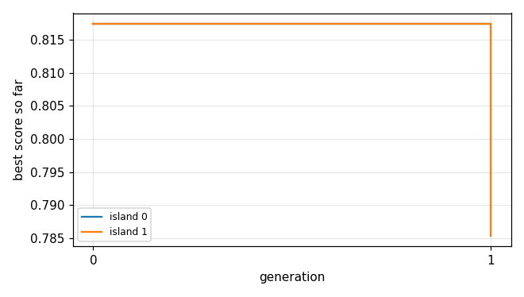
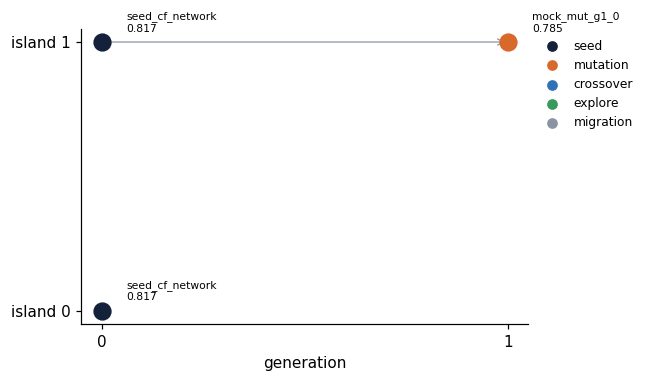
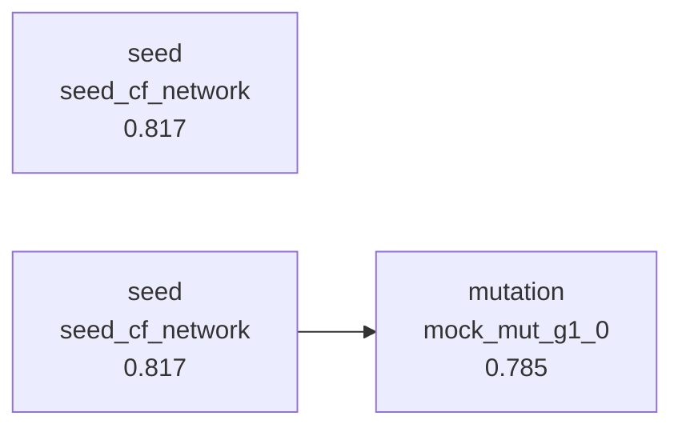
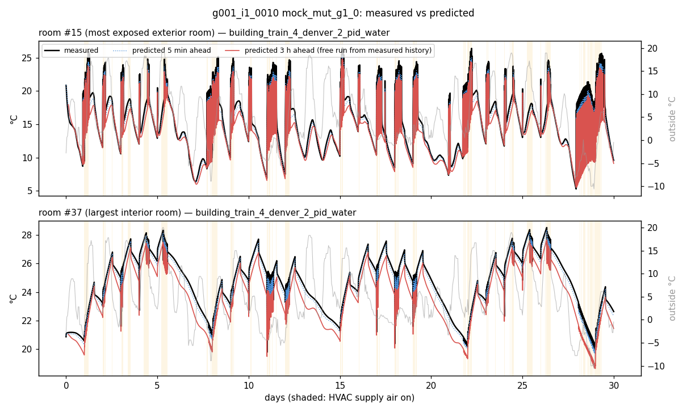
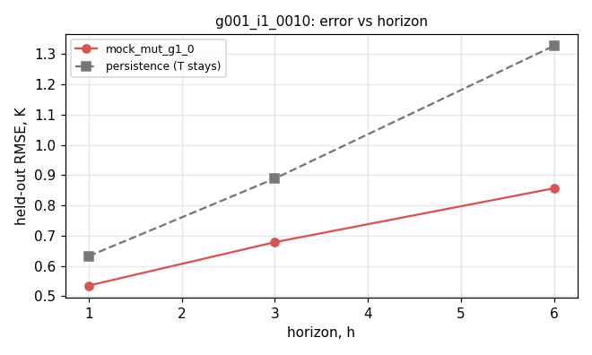
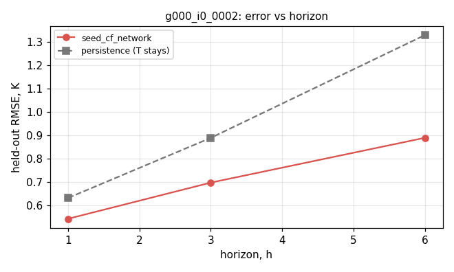

# Discovery run `real12`

Mode: closed-form, **no fitting anywhere**. Proposer: `mock` (mechanical operators, **no LLM**). Islands: 2, migration every 3 generation(s). Generations so far: 1. Candidates: 15 records (15 evaluated programs incl. seed copies). Held-out episodes used for the score: 6. Score = held-out 3 h rollout RMSE from measured history + 0.0001 K per AST node.

## Where to look

| what | where |
|---|---|
| the system prompt every request shares | [system_prompt.md](system_prompt.md) |
| every LLM request: the prompt it got | `generations/gNNN/island_K/<operator>/prompt.md` |
| the pre-mutation / pre-crossover analysis it was given | `generations/gNNN/island_K/<operator>/analysis.md` |
| the raw LLM response (Claude proposer) | `generations/gNNN/island_K/<operator>/response.json` |
| candidates for the `dir` proposer (any LLM or a person) | `generations/gNNN/island_K/<operator>/inbox/*.py` |
| every candidate's source | `candidates/<id>_<name>.py` |
| every candidate's scores, parents, operator, analysis | `database.jsonl` (one JSON per line) |
| the timeline (requests, children, Δ vs parent, migrations) | [log.md](log.md) |
| measured vs predicted temperatures, error vs horizon | `plots/<id>_profile.png`, `plots/<id>_horizon.png` |

Operators: **seed** (hand-written start), **mutation** (one parent changed where its analysis points), **crossover** (two parents' templates combined), **explore** (structurally new), **migration** (an island's best copied into the next island; not re-evaluated).

## Best so far

**[g001_i1_0010] `mock_mut_g1_0`** — island 1, mutation, score 0.7854

Hypothesis: [mock mutation, no LLM] rescaled 920 -> 1472, 1e-09 -> 6e-10 in seed_cf_network

Source: [candidates/g001_i1_0010_mock_mut_g1_0.py](candidates/g001_i1_0010_mock_mut_g1_0.py)

```
OBJECTIVES (validation, lower is better): main 0.785, fast 0.535, slow 0.857, exterior 0.704, interior 0.802, passive 0.743, driven 0.606, complexity 772

TEMPORAL
  error vs horizon (rmse / bias / persistence rmse, K):
     0.08 h   0.249 / -0.096 / 0.527
     0.50 h   0.518 / -0.236 / 0.578
     1.00 h   0.575 / -0.269 / 0.764
     2.00 h   0.660 / -0.317 / 0.784
     3.00 h   0.739 / -0.363 / 0.931
     4.00 h   0.812 / -0.407 / 1.120
     6.00 h   0.948 / -0.490 / 1.358
    -> half of the long-horizon error is already there after 1 h: the fast terms (air, heat, neighbours) are off
  one-step error autocorrelation at 1 h lag: +0.81 (persistent: a slow state or a slowly varying input is missing or mis-scaled)
  3h rollout error by time (rmse, bias, K):
    target hour 00-04                            0.678  -0.293
    target hour 04-08                            0.767  -0.405
    target hour 08-12                            0.829  -0.518
    target hour 12-16                            0.793  -0.504
    target hour 16-20                            0.660  -0.294
    target hour 20-24                            0.619  -0.215
    occupied (comfort) hours                     0.745  -0.390
    nights and weekends                          0.716  -0.359
    HVAC air on at the target                    0.606  -0.281
    HVAC air off at the target                   0.743  -0.384
    HVAC switched off during the rollout         0.769  -0.395
    HVAC switched on during the rollout          0.645  -0.294
    colder half of outside temperatures          0.785  -0.401
    warmer half of outside temperatures          0.669  -0.343
    first 3 days of the episode                  0.588  -0.245
    after day 3                                  0.741  -0.384

SPATIAL
  3h rollout error by place (rmse, bias, K):
    exterior rooms                               0.704  -0.318
    interior rooms                               0.802  -0.554
    corner rooms (outside wall on 2+ sides)      0.735  -0.312
    outside wall on the top side of the plan     0.679  -0.258
    outside wall on the bottom side of the plan  0.707  -0.284
    outside wall on the left side of the plan    0.712  -0.320
    outside wall on the right side of the plan   0.702  -0.320
    floor 1                                      0.731  -0.344
    floor 2                                      0.749  -0.382
    floor 3                                      0.783  -0.487
    floor 4                                      0.498  -0.176
  correlation of a room's bias with its geometry (over all validation rooms):
    floor area                                   -0.47   <- the formula's dependence on this is wrong
    outside-wall length per floor area           +0.26
    number of neighbours                         -0.25
    shared-wall length per floor area            +0.16
    door width per floor area                    -0.11
  error series correlation, adjacent rooms +0.75 vs non-adjacent +0.68 (similar: a building-wide cause, e.g. supply air or outside term)
  worst rooms: episode 2 room #42 (rmse 1.72, bias -1.64, outside-wall faces 0, area 116 m2, doors 4); episode 1 room #36 (rmse 1.63, bias -1.51, outside-wall faces 308, area 195 m2, doors 1); episode 1 room #49 (rmse 1.59, bias -1.50, outside-wall faces 155, area 135 m2, doors 1); episode 2 room #53 (rmse 1.55, bias -1.47, outside-wall faces 0, area 174 m2, doors 4)

TERMS (one-step residual regressed on each term's contribution; slope s means the term should be about (1+s) times as large)
  residual rms 0.2417 K per step; the terms explain 54% of it
    air         size 0.3168 K/step   slope +0.019 +- 0.003   -> consistent with its current size
    neighbours  size 0.2230 K/step   slope -0.730 +- 0.004   -> too strong by about 73%
    slab        size 0.1388 K/step   slope +0.053 +- 0.011   -> too weak by about 5%
    wall        size 0.3945 K/step   slope -0.430 +- 0.003   -> too strong by about 43%
    inner       size 0.0839 K/step   slope -0.387 +- 0.019   -> too strong by about 39%
    heat        size 0.4642 K/step   slope -0.007 +- 0.002   -> consistent with its current size
  exterior rooms only: wall -0.421 (too strong by about 42%)
  (terms that move together, e.g. outside and wall, share the residual: read their slopes together)

complexity 772 AST nodes, history 1 steps, horizons 1h, 3h, 6h
```

## Leaderboard (held-out, K)

Score uses test-time information only (future outside temperature and occupancy unknown); the 1/3/6 h columns use the true future inputs (dynamics only).

| id | island | operator | parents | name | score | 3 h test-time | 5 min | 1 h | 3 h | 6 h | persistence 3 h |
|---|---|---|---|---|---|---|---|---|---|---|---|
| g001_i1_0010 | 1 | mutation | g000_i1_0003 | `mock_mut_g1_0` | 0.7854 | 0.708 | 0.238 | 0.535 | 0.679 | 0.857 | 0.889 |
| g001_i1_0014 | 1 | explore | - | `mock_exp_g1_0` | 0.7928 | 0.716 | 0.228 | 0.525 | 0.673 | 0.856 | 0.889 |
| g001_i1_0011 | 1 | mutation | g000_i1_0003 | `mock_mut_g1_1` | 0.8130 | 0.736 | 0.231 | 0.547 | 0.699 | 0.880 | 0.889 |
| g000_i0_0002 | 0 | seed | - | `seed_cf_network` | 0.8174 | 0.740 | 0.238 | 0.544 | 0.698 | 0.889 | 0.889 |
| g000_i1_0003 | 1 | seed | - | `seed_cf_network` | 0.8174 | 0.740 | 0.238 | 0.544 | 0.698 | 0.889 | 0.889 |
| g001_i0_0008 | 0 | crossover | g000_i0_0002, g000_i0_0000 | `mock_cro_g1_0` | 0.8174 | 0.740 | 0.238 | 0.544 | 0.698 | 0.889 | 0.889 |
| g001_i1_0012 | 1 | crossover | g000_i1_0001, g000_i1_0003 | `mock_cro_g1_0` | 1.0560 | 0.983 | 0.296 | 0.947 | 1.104 | 1.261 | 0.889 |
| g001_i1_0013 | 1 | crossover | g000_i1_0001, g000_i1_0003 | `mock_cro_g1_1` | 1.1327 | 1.060 | 0.315 | 0.979 | 1.146 | 1.329 | 0.889 |
| g000_i0_0000 | 0 | seed | - | `seed_cf_history` | 1.1724 | 1.099 | 0.327 | 1.036 | 1.235 | 1.438 | 0.889 |
| g000_i1_0001 | 1 | seed | - | `seed_cf_history` | 1.1724 | 1.099 | 0.327 | 1.036 | 1.235 | 1.438 | 0.889 |
| g001_i0_0007 | 0 | mutation | g000_i0_0000 | `mock_mut_g1_1` | 1.1733 | 1.100 | 0.327 | 1.037 | 1.236 | 1.439 | 0.889 |
| g001_i0_0006 | 0 | mutation | g000_i0_0000 | `mock_mut_g1_0` | 1.5652 | 1.492 | 0.346 | 1.243 | 1.642 | 2.070 | 0.889 |
| g000_i0_0004 | 0 | seed | - | `seed_cf_one_node` | 5.7230 | 5.707 | 0.465 | 3.282 | 6.047 | 7.277 | 0.889 |
| g000_i1_0005 | 1 | seed | - | `seed_cf_one_node` | 5.7230 | 5.707 | 0.465 | 3.282 | 6.047 | 7.277 | 0.889 |
| g001_i0_0009 | 0 | explore | - | `mock_exp_g1_0` | 5.9478 | 5.932 | 0.475 | 3.160 | 6.218 | 8.125 | 0.889 |

## Operators

| operator | proposed | ok | screened (stage 1) | rejected (stage 0) | unstable (stage 2) | error | better than best parent | median Δ |
|---|---|---|---|---|---|---|---|---|
| seed | 6 | 6 | 0 | 0 | 0 | 0 | - | - |
| mutation | 4 | 4 | 0 | 0 | 0 | 0 | 2 of 4 | -0.0017 |
| crossover | 3 | 3 | 0 | 0 | 0 | 0 | 0 of 3 | +0.2386 |
| explore | 2 | 2 | 0 | 0 | 0 | 0 | - | - |

## Islands



- island 0: best [g000_i0_0002] `seed_cf_network` score 0.8174 (seed)
- island 1: best [g001_i1_0010] `mock_mut_g1_0` score 0.7854 (mutation)

## Lineage of the best

- [g001_i1_0010] mutation `mock_mut_g1_0` (island 1): score 0.7854
  - [g000_i1_0003] seed `seed_cf_network` (island 1): score 0.8174

Family tree of each island's best:



Same tree as mermaid:



## Measured vs predicted

**[g001_i1_0010] `mock_mut_g1_0`**





**[g000_i0_0002] `seed_cf_network`**




## Generation by generation

Each line: island, operator, parents → child, outcome. Open the request folder for its prompt and analysis.

### Generation 0
- island 0 seed → [g000_i0_0000] `seed_cf_history`: score 1.1724
- island 1 seed → [g000_i1_0001] `seed_cf_history`: score 1.1724
- island 0 seed → [g000_i0_0002] `seed_cf_network`: score 0.8174
- island 1 seed → [g000_i1_0003] `seed_cf_network`: score 0.8174
- island 0 seed → [g000_i0_0004] `seed_cf_one_node`: score 5.7230
- island 1 seed → [g000_i1_0005] `seed_cf_one_node`: score 5.7230

### Generation 1
- island 0 mutation of g000_i0_0000 → [g001_i0_0006] `mock_mut_g1_0`: score 1.5652 — [request](generations/g001/island_0/mutation/prompt.md)
- island 0 mutation of g000_i0_0000 → [g001_i0_0007] `mock_mut_g1_1`: score 1.1733 — [request](generations/g001/island_0/mutation/prompt.md)
- island 0 crossover of g000_i0_0002, g000_i0_0000 → [g001_i0_0008] `mock_cro_g1_0`: score 0.8174 — [request](generations/g001/island_0/crossover/prompt.md)
- island 0 explore → [g001_i0_0009] `mock_exp_g1_0`: score 5.9478 — [request](generations/g001/island_0/explore/prompt.md)
- island 1 mutation of g000_i1_0003 → [g001_i1_0010] `mock_mut_g1_0`: score 0.7854 — [request](generations/g001/island_1/mutation/prompt.md)
- island 1 mutation of g000_i1_0003 → [g001_i1_0011] `mock_mut_g1_1`: score 0.8130 — [request](generations/g001/island_1/mutation/prompt.md)
- island 1 crossover of g000_i1_0001, g000_i1_0003 → [g001_i1_0012] `mock_cro_g1_0`: score 1.0560 — [request](generations/g001/island_1/crossover/prompt.md)
- island 1 crossover of g000_i1_0001, g000_i1_0003 → [g001_i1_0013] `mock_cro_g1_1`: score 1.1327 — [request](generations/g001/island_1/crossover/prompt.md)
- island 1 explore → [g001_i1_0014] `mock_exp_g1_0`: score 0.7928 — [request](generations/g001/island_1/explore/prompt.md)

