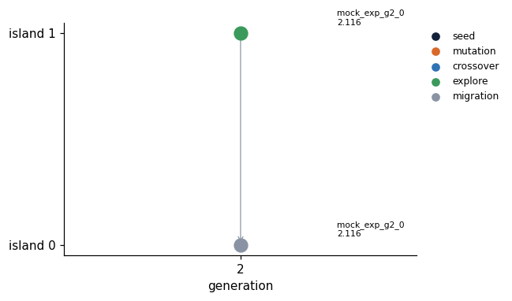
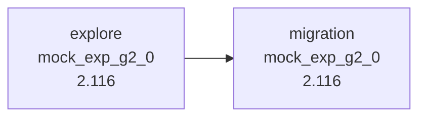
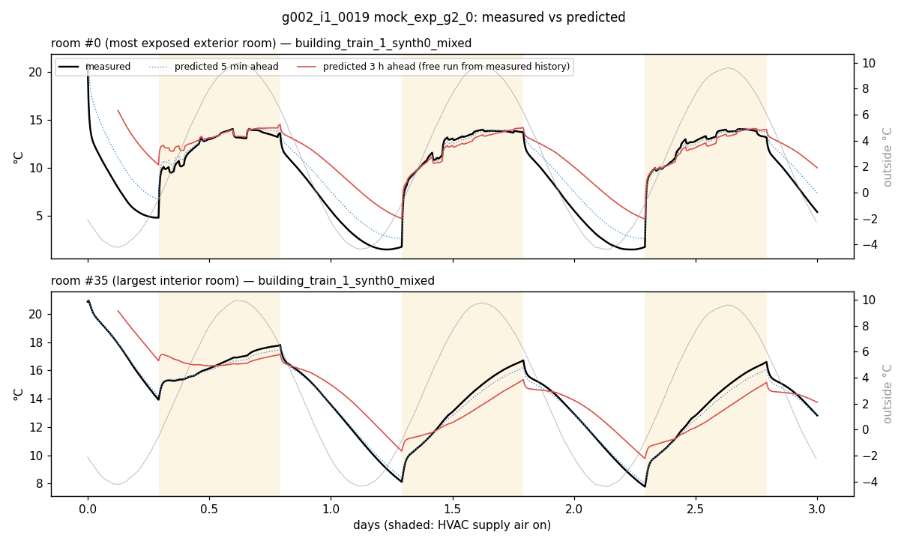
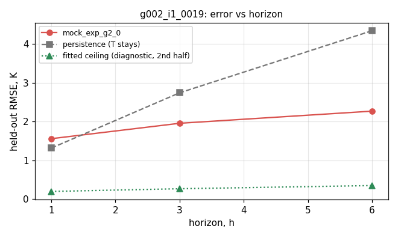

# Discovery run `selftest` — SYNTHETIC self-test (planted truth, not simulator data)

Mode: closed-form, **no fitting anywhere**. Proposer: `mock` (mechanical operators, **no LLM**). Islands: 2, migration every 1 generation(s). Generations so far: 2. Candidates: 21 records (20 evaluated programs incl. seed copies). Held-out episodes used for the score: 10. Score = held-out 3 h rollout RMSE from measured history + 0.0001 K per AST node.

## Where to look

| what | where |
|---|---|
| the system prompt every request shares | [system_prompt.md](system_prompt.md) |
| every LLM request: the prompt it got | `generations/gNNN/island_K/<operator>/prompt.md` |
| the pre-mutation / pre-crossover analysis it was given | `generations/gNNN/island_K/<operator>/analysis.md` |
| the raw LLM response (Claude proposer) | `generations/gNNN/island_K/<operator>/response.json` |
| candidates for the `dir` proposer (any LLM or a person) | `generations/gNNN/island_K/<operator>/inbox/*.py` |
| every candidate's source | `candidates/<id>_<name>.py` |
| every candidate's scores, parents, operator, analysis | `database.jsonl` (one JSON per line) |
| the timeline (requests, children, Δ vs parent, migrations) | [log.md](log.md) |
| measured vs predicted temperatures, error vs horizon | `plots/<id>_profile.png`, `plots/<id>_horizon.png` |

Operators: **seed** (hand-written start), **mutation** (one parent changed where its analysis points), **crossover** (two parents' templates combined), **explore** (structurally new), **migration** (an island's best copied into the next island; not re-evaluated).

## Best so far

**[g002_i1_0019] `mock_exp_g2_0`** — island 1, explore, score 2.1163

Hypothesis: [mock explore, no LLM] rescaled 0.5 -> 0.4, 17.75 -> 10.65, 0.525 -> 0.84, 50 -> 80 in mock_mut_g1_0

Source: [candidates/g002_i1_0019_mock_exp_g2_0.py](candidates/g002_i1_0019_mock_exp_g2_0.py)

```
OBJECTIVES (validation, lower is better): main 2.039, fast 1.560, slow 2.270, exterior 2.193, interior 0.968, passive 2.848, driven 0.644, complexity 772

TEMPORAL
  error vs horizon (rmse / bias / persistence rmse, K):
     0.08 h   0.682 / +0.307 / 0.565
     0.50 h   1.386 / +0.681 / 1.116
     1.00 h   1.573 / +0.801 / 1.330
     2.00 h   1.806 / +0.926 / 2.088
     3.00 h   1.973 / +1.026 / 2.774
     4.00 h   2.090 / +1.102 / 3.394
     6.00 h   2.289 / +1.255 / 4.399
    -> half of the long-horizon error is already there after 1 h: the fast terms (air, heat, neighbours) are off
  one-step error autocorrelation at 1 h lag: +0.86 (persistent: a slow state or a slowly varying input is missing or mis-scaled)
  3h rollout error by time (rmse, bias, K):
    target hour 00-04                            3.299  +3.019
    target hour 04-08                            2.858  +2.381
    target hour 08-12                            0.683  -0.066
    target hour 12-16                            0.580  -0.345
    target hour 16-20                            0.652  +0.141
    target hour 20-24                            2.299  +1.942
    occupied (comfort) hours                     0.644  -0.102
    nights and weekends                          2.848  +2.456
    HVAC air on at the target                    0.644  -0.102
    HVAC air off at the target                   2.848  +2.456
    HVAC switched off during the rollout         1.308  +1.009
    HVAC switched on during the rollout          0.992  +0.523
    colder half of outside temperatures          2.791  +2.317
    warmer half of outside temperatures          0.711  -0.046
    first 3 days of the episode                  1.927  +0.994

SPATIAL
  3h rollout error by place (rmse, bias, K):
    exterior rooms                               2.193  +1.272
    interior rooms                               0.968  +0.291
    corner rooms (outside wall on 2+ sides)      2.470  +1.484
    outside wall on the top side of the plan     2.281  +1.333
    outside wall on the bottom side of the plan  2.278  +1.335
    outside wall on the left side of the plan    2.231  +1.309
    outside wall on the right side of the plan   2.203  +1.284
    floor 1                                      1.915  +1.000
    floor 2                                      1.837  +0.923
    floor 3                                      2.054  +1.085
    floor 4                                      2.149  +1.139
  correlation of a room's bias with its geometry (over all validation rooms):
    outside-wall length per floor area           +0.88   <- the formula's dependence on this is wrong
    number of neighbours                         -0.75   <- the formula's dependence on this is wrong
    shared-wall length per floor area            -0.53   <- the formula's dependence on this is wrong
    door width per floor area                    -0.35
    floor area                                   -0.19
  error series correlation, adjacent rooms +0.95 vs non-adjacent +0.91 (similar: a building-wide cause, e.g. supply air or outside term)
  worst rooms: episode 7 room #57 (rmse 3.10, bias +2.00, outside-wall faces 154, area 38 m2, doors 1); episode 6 room #22 (rmse 3.00, bias +1.90, outside-wall faces 181, area 63 m2, doors 1); episode 8 room #57 (rmse 2.98, bias +1.87, outside-wall faces 154, area 38 m2, doors 1); episode 6 room #4 (rmse 2.94, bias +1.91, outside-wall faces 204, area 95 m2, doors 1)

TERMS (one-step residual regressed on each term's contribution; slope s means the term should be about (1+s) times as large)
  residual rms 0.6695 K per step; the terms explain 97% of it
    air         size 0.2365 K/step   slope -0.291 +- 0.002   -> too strong by about 29%
    neighbours  size 0.2509 K/step   slope -0.760 +- 0.002   -> too strong by about 76%
    slab        size 0.3793 K/step   slope -0.966 +- 0.002   -> too strong by about 97%
    wall        size 0.2163 K/step   slope +0.007 +- 0.004   -> consistent with its current size
    inner       size 0.2591 K/step   slope -0.902 +- 0.004   -> too strong by about 90%
    heat        size 0.2709 K/step   slope -0.455 +- 0.002   -> too strong by about 46%
  exterior rooms only: wall +0.006 (consistent with its current size)
  (terms that move together, e.g. outside and wall, share the residual: read their slopes together)

complexity 772 AST nodes, history 1 steps, horizons 1h, 3h, 6h
```

## Leaderboard (held-out, K)

Score uses test-time information only (future outside temperature and occupancy unknown); the 1/3/6 h columns use the true future inputs (dynamics only).

| id | island | operator | parents | name | score | 3 h test-time | 5 min | 1 h | 3 h | 6 h | persistence 3 h |
|---|---|---|---|---|---|---|---|---|---|---|---|
| g002_i1_0019 | 1 | explore | - | `mock_exp_g2_0` | 2.1163 | 2.039 | 0.670 | 1.560 | 1.957 | 2.270 | 2.743 |
| g000_i0_0002 | 0 | seed | - | `seed_cf_network` | 2.2602 | 2.183 | 0.744 | 1.807 | 2.127 | 2.384 | 2.743 |
| g000_i1_0003 | 1 | seed | - | `seed_cf_network` | 2.2602 | 2.183 | 0.744 | 1.807 | 2.127 | 2.384 | 2.743 |
| g002_i1_0017 | 1 | mutation | g001_i1_0011 | `mock_mut_g2_0` | 2.2619 | 2.185 | 0.722 | 1.816 | 2.132 | 2.366 | 2.743 |
| g001_i1_0011 | 1 | mutation | g000_i1_0003 | `mock_mut_g1_1` | 2.2760 | 2.199 | 0.722 | 1.831 | 2.147 | 2.383 | 2.743 |
| g001_i1_0010 | 1 | mutation | g000_i1_0003 | `mock_mut_g1_0` | 2.4487 | 2.371 | 0.842 | 2.025 | 2.336 | 2.555 | 2.743 |
| g001_i0_0006 | 0 | mutation | g000_i0_0004 | `mock_mut_g1_0` | 2.6443 | 2.629 | 0.492 | 2.165 | 2.909 | 3.070 | 2.743 |
| g001_i0_0009 | 0 | explore | - | `mock_exp_g1_0` | 2.6475 | 2.632 | 0.543 | 2.241 | 2.711 | 2.755 | 2.743 |
| g002_i0_0015 | 0 | mutation | g000_i0_0004 | `mock_mut_g2_1` | 2.6675 | 2.652 | 0.533 | 2.226 | 2.744 | 2.793 | 2.743 |
| g001_i0_0007 | 0 | mutation | g000_i0_0004 | `mock_mut_g1_1` | 2.8048 | 2.789 | 0.483 | 2.293 | 3.222 | 3.436 | 2.743 |
| g000_i0_0004 | 0 | seed | - | `seed_cf_one_node` | 2.8151 | 2.799 | 0.463 | 2.230 | 3.214 | 3.475 | 2.743 |
| g000_i1_0005 | 1 | seed | - | `seed_cf_one_node` | 2.8151 | 2.799 | 0.463 | 2.230 | 3.214 | 3.475 | 2.743 |
| g001_i0_0008 | 0 | crossover | g000_i0_0004, g000_i0_0000 | `mock_cro_g1_0` | 2.8151 | 2.799 | 0.463 | 2.230 | 3.214 | 3.475 | 2.743 |
| g000_i0_0000 | 0 | seed | - | `seed_cf_history` | 2.8173 | 2.744 | 0.731 | 2.591 | 2.808 | 2.926 | 2.743 |
| g000_i1_0001 | 1 | seed | - | `seed_cf_history` | 2.8173 | 2.744 | 0.731 | 2.591 | 2.808 | 2.926 | 2.743 |
| ceiling | - | fitted per room (diagnostic) | - | second half of each episode | - | - | - | 0.198 | 0.268 | 0.350 | 2.655 |

## Operators

| operator | proposed | ok | screened (stage 1) | rejected (stage 0) | unstable (stage 2) | error | better than best parent | median Δ |
|---|---|---|---|---|---|---|---|---|
| seed | 6 | 6 | 0 | 0 | 0 | 0 | - | - |
| mutation | 8 | 7 | 1 | 0 | 0 | 0 | 4 of 7 | -0.0103 |
| crossover | 2 | 1 | 0 | 1 | 0 | 0 | 0 of 1 | +0.0000 |
| explore | 4 | 3 | 1 | 0 | 0 | 0 | - | - |

## Islands


- island 0: best [g002_i0_0020] `mock_exp_g2_0` score 2.1163 (migration)
- island 1: best [g002_i1_0019] `mock_exp_g2_0` score 2.1163 (explore)

## Lineage of the best

- [g002_i1_0019] explore `mock_exp_g2_0` (island 1): score 2.1163

Family tree of each island's best:



Same tree as mermaid:



## Measured vs predicted

**[g002_i1_0019] `mock_exp_g2_0`**





**[g002_i1_0019] `mock_exp_g2_0`**


## Generation by generation

Each line: island, operator, parents → child, outcome. Open the request folder for its prompt and analysis.

### Generation 0
- island 0 seed → [g000_i0_0000] `seed_cf_history`: score 2.8173
- island 1 seed → [g000_i1_0001] `seed_cf_history`: score 2.8173
- island 0 seed → [g000_i0_0002] `seed_cf_network`: score 2.2602
- island 1 seed → [g000_i1_0003] `seed_cf_network`: score 2.2602
- island 0 seed → [g000_i0_0004] `seed_cf_one_node`: score 2.8151
- island 1 seed → [g000_i1_0005] `seed_cf_one_node`: score 2.8151

### Generation 1
- island 0 mutation of g000_i0_0004 → [g001_i0_0006] `mock_mut_g1_0`: score 2.6443 — [request](generations/g001/island_0/mutation/prompt.md)
- island 0 mutation of g000_i0_0004 → [g001_i0_0007] `mock_mut_g1_1`: score 2.8048 — [request](generations/g001/island_0/mutation/prompt.md)
- island 0 crossover of g000_i0_0004, g000_i0_0000 → [g001_i0_0008] `mock_cro_g1_0`: score 2.8151 — [request](generations/g001/island_0/crossover/prompt.md)
- island 0 explore → [g001_i0_0009] `mock_exp_g1_0`: score 2.6475 — [request](generations/g001/island_0/explore/prompt.md)
- island 1 mutation of g000_i1_0003 → [g001_i1_0010] `mock_mut_g1_0`: score 2.4487 — [request](generations/g001/island_1/mutation/prompt.md)
- island 1 mutation of g000_i1_0003 → [g001_i1_0011] `mock_mut_g1_1`: score 2.2760 — [request](generations/g001/island_1/mutation/prompt.md)
- island 1 crossover of g000_i1_0005, g000_i1_0003 → [g001_i1_0012] `mock_cro_g1_0`: rejected: physics checks failed — [request](generations/g001/island_1/crossover/prompt.md)
- island 1 explore → [g001_i1_0013] `mock_exp_g1_0`: screened: one-step RMSE 1.3540 K is more than 5.0x persistence (0.1897 K) on the validation buildings — [request](generations/g001/island_1/explore/prompt.md)

### Generation 2
- island 0 mutation of g000_i0_0004 → [g002_i0_0014] `mock_mut_g2_0`: score 3.1170 — [request](generations/g002/island_0/mutation/prompt.md)
- island 0 mutation of g000_i0_0004 → [g002_i0_0015] `mock_mut_g2_1`: score 2.6675 — [request](generations/g002/island_0/mutation/prompt.md)
- island 0 explore → [g002_i0_0016] `mock_exp_g2_0`: score 2.8259 — [request](generations/g002/island_0/explore/prompt.md)
- island 1 mutation of g001_i1_0011 → [g002_i1_0017] `mock_mut_g2_0`: score 2.2619 — [request](generations/g002/island_1/mutation/prompt.md)
- island 1 mutation of g001_i1_0011 → [g002_i1_0018] `mock_mut_g2_1`: screened: one-step RMSE 1.7909 K is more than 5.0x persistence (0.1897 K) on the validation buildings — [request](generations/g002/island_1/mutation/prompt.md)
- island 1 explore → [g002_i1_0019] `mock_exp_g2_0`: score 2.1163 — [request](generations/g002/island_1/explore/prompt.md)
- island 0 migration of g002_i1_0019 → [g002_i0_0020] `mock_exp_g2_0`: score 2.1163 — [request](generations/g002/island_1/explore/prompt.md)

