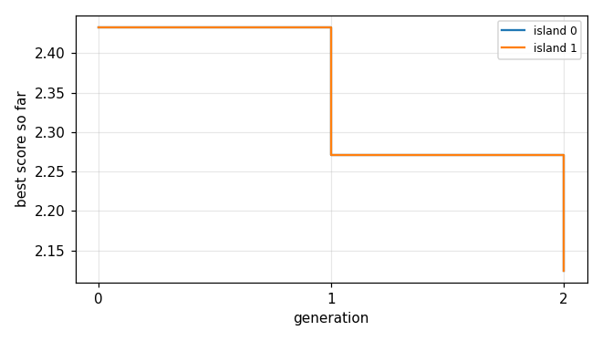
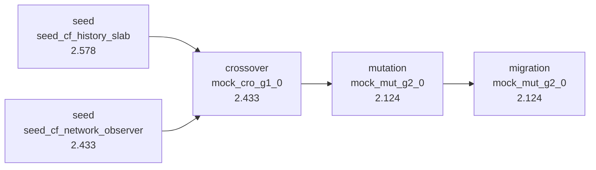
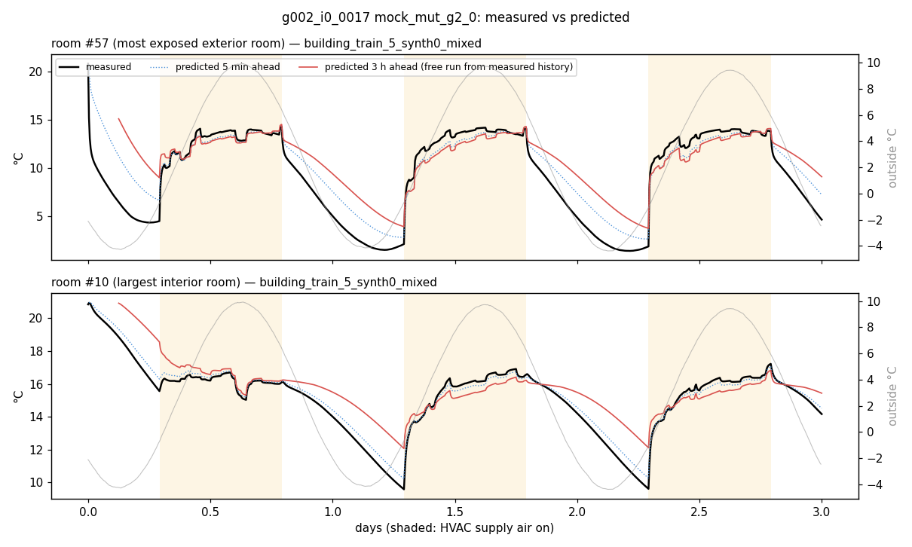
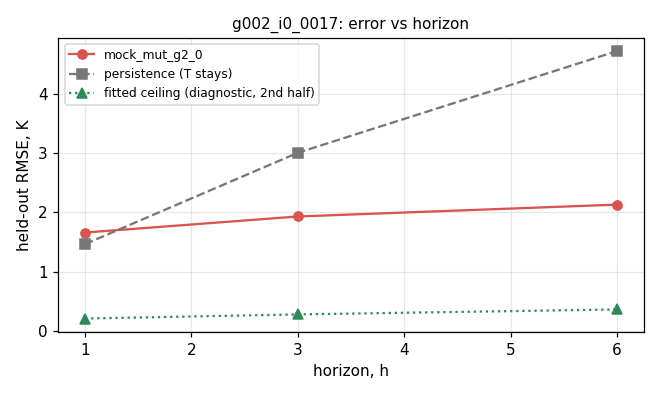

# Discovery run `selftest` — SYNTHETIC self-test (planted truth, not simulator data)

Mode: closed-form, **no fitting anywhere**. Proposer: `mock` (mechanical operators, **no LLM**). Islands: 2, migration every 1 generation(s). Generations so far: 2. Candidates: 26 records (23 evaluated programs incl. seed copies). Held-out episodes used for the score: 4. Score = held-out 3 h rollout RMSE from measured history + 0.0001 K per AST node.

## Where to look

| what | where |
|---|---|
| the system prompt every request shares | [system_prompt.md](system_prompt.md) |
| every LLM request: the prompt it got | `generations/gNNN/island_K/<operator>/prompt.md` |
| the pre-mutation / pre-crossover analysis it was given | `generations/gNNN/island_K/<operator>/analysis.md` |
| the raw LLM response (Claude proposer) | `generations/gNNN/island_K/<operator>/response.json` |
| candidates for the `dir` proposer (any LLM or a person) | `generations/gNNN/island_K/<operator>/inbox/*.py` |
| every candidate's source | `candidates/<id>_<name>.py` |
| every candidate's scores, parents, operator, analysis | `database.jsonl` (one JSON per line) |
| the timeline (requests, children, Δ vs parent, migrations) | [log.md](log.md) |
| measured vs predicted temperatures, error vs horizon | `plots/<id>_profile.png`, `plots/<id>_horizon.png` |

Operators: **seed** (hand-written start), **mutation** (one parent changed where its analysis points), **crossover** (two parents' templates combined), **explore** (structurally new), **migration** (an island's best copied into the next island; not re-evaluated).

## Best so far

**[g002_i0_0017] `mock_mut_g2_0`** — island 0, mutation, score 2.1245

Hypothesis: [mock mutation, no LLM] rescaled 0.55 -> 0.88, 900 -> 720 in mock_cro_g1_0

Source: [candidates/g002_i0_0017_mock_mut_g2_0.py](candidates/g002_i0_0017_mock_mut_g2_0.py)

```
held-out rollout RMSE by horizon (model / persistence), K: 1h 1.658/1.464, 3h 1.930/3.005, 6h 2.130/4.722
one-step (5 min) RMSE 0.7577 K (persistence 0.2169); train buildings 3h 1.705 K
3h rollout error by group (rmse, bias), K:
  all rooms                              1.940  +0.898
  exterior rooms                         2.088  +0.969
  interior rooms                         1.444  +0.698
  most exposed third of exterior rooms   2.311  +1.071
  HVAC air on                            0.776  -0.341
  HVAC air off                           2.825  +2.551
  comfort hours                          0.776  -0.341
  night/weekend                          2.825  +2.551
  room being reheated                    0.661  -0.063
  room not reheated                      2.139  +1.133
  colder half of outside temps           2.790  +2.434
  warmer half                            0.807  -0.292
skill vs persistence by horizon (ratio <1 is better): 1h 1.13, 3h 0.64, 6h 0.45
worst rooms: held-out episode 1 room #6 (rmse 2.72, bias +0.38, facade faces 74, area 35 m2, doors 0); held-out episode 1 room #13 (rmse 2.54, bias +1.31, facade faces 72, area 44 m2, doors 0); held-out episode 2 room #6 (rmse 2.50, bias +1.25, facade faces 74, area 35 m2, doors 0); held-out episode 4 room #17 (rmse 2.50, bias +1.21, facade faces 135, area 77 m2, doors 1)
complexity 990 AST nodes, history 1 steps
```

## Leaderboard (held-out, K)

Score uses test-time information only (future outside temperature and occupancy unknown); the 1/3/6 h columns use the true future inputs (dynamics only).

| id | island | operator | parents | name | score | 3 h test-time | 5 min | 1 h | 3 h | 6 h | persistence 3 h |
|---|---|---|---|---|---|---|---|---|---|---|---|
| g002_i0_0017 | 0 | mutation | g001_i0_0008 | `mock_mut_g2_0` | 2.1245 | 2.025 | 0.758 | 1.658 | 1.930 | 2.130 | 3.005 |
| g002_i1_0023 | 1 | crossover | g001_i1_0010, g001_i1_0014 | `mock_cro_g2_1` | 2.2701 | 2.171 | 0.780 | 1.777 | 2.097 | 2.336 | 3.005 |
| g001_i1_0014 | 1 | explore | - | `mock_exp_g1_0` | 2.2714 | 2.172 | 0.775 | 1.775 | 2.099 | 2.340 | 3.005 |
| g002_i1_0024 | 1 | explore | - | `mock_exp_g2_0` | 2.2975 | 2.218 | 0.545 | 2.109 | 2.339 | 2.035 | 3.005 |
| g001_i0_0006 | 0 | mutation | g000_i0_0000 | `mock_mut_g1_0` | 2.3663 | 2.287 | 0.555 | 2.136 | 2.346 | 2.126 | 3.005 |
| g002_i1_0022 | 1 | crossover | g001_i1_0010, g001_i1_0014 | `mock_cro_g2_0` | 2.3925 | 2.294 | 0.865 | 1.923 | 2.224 | 2.461 | 3.005 |
| g002_i1_0020 | 1 | mutation | g001_i1_0010 | `mock_mut_g2_0` | 2.4202 | 2.321 | 0.883 | 1.949 | 2.254 | 2.495 | 3.005 |
| g000_i0_0002 | 0 | seed | - | `seed_cf_network_observer` | 2.4331 | 2.334 | 0.882 | 1.961 | 2.268 | 2.512 | 3.005 |
| g000_i1_0003 | 1 | seed | - | `seed_cf_network_observer` | 2.4331 | 2.334 | 0.882 | 1.961 | 2.268 | 2.512 | 3.005 |
| g001_i0_0008 | 0 | crossover | g000_i0_0002, g000_i0_0000 | `mock_cro_g1_0` | 2.4331 | 2.334 | 0.882 | 1.961 | 2.268 | 2.512 | 3.005 |
| g001_i1_0010 | 1 | mutation | g000_i1_0003 | `mock_mut_g1_0` | 2.4331 | 2.334 | 0.882 | 1.961 | 2.268 | 2.512 | 3.005 |
| g002_i0_0018 | 0 | mutation | g001_i0_0008 | `mock_mut_g2_1` | 2.4331 | 2.334 | 0.882 | 1.961 | 2.268 | 2.512 | 3.005 |
| g002_i1_0021 | 1 | mutation | g001_i1_0010 | `mock_mut_g2_1` | 2.4812 | 2.382 | 0.902 | 2.006 | 2.321 | 2.572 | 3.005 |
| g000_i0_0000 | 0 | seed | - | `seed_cf_history_slab` | 2.5778 | 2.498 | 0.660 | 2.339 | 2.498 | 2.326 | 3.005 |
| g000_i1_0001 | 1 | seed | - | `seed_cf_history_slab` | 2.5778 | 2.498 | 0.660 | 2.339 | 2.498 | 2.326 | 3.005 |
| ceiling | - | fitted per room (diagnostic) | - | second half of each episode | - | - | - | 0.206 | 0.275 | 0.359 | 2.887 |

## Operators

| operator | proposed | ok | screened (stage 1) | rejected (stage 0) | unstable (stage 2) | error | better than best parent | median Δ |
|---|---|---|---|---|---|---|---|---|
| seed | 6 | 6 | 0 | 0 | 0 | 0 | - | - |
| mutation | 8 | 7 | 1 | 0 | 0 | 0 | 3 of 7 | +0.0000 |
| crossover | 5 | 4 | 0 | 0 | 0 | 1 | 1 of 4 | +0.0606 |
| explore | 4 | 4 | 0 | 0 | 0 | 0 | - | - |

## Islands



- island 0: best [g002_i0_0017] `mock_mut_g2_0` score 2.1245 (mutation)
- island 1: best [g002_i1_0025] `mock_mut_g2_0` score 2.1245 (migration)

## Lineage of the best

- [g002_i0_0017] mutation `mock_mut_g2_0` (island 0): score 2.1245
  - [g001_i0_0008] crossover `mock_cro_g1_0` (island 0): score 2.4331
    - [g000_i0_0002] seed `seed_cf_network_observer` (island 0): score 2.4331
    - [g000_i0_0000] seed `seed_cf_history_slab` (island 0): score 2.5778

Family tree of each island's best:


Same tree as mermaid:



## Measured vs predicted

**[g002_i0_0017] `mock_mut_g2_0`**





**[g002_i0_0017] `mock_mut_g2_0`**


## Generation by generation

Each line: island, operator, parents → child, outcome. Open the request folder for its prompt and analysis.

### Generation 0
- island 0 seed → [g000_i0_0000] `seed_cf_history_slab`: score 2.5778
- island 1 seed → [g000_i1_0001] `seed_cf_history_slab`: score 2.5778
- island 0 seed → [g000_i0_0002] `seed_cf_network_observer`: score 2.4331
- island 1 seed → [g000_i1_0003] `seed_cf_network_observer`: score 2.4331
- island 0 seed → [g000_i0_0004] `seed_cf_one_node`: score 2.9331
- island 1 seed → [g000_i1_0005] `seed_cf_one_node`: score 2.9331

### Generation 1
- island 0 mutation of g000_i0_0000 → [g001_i0_0006] `mock_mut_g1_0`: score 2.3663 — [request](generations/g001/island_0/mutation/prompt.md)
- island 0 mutation of g000_i0_0000 → [g001_i0_0007] `mock_mut_g1_1`: score 2.5799 — [request](generations/g001/island_0/mutation/prompt.md)
- island 0 crossover of g000_i0_0002, g000_i0_0000 → [g001_i0_0008] `mock_cro_g1_0`: score 2.4331 — [request](generations/g001/island_0/crossover/prompt.md)
- island 0 explore → [g001_i0_0009] `mock_exp_g1_0`: score 2.7265 — [request](generations/g001/island_0/explore/prompt.md)
- island 1 mutation of g000_i1_0003 → [g001_i1_0010] `mock_mut_g1_0`: score 2.4331 — [request](generations/g001/island_1/mutation/prompt.md)
- island 1 mutation of g000_i1_0003 → [g001_i1_0011] `mock_mut_g1_1`: screened: one-step RMSE 1.0871 K is more than 5.0x persistence (0.2169 K) on held-out buildings — [request](generations/g001/island_1/mutation/prompt.md)
- island 1 crossover of g000_i1_0001, g000_i1_0003 → [g001_i1_0012] `mock_cro_g1_0`: error: NameError: name 'RC_MASS' is not defined — [request](generations/g001/island_1/crossover/prompt.md)
- island 1 crossover of g000_i1_0001, g000_i1_0003 → [g001_i1_0013] `mock_cro_g1_1`: score 2.5778 — [request](generations/g001/island_1/crossover/prompt.md)
- island 1 explore → [g001_i1_0014] `mock_exp_g1_0`: score 2.2714 — [request](generations/g001/island_1/explore/prompt.md)
- island 1 migration of g001_i0_0006 → [g001_i1_0015] `mock_mut_g1_0`: score 2.3663 — [request](generations/g001/island_0/mutation/prompt.md)
- island 0 migration of g001_i1_0014 → [g001_i0_0016] `mock_exp_g1_0`: score 2.2714 — [request](generations/g001/island_1/explore/prompt.md)

### Generation 2
- island 0 mutation of g001_i0_0008 → [g002_i0_0017] `mock_mut_g2_0`: score 2.1245 — [request](generations/g002/island_0/mutation/prompt.md)
- island 0 mutation of g001_i0_0008 → [g002_i0_0018] `mock_mut_g2_1`: score 2.4331 — [request](generations/g002/island_0/mutation/prompt.md)
- island 0 explore → [g002_i0_0019] `mock_exp_g2_0`: score 2.6515 — [request](generations/g002/island_0/explore/prompt.md)
- island 1 mutation of g001_i1_0010 → [g002_i1_0020] `mock_mut_g2_0`: score 2.4202 — [request](generations/g002/island_1/mutation/prompt.md)
- island 1 mutation of g001_i1_0010 → [g002_i1_0021] `mock_mut_g2_1`: score 2.4812 — [request](generations/g002/island_1/mutation/prompt.md)
- island 1 crossover of g001_i1_0010, g001_i1_0014 → [g002_i1_0022] `mock_cro_g2_0`: score 2.3925 — [request](generations/g002/island_1/crossover/prompt.md)
- island 1 crossover of g001_i1_0010, g001_i1_0014 → [g002_i1_0023] `mock_cro_g2_1`: score 2.2701 — [request](generations/g002/island_1/crossover/prompt.md)
- island 1 explore → [g002_i1_0024] `mock_exp_g2_0`: score 2.2975 — [request](generations/g002/island_1/explore/prompt.md)
- island 1 migration of g002_i0_0017 → [g002_i1_0025] `mock_mut_g2_0`: score 2.1245 — [request](generations/g002/island_0/mutation/prompt.md)

