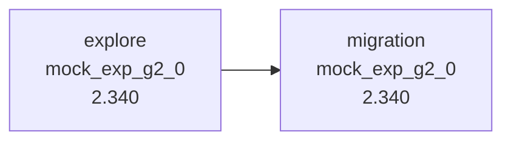
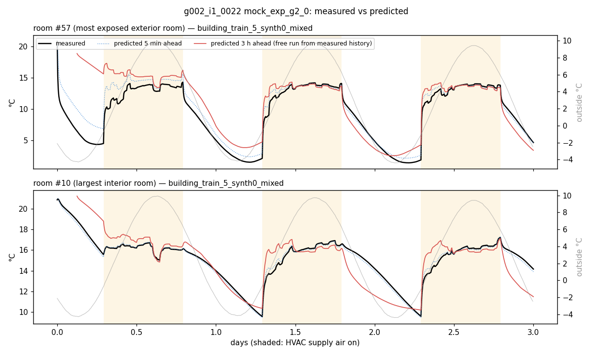
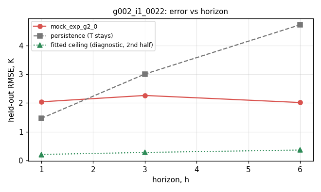

# Discovery run `selftest` — SYNTHETIC self-test (planted truth, not simulator data)

Mode: closed-form, **no fitting anywhere**. Proposer: `mock` (mechanical operators, **no LLM**). Islands: 2, migration every 1 generation(s). Generations so far: 2. Candidates: 24 records (22 evaluated programs incl. seed copies). Held-out episodes used for the score: 4. Score = held-out 3 h rollout RMSE from measured history + 0.0001 K per AST node.

## Where to look

| what | where |
|---|---|
| the system prompt every request shares | [system_prompt.md](system_prompt.md) |
| every LLM request: the prompt it got | `generations/gNNN/island_K/<operator>/prompt.md` |
| the pre-mutation / pre-crossover analysis it was given | `generations/gNNN/island_K/<operator>/analysis.md` |
| the raw LLM response (Claude proposer) | `generations/gNNN/island_K/<operator>/response.json` |
| candidates for the `dir` proposer (any LLM or a person) | `generations/gNNN/island_K/<operator>/inbox/*.py` |
| every candidate's source | `candidates/<id>_<name>.py` |
| every candidate's scores, parents, operator, analysis | `database.jsonl` (one JSON per line) |
| the timeline (requests, children, Δ vs parent, migrations) | [log.md](log.md) |
| measured vs predicted temperatures, error vs horizon | `plots/<id>_profile.png`, `plots/<id>_horizon.png` |

Operators: **seed** (hand-written start), **mutation** (one parent changed where its analysis points), **crossover** (two parents' templates combined), **explore** (structurally new), **migration** (an island's best copied into the next island; not re-evaluated).

## Best so far

**[g002_i1_0022] `mock_exp_g2_0`** — island 1, explore, score 2.3400

Hypothesis: [mock explore, no LLM] rescaled 20 -> 12, 8 -> 10, 2.4 -> 1.92, 2.5 -> 4 in mock_mut_g1_0

Source: [candidates/g002_i1_0022_mock_exp_g2_0.py](candidates/g002_i1_0022_mock_exp_g2_0.py)

```
held-out rollout RMSE by horizon (model / persistence), K: 1h 2.039/1.464, 3h 2.261/3.005, 6h 2.015/4.722
one-step (5 min) RMSE 0.5346 K (persistence 0.2169); train buildings 3h 2.233 K
3h rollout error by group (rmse, bias), K:
  all rooms                              2.257  +0.799
  exterior rooms                         2.488  +1.029
  interior rooms                         1.406  +0.149
  most exposed third of exterior rooms   2.807  +1.282
  HVAC air on                            1.738  +0.909
  HVAC air off                           2.803  +0.653
  comfort hours                          1.738  +0.909
  night/weekend                          2.803  +0.653
  room being reheated                    2.099  +1.638
  room not reheated                      2.294  +0.595
  colder half of outside temps           2.990  +1.354
  warmer half                            1.453  +0.370
skill vs persistence by horizon (ratio <1 is better): 1h 1.39, 3h 0.75, 6h 0.43
worst rooms: building_train_5_synth0_mixed room #6 (rmse 4.26, bias +2.50, facade faces 74, area 35 m2, doors 0); building_train_5_synth1_mixed room #22 (rmse 3.90, bias +2.28, facade faces 79, area 55 m2, doors 0); building_train_5_synth1_mixed room #63 (rmse 3.81, bias +2.27, facade faces 111, area 74 m2, doors 0); building_train_5_synth0_mixed room #45 (rmse 3.74, bias +2.13, facade faces 93, area 78 m2, doors 0)
complexity 793 AST nodes, history 288 steps
```

## Leaderboard (held-out, K)

| id | island | operator | parents | name | score | 5 min | 1 h | 3 h | 6 h | persistence 3 h |
|---|---|---|---|---|---|---|---|---|---|---|
| g002_i1_0022 | 1 | explore | - | `mock_exp_g2_0` | 2.3400 | 0.535 | 2.039 | 2.261 | 2.015 | 3.005 |
| g001_i0_0004 | 0 | mutation | g000_i0_0000 | `mock_mut_g1_0` | 2.4253 | 0.555 | 2.136 | 2.346 | 2.126 | 3.005 |
| g002_i0_0015 | 0 | mutation | g001_i0_0004 | `mock_mut_g2_1` | 2.4309 | 0.555 | 2.140 | 2.352 | 2.134 | 3.005 |
| g002_i0_0014 | 0 | mutation | g001_i0_0004 | `mock_mut_g2_0` | 2.4830 | 0.590 | 2.220 | 2.404 | 2.203 | 3.005 |
| g000_i0_0000 | 0 | seed | - | `seed_cf_history_slab` | 2.5772 | 0.660 | 2.339 | 2.498 | 2.326 | 3.005 |
| g000_i1_0001 | 1 | seed | - | `seed_cf_history_slab` | 2.5772 | 0.660 | 2.339 | 2.498 | 2.326 | 3.005 |
| g001_i0_0006 | 0 | crossover | g000_i0_0000, g000_i0_0002 | `mock_cro_g1_0` | 2.5772 | 0.660 | 2.339 | 2.498 | 2.326 | 3.005 |
| g001_i1_0009 | 1 | mutation | g000_i1_0001 | `mock_mut_g1_1` | 2.5782 | 0.661 | 2.340 | 2.499 | 2.327 | 3.005 |
| g001_i0_0005 | 0 | mutation | g000_i0_0000 | `mock_mut_g1_1` | 2.5791 | 0.661 | 2.341 | 2.500 | 2.329 | 3.005 |
| g002_i1_0021 | 1 | crossover | g000_i1_0001, g001_i1_0013 | `mock_cro_g2_0` | 2.5831 | 0.661 | 2.344 | 2.504 | 2.335 | 3.005 |
| g002_i1_0019 | 1 | mutation | g001_i1_0009 | `mock_mut_g2_0` | 2.6157 | 0.668 | 2.368 | 2.536 | 2.385 | 3.005 |
| g002_i1_0020 | 1 | mutation | g001_i1_0009 | `mock_mut_g2_1` | 2.6242 | 0.670 | 2.390 | 2.545 | 2.344 | 3.005 |
| g001_i1_0012 | 1 | explore | - | `mock_exp_g1_0` | 2.6539 | 0.734 | 2.429 | 2.575 | 2.422 | 3.005 |
| g001_i1_0008 | 1 | mutation | g000_i1_0001 | `mock_mut_g1_0` | 2.6587 | 0.678 | 2.399 | 2.579 | 2.453 | 3.005 |
| g002_i0_0018 | 0 | explore | - | `mock_exp_g2_0` | 2.7190 | 0.749 | 2.492 | 2.640 | 2.477 | 3.005 |
| ceiling | - | fitted per room (diagnostic) | - | second half of each episode | - | - | 0.206 | 0.275 | 0.359 | 2.887 |

## Operators

| operator | proposed | ok | screened (stage 1) | rejected (stage 0) | unstable (stage 2) | error | better than best parent | median Δ |
|---|---|---|---|---|---|---|---|---|
| seed | 4 | 4 | 0 | 0 | 0 | 0 | - | - |
| mutation | 8 | 8 | 0 | 0 | 0 | 0 | 1 of 8 | +0.0216 |
| crossover | 6 | 3 | 0 | 3 | 0 | 0 | 0 of 3 | +0.1578 |
| explore | 4 | 4 | 0 | 0 | 0 | 0 | - | - |

## Islands


- island 0: best [g002_i0_0023] `mock_exp_g2_0` score 2.3400 (migration)
- island 1: best [g002_i1_0022] `mock_exp_g2_0` score 2.3400 (explore)

## Lineage of the best

- [g002_i1_0022] explore `mock_exp_g2_0` (island 1): score 2.3400

Family tree of each island's best (mermaid):



## Measured vs predicted

**[g002_i1_0022] `mock_exp_g2_0`**





**[g002_i1_0022] `mock_exp_g2_0`**


## Generation by generation

Each line: island, operator, parents → child, outcome. Open the request folder for its prompt and analysis.

### Generation 0
- island 0 seed → [g000_i0_0000] `seed_cf_history_slab`: score 2.5772
- island 1 seed → [g000_i1_0001] `seed_cf_history_slab`: score 2.5772
- island 0 seed → [g000_i0_0002] `seed_cf_one_node`: score 3.3729
- island 1 seed → [g000_i1_0003] `seed_cf_one_node`: score 3.3729

### Generation 1
- island 0 mutation of g000_i0_0000 → [g001_i0_0004] `mock_mut_g1_0`: score 2.4253 — [request](generations/g001/island_0/mutation/prompt.md)
- island 0 mutation of g000_i0_0000 → [g001_i0_0005] `mock_mut_g1_1`: score 2.5791 — [request](generations/g001/island_0/mutation/prompt.md)
- island 0 crossover of g000_i0_0000, g000_i0_0002 → [g001_i0_0006] `mock_cro_g1_0`: score 2.5772 — [request](generations/g001/island_0/crossover/prompt.md)
- island 0 explore → [g001_i0_0007] `mock_exp_g1_0`: score 3.8577 — [request](generations/g001/island_0/explore/prompt.md)
- island 1 mutation of g000_i1_0001 → [g001_i1_0008] `mock_mut_g1_0`: score 2.6587 — [request](generations/g001/island_1/mutation/prompt.md)
- island 1 mutation of g000_i1_0001 → [g001_i1_0009] `mock_mut_g1_1`: score 2.5782 — [request](generations/g001/island_1/mutation/prompt.md)
- island 1 crossover of g000_i1_0001, g000_i1_0003 → [g001_i1_0010] `mock_cro_g1_0`: score 2.9850 — [request](generations/g001/island_1/crossover/prompt.md)
- island 1 crossover of g000_i1_0001, g000_i1_0003 → [g001_i1_0011] `mock_cro_g1_1`: rejected: physics checks failed — [request](generations/g001/island_1/crossover/prompt.md)
- island 1 explore → [g001_i1_0012] `mock_exp_g1_0`: score 2.6539 — [request](generations/g001/island_1/explore/prompt.md)
- island 1 migration of g001_i0_0004 → [g001_i1_0013] `mock_mut_g1_0`: score 2.4253 — [request](generations/g001/island_0/mutation/prompt.md)

### Generation 2
- island 0 mutation of g001_i0_0004 → [g002_i0_0014] `mock_mut_g2_0`: score 2.4830 — [request](generations/g002/island_0/mutation/prompt.md)
- island 0 mutation of g001_i0_0004 → [g002_i0_0015] `mock_mut_g2_1`: score 2.4309 — [request](generations/g002/island_0/mutation/prompt.md)
- island 0 crossover of g001_i0_0005, g000_i0_0002 → [g002_i0_0016] `mock_cro_g2_0`: rejected: physics checks failed — [request](generations/g002/island_0/crossover/prompt.md)
- island 0 crossover of g001_i0_0005, g000_i0_0002 → [g002_i0_0017] `mock_cro_g2_1`: rejected: physics checks failed — [request](generations/g002/island_0/crossover/prompt.md)
- island 0 explore → [g002_i0_0018] `mock_exp_g2_0`: score 2.7190 — [request](generations/g002/island_0/explore/prompt.md)
- island 1 mutation of g001_i1_0009 → [g002_i1_0019] `mock_mut_g2_0`: score 2.6157 — [request](generations/g002/island_1/mutation/prompt.md)
- island 1 mutation of g001_i1_0009 → [g002_i1_0020] `mock_mut_g2_1`: score 2.6242 — [request](generations/g002/island_1/mutation/prompt.md)
- island 1 crossover of g000_i1_0001, g001_i1_0013 → [g002_i1_0021] `mock_cro_g2_0`: score 2.5831 — [request](generations/g002/island_1/crossover/prompt.md)
- island 1 explore → [g002_i1_0022] `mock_exp_g2_0`: score 2.3400 — [request](generations/g002/island_1/explore/prompt.md)
- island 0 migration of g002_i1_0022 → [g002_i0_0023] `mock_exp_g2_0`: score 2.3400 — [request](generations/g002/island_1/explore/prompt.md)

